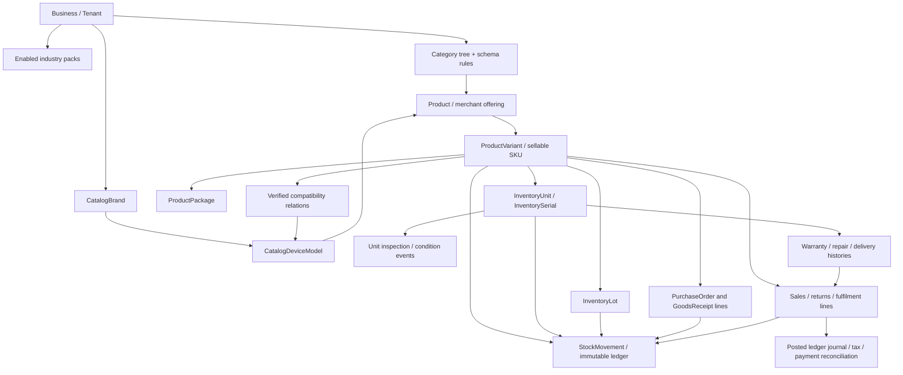
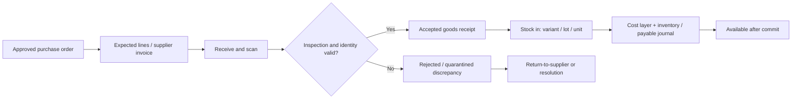

# LEXA ELECTRONICS CATALOGUE V2 — FULL SPECIFICATIONS

**Document type:** Product requirements document (PRD) + taxonomy + domain architecture + implementation and release specification  
**Version:** 2.0.0 — Proposed architecture and phased implementation specification  
**Prepared:** 5 November 2026  
**Primary market:** Uganda (retail, wholesale, service, multi-branch and mixed-business operations)  
**Repository baseline inspected:** [`MONALISA2003-CMD/The-LEXA-`](https://github.com/MONALISA2003-CMD/The-LEXA-) `main` at commit [`110b308bfef09ba13a6354c9fbe33d96eb16655f`](https://github.com/MONALISA2003-CMD/The-LEXA-/commit/110b308bfef09ba13a6354c9fbe33d96eb16655f).  
**Status:** **Design specification, not implementation or production certification.** All changes marked *V2* below require development, migration, automated verification and staged rollout.

> **Core product decision:** One authoritative LEXA stock and accounting engine, multiple category-specific product experiences. Do **not** build separate, disconnected inventory ledgers for phones, electronics, accessories or appliances. Do **not** reset existing customer records or reassign existing product, variant, lot, serial, sale, payment or movement IDs.

---

## Document navigation

- [0. Executive summary and binding decisions](#0-executive-summary-and-binding-decisions)
- [1. Uganda market research](#1-uganda-market-research-assumptions-and-boundaries)
- [2. Full taxonomy and category trees](#2-canonical-taxonomy-and-ownership)
- [3. Typed attributes and tracking profiles](#3-attribute-dictionary-policy-language-and-inventory-profiles)
- [4. Product-family specifications (including feature phones)](#4-per-family-v2-specification-and-stock-architecture)
- [5. Domain model and data ownership](#5-domain-architecture-and-data-ownership)
- [6. Stock, purchasing, sales and service workflows](#6-operational-workflows-state-transitions-and-end-to-end-contracts)
- [7. API and integration contracts](#7-backend-api-client-and-event-contracts)
- [8. Security and Uganda-specific compliance](#8-security-privacy-compliance-and-operational-safeguards)
- [9. Migration and rollback safety](#9-historical-data-migration-safety-and-rollback)
- [10. Ten implementation phases](#10-phased-implementation-programme-and-completion-gates)
- [11. E2E scenarios and release tests](#11-executable-acceptance-scenarios-and-release-test-matrix)
- [12. Example templates and import formats](#12-data-migration-examples-import-templates-and-policy-illustrations)
- [13. Open decisions](#13-decision-register-for-implementation-review)
- [14. Research and source register](#14-source-register-and-research-provenance)
- [15. Glossary and implementation directive](#15-glossary-and-final-implementation-directive)

---

## 0. Executive summary and binding decisions

LEXA should enable a small phone seller, electronics wholesaler, computer retailer, large-appliance showroom, repair technician and combined multi-branch business to use the **same business account and underlying product catalogue** with the correct workflows for their merchandise. The user chooses an **industry** at business setup, a **division** when adding products, and then a **specific product subtype**. Only applicable fields are displayed, but all APIs enforce the same rules.

### 0.1 V2 design decisions

| ID | Decision | Why it matters |
|---|---|---|
| D-01 | Retain the 13 approved LEXA industries; specialize `mobile_phones`, `electronics`, `household_goods` and `repair_services` through catalogue packs. | No business reclassification or industry-count explosion. |
| D-02 | Category, brand, manufacturer model, product, sellable variant and physical unit are **different entities**. | Stops duplicated catalogues and incorrect exact-unit allocation. |
| D-03 | Track each phone/feature-phone handset by actual IMEI(s) where available; separate SIM-slot count from IMEI count. | Correct handling of single-SIM, dual-SIM and multi-SIM designs. |
| D-04 | Track most cases, chargers, USB cables, toners and low-value peripherals by SKU/variant quantity; enable serial or batch selectively. | Fast receiving without unnecessary serial entry. |
| D-05 | Model compatibility as verified evidence-backed relationships, not a free-text guess or automatic match by connector. | Prevents unsafe or wrong accessory recommendations. |
| D-06 | Keep manufacturer specifications separate from **as-received**, **as-configured** and **as-sold** unit condition. | Necessary for refurbished laptops, used phones and upgraded PCs. |
| D-07 | Inventory quantity is derived from an authoritative, immutable stock ledger with transactional reservations and state transitions. | Prevents overselling, inaccurate stock and audit gaps. |
| D-08 | Purchases, accepted goods receipts, transfers, POS sales, returns, deliveries, warranty and finance reference canonical IDs. | Complete traceability and accounting reconciliation. |
| D-09 | Tax, regulatory certificates, warranty and safety rules are policy- and jurisdiction-based. | Do not infer regulatory compliance or fiscalization from an ordinary receipt. |
| D-10 | All new schema is additive; migration/audit/restore gates precede rollout. | Preserve existing Ugandan businesses and historical records. |
| D-11 | Introduce V2 taxonomy via versioned stable codes and aliases, not destructive category renaming. | Supports historical paths and custom categories. |
| D-12 | Ship in guarded phases with feature flags, role controls, staging journeys and rollback. | Prevents a catalogue enhancement from breaking production. |

### 0.2 Definition of done

A catalogue family is **operationally complete** only when a business can: create its hierarchy; define brand/model and valid specifications; create correct sellable variants; order stock; receive actual units/packages; locate/reserve/transfer/count them; sell and issue appropriate receipt/tax documents; return/quarantine/release them; reconcile cost/payment/ledger; and view truthful reports, **without bypass through browser, API, CSV or workers**. Non-applicable steps (e.g. installation for USB cables) must be intentionally excluded rather than treated as failing tests.

### 0.3 Existing baseline versus proposed V2

**Observed in the inspected GitHub source:** a version-2 industry manifest with **13 industries, 51 product presets**, existing suggested category paths, product/variant/lot/serial/package models, `CatalogBrand`, `CatalogDeviceModel`, `AccessoryCompatibility`, `InventoryUnitInspection`, server tracking policies, IMEI/serial lookup, variant matrix, and product/stock screens. Existing four-division work includes brand/model registries and approval-gated compatibility. See [industry manifest](https://github.com/MONALISA2003-CMD/The-LEXA-/blob/110b308bfef09ba13a6354c9fbe33d96eb16655f/backend/src/catalog/industry-manifest.json) and [Prisma schema](https://github.com/MONALISA2003-CMD/The-LEXA-/blob/110b308bfef09ba13a6354c9fbe33d96eb16655f/backend/prisma/schema.prisma).

**Not yet established by that source inspection:** every family-specific form, production-grade manufacturer specification normalization, complete optional-identifier schema, confirmed component compatibility, installed-system component history, universal exact-unit costing, full warranty/installation lifecycle, complete import/export round-trips or end-to-end financial certification. V2 is **not** a claim those exist in production.

---

## 1. Uganda market research, assumptions and boundaries

### 1.1 Evidence-based product coverage

- Ugandan retailer catalogues include basic/feature phones, dual-SIM devices, smartphones, appliances, consumer electronics, IT hardware, home cooling, cooking, audio and accessories. Jumia Uganda has current examples of itel keypad phones with FM radio, torch, removable batteries and different SIM/network configurations; these are *examples*, **not approved master-data specifications**. See [Jumia itel 2163 example](https://www.jumia.ug/2163-small-button-phone-dual-sim-1.8-display-32mb-storage-1000mah-battery-blue-itel-mpg7008328.html) and [Jumia Nokia 105 example](https://www.jumia.ug/nokia-105-new-edition-1.8-display-dual-sim-wireless-fm-radio-built-in-torchlight-1000mah-battery-charcoal-black-1-month-warranty-260266762.html). Descriptions of the same model may differ across sellers; verify against the device or manufacturer's documentation before populating trusted model specs.
- Ugandan appliance retail covers refrigerators/freezers, washing machines, cookers, air conditioners, water dispensers, fans, irons, microwaves, blenders, juicers, air fryers, rice cookers and more. See [Kanta Appliances product divisions](https://www.kantaappliances.com/) and [Jumia Uganda appliances](https://www.jumia.ug/home-improvement-appliances/).
- The Uganda National Bureau of Standards (UNBS) identifies electrical/electronic goods, including computers, routers, printers, communications, home and kitchen appliances, batteries and solar equipment, within its PVoC categories. Applicability is per good/import path and must be verified; a catalogue record is not a certificate. See [UNBS PVoC categories](https://www.unbs.go.ug/content.php?content=&src=categories-of-goods-covered-under-pvoc).
- The Uganda Communications Commission (UCC) administers type approval for relevant communications equipment before sale, import or use. Capture certificate/reference and validity when applicable. See [UCC type approval](https://eservices.ucc.co.ug/type-approval).
- Uganda's supply is commonly **240 V AC / 50 Hz with Type G plugs**. Store actual rated voltage/frequency/plug of the product and mark mismatches; do not automatically assert every imported appliance is locally compatible. See [Uganda electrical supply guidance](https://www.peacecorps.gov/uganda/packing-guidance/).
- URA states EFRIS applicability for VAT-registered taxpayers and relevant designated sectors; fiscalization must use a real supported/authorized process, and a normal LEXA receipt is not automatically an EFRIS document. See [URA EFRIS](https://ura.go.ug/en/efris/).
- GS1 separates trade-item IDs (GTIN), lot/batch and individual serial data (AIs 01, 10, 21); GTIN must not be confused with IMEI or a seller-generated SKU. See [GS1 Application Identifiers](https://ref-pd.gs1.org/ai/).
- GSMA TS.37 expressly distinguishes multi-SIM phones with **one** IMEI and devices with multiple simultaneous network connections/IMEIs. See [GSMA multi-SIM requirements](https://www.gsma.com/get-involved/working-groups/gsma_resources/ts-37-requirements-for-multi-sim-devices/) and [GSMA IMEI allocation](https://www.gsma.com/get-involved/working-groups/gsma_resources/ts-06/).
- USB-IF distinguishes actual USB-C cable power/data capabilities; a USB-C connector **alone** does not prove suitability for a particular charging or display task. See [USB-IF cable and connector guidance](https://usb.org/cable_connector).

### 1.2 Ugandan business assumptions to support, not hard-code

- Retail and wholesale in **UGX**, with supplier purchasing potentially in USD or other currencies; track exchange-rate source/date and landed-cost allocation, not hand-entered currency conversion disguised as cost.
- Single-shop, multi-branch, distributor, repair centre and delivery/installation business models; offline or intermittent network for cashier/warehouse scanning, with server-authoritative final posting.
- Supplier cartons/packs, mixed accessories and bulk PO receipts; open-box/used devices; multi-warehouse movements and consignment where separately enabled.
- Mobile money, cash, card and bank payment reconciliation. Use provider-confirmed payments and appropriate idempotency; no simulated provider success.
- Verified customs, tax, UCC, UNBS and warranty information varies by product, taxpayer, import arrangement, supplier and date; no universal mandatory values imposed across every device.
- All examples below are catalogue **templates**, not actual stock records, manufacturer endorsements, prices or certified compatibility claims.

### 1.3 Scope boundaries

**Included:** taxonomy, subtype policies, attribute dictionary, variants, identifiers, receiving/stock, compatibility, packages/bundles, delivery/installation/warranty, security, finance references, APIs, UX, data migration and phase acceptance.

**Excluded from this specification's automatic go-live:** telecom SIM activation/KYC; carrier unlocking; verifying stolen-device status without a licensed provider; automated tax filing without certified EFRIS integration; electrical installation certification; remote phone/device access; manufacturer databases without a licensed ingestion source; automatic assertions that an accessory is safe for a device.

---

## 2. Canonical taxonomy and ownership

### 2.1 Four business experiences, ten catalogue divisions

**Business entrypoints (navigation and wizards):** (1) Phones & mobile devices; (2) Phone/computer accessories; (3) Computers, entertainment & electronics; (4) Appliances, office & power. They can be combined within one tenant.

**Canonical category divisions** below give stable leaves, and a leaf is never a brand. Every code is a permanent identity even if its English name or displayed path changes. `ELEC.*` means electronics-focused V2 catalogue, **not** a new 14th industry code.

| Division code | Display name | Product coverage |
|---|---|---|
| `ELEC.MOB` | Mobile phones and cellular devices | Smartphones, feature phones, LTE/5G tablets, MiFi, cellular wearables |
| `ELEC.ACC` | Phone and computer accessories | Protection, charging, cables, batteries, audio, adapters, peripherals |
| `ELEC.COMP` | Computers, components and storage | Laptops, desktops, monitors, memory, storage, internal parts |
| `ELEC.AV` | Audio, television and entertainment | TVs, projectors, radios, woofers, home theatre, consoles |
| `ELEC.NET` | Networking and communications | Wi-Fi routers, switches, access points, modems, network devices |
| `ELEC.SEC` | Security and monitoring | CCTV, NVR/DVR, access control, sensors, alarm components |
| `ELEC.KIT` | Kitchen appliances | Blenders, kettles, cookers, air fryers, microwaves, commercial kitchens |
| `ELEC.HOME` | Large and household appliances | Fridges, freezers, washers, AC, fans, water dispensers, irons |
| `ELEC.OFF` | Office and point-of-sale equipment | Printers, copiers, scanners, POS, projectors, money counters |
| `ELEC.PWR` | Power, solar and electrical | UPS, inverters, batteries, solar panels, controllers, protectors |

**Cross-cutting catalogue classes:** `ELEC.PART` (repair components/consumables), `ELEC.KITSET` (component bundles), `ELEC.SVC` (installation/repair services). These are **product families/tags**, not duplicate global department trees. Shared spare-part entries belong to one canonical category with additional discoverability tags; do not duplicate products into separate stock balances.

### 2.2 Category tree: phones and connected devices (`ELEC.MOB`)

```text
Mobile phones and cellular devices
├── Smartphones
│   ├── Android smartphones
│   ├── Apple iPhones
│   ├── Rugged / industrial smartphones
│   ├── Foldable smartphones
│   └── Used / refurbished [FILTER, not separate manufacturer model]
├── Feature / keypad phones
│   ├── Basic GSM keypad phones
│   ├── 3G / 4G feature phones (where applicable)
│   ├── Flip / folding feature phones
│   ├── Big-button / accessibility handsets
│   ├── Rugged feature phones
│   └── Desk-type GSM phones
├── Tablets
│   ├── Wi-Fi-only tablets
│   ├── Cellular tablets
│   ├── Rugged / enterprise tablets
│   └── Children's / education tablets
├── Mobile connectivity
│   ├── MiFi / pocket hotspots
│   ├── Cellular USB dongles
│   └── 4G/5G fixed wireless terminals
└── Wearables
    ├── Bluetooth smartwatches
    ├── Cellular smartwatches
    ├── Fitness bands
    └── Wearable accessories [links to ELEC.ACC]
```

**Taxonomy caution:** labels like “used/refurbished,” “dual SIM,” “4G,” and “64 GB” are mostly *facets/attributes or variants*, not normally separate immutable categories. Keep the tree shallow enough for staff to browse; use filters instead of creating thousands of combinations.

### 2.3 Category tree: phone and computer accessories (`ELEC.ACC`)

```text
Accessories
├── Phone protection
│   ├── Cases (silicone / TPU / leather / rugged / flip)
│   ├── Screen protectors (clear / privacy / tempered)
│   ├── Camera-lens protectors
│   └── Tablet covers
├── Charging and power
│   ├── Wall chargers / travel adapters
│   ├── Wireless charging pads / stands
│   ├── Vehicle chargers
│   ├── Power banks
│   ├── Replacement device batteries
│   └── Charging docks
├── Cables and connectors
│   ├── USB-A ↔ USB-C
│   ├── USB-C ↔ USB-C
│   ├── Lightning / legacy phone cables
│   ├── HDMI / DisplayPort / VGA
│   ├── Ethernet / network patch cables
│   └── USB hubs / converter adapters
├── Audio accessories
│   ├── Wired earphones / headsets
│   ├── Bluetooth earbuds / headphones
│   ├── Microphones
│   └── Audio cables / splitters
├── Storage and media
│   ├── microSD / SD cards
│   ├── USB flash drives
│   ├── External HDD / SSD
│   └── Card readers
├── Computer accessories
│   ├── Keyboards / mice
│   ├── Laptop chargers / DC adapters
│   ├── Docking stations
│   ├── Webcams / headset stands
│   ├── Laptop bags / sleeves / cooling stands
│   └── Display cables / adapters
├── Mobile accessories
│   ├── Phone mounts / holders
│   ├── Selfie sticks / tripods
│   ├── Styluses
│   └── Smartwatch straps
└── Consumables and replacements [canonical cross-link ELEC.PART]
    ├── Phone screens / batteries / charging ports
    ├── Laptop keyboards / fans / chargers
    └── Printer ink / toner / ribbons / label rolls
```

### 2.4 Category tree: computing and IT (`ELEC.COMP`)

```text
Computers and IT
├── Laptops
│   ├── Everyday / student
│   ├── Business
│   ├── Gaming
│   ├── Workstations
│   ├── Convertible / 2-in-1
│   ├── Apple MacBook
│   └── Refurbished [FILTER by condition]
├── Desktop computing
│   ├── Tower PCs
│   ├── All-in-one PCs
│   ├── Mini PCs
│   ├── Custom-built PCs
│   └── Thin clients
├── Displays
│   ├── Office monitors
│   ├── Gaming monitors
│   ├── Professional monitors
│   └── Portable monitors
├── Components
│   ├── Processors / motherboards
│   ├── RAM (DIMM / SO-DIMM)
│   ├── Storage SSD / HDD
│   ├── Graphics cards
│   ├── Power supplies / cooling fans
│   ├── Cases / chassis
│   └── Internal cables / adapters
├── Servers and network storage
│   ├── Tower / rack servers
│   ├── NAS / DAS
│   ├── Enterprise drives
│   └── Server RAM / accessories
└── Computer input / peripherals [cross-linked ELEC.ACC]
```

### 2.5 Category tree: televisions, audio and entertainment (`ELEC.AV`)

```text
TV, audio and entertainment
├── Televisions
│   ├── Smart televisions
│   ├── Non-smart / digital TVs
│   ├── LED / QLED / OLED [technology facet]
│   └── Commercial / hospitality displays
├── Projectors and screens
│   ├── Home projectors
│   ├── Business projectors
│   ├── Portable projectors
│   └── Projection screens
├── Audio
│   ├── Portable / rechargeable radios
│   ├── Solar / battery-powered radios
│   ├── Bluetooth / party speakers
│   ├── Professional / PA speakers
│   ├── Subwoofers / woofers
│   ├── Soundbars
│   ├── Home-theatre systems
│   ├── Amplifiers / mixers
│   └── Microphones / audio interfaces
├── Video distribution
│   ├── TV decoders / set-top boxes
│   ├── Antennas / dishes / LNBs
│   ├── Streaming boxes / sticks
│   └── Remote controls / mounts / cables
└── Gaming
    ├── Consoles
    ├── Controllers
    ├── Game media / accessories
    ├── VR equipment
    └── Gaming bundles
```

### 2.6 Category tree: networking (`ELEC.NET`) and security (`ELEC.SEC`)

```text
Networking
├── Home / office Wi-Fi routers
├── MiFi / cellular routers [shared model identity with ELEC.MOB]
├── Access points / mesh nodes
├── Network switches (managed / unmanaged / PoE)
├── Modems / ONTs / gateways
├── Patch panels / cable / connectors
├── Network adapters / extenders
└── Small-business network kits

Security and monitoring
├── CCTV cameras (IP / analogue / PTZ / indoor / outdoor)
├── NVR / DVR recorders
├── Surveillance drives / storage
├── Access control / biometric readers
├── Intercoms / smart doorbells
├── Alarm panels / sensors / sirens
├── Video surveillance kits
└── Security installation accessories
```

### 2.7 Category tree: kitchen appliances (`ELEC.KIT`)

```text
Kitchen appliances
├── Food preparation
│   ├── Blenders / personal blenders
│   ├── Juicers
│   ├── Grinders / choppers
│   ├── Food processors
│   └── Stand / hand mixers
├── Heating and beverage preparation
│   ├── Electric kettles
│   ├── Coffee / espresso machines
│   ├── Toasters / sandwich makers
│   └── Water boilers
├── Compact cooking
│   ├── Rice cookers
│   ├── Pressure / multi-cookers
│   ├── Air fryers / deep fryers
│   ├── Slow cookers
│   └── Electric hot plates
├── Full-size cooking
│   ├── Gas cookers / stoves
│   ├── Electric cookers
│   ├── Combination / dual-fuel cookers
│   ├── Built-in hobs / ovens
│   ├── Microwave ovens
│   └── Cooker hoods / extractors
└── Commercial kitchen
    ├── Industrial mixers / processors
    ├── Commercial fryers / ovens
    ├── Display chillers
    └── Commercial food-warming equipment
```

### 2.8 Category tree: large home appliances (`ELEC.HOME`)

```text
Home and large appliances
├── Refrigeration
│   ├── Single-door fridges
│   ├── Double-door / top-freezer fridges
│   ├── Side-by-side / inverter fridges
│   ├── Chest / upright freezers
│   └── Display refrigerators / chillers
├── Laundry
│   ├── Twin-tub washers
│   ├── Top-load automatic washers
│   ├── Front-load washers
│   ├── Tumble dryers
│   └── Washer-dryer combinations
├── Air and climate
│   ├── Split / window / portable air conditioners
│   ├── Standing / ceiling / table fans
│   ├── Air coolers / purifiers
│   └── Dehumidifiers
├── Water
│   ├── Hot/cold water dispensers
│   ├── Water purifiers / filters
│   └── Electric water heaters
├── Cleaning
│   ├── Vacuum cleaners
│   ├── Steam cleaners
│   └── Carpet cleaners
├── Garment care
│   ├── Dry irons
│   ├── Steam irons / garment steamers
│   └── Hair dryers / grooming appliances
└── Built-in installation appliances
    ├── Dishwashers
    ├── Integrated ovens
    └── Extractor / ventilation appliances
```

### 2.9 Category tree: office/POS (`ELEC.OFF`) and power/solar (`ELEC.PWR`)

```text
Office and POS equipment
├── Printing
│   ├── Inkjet / ink-tank printers
│   ├── Laser printers
│   ├── Multifunction printers / copiers
│   ├── Thermal receipt / label printers
│   └── Dot-matrix / specialty printers
├── Scanning
│   ├── Flatbed / document scanners
│   ├── Barcode scanners
│   └── ID / card readers
├── Business equipment
│   ├── Laminators / binding / shredders
│   ├── Projectors / presentation equipment
│   ├── Money counters / counterfeit detectors
│   ├── Biometric attendance terminals
│   └── Cash drawers
├── POS
│   ├── POS terminals / tablets
│   ├── Customer displays
│   └── POS kits
└── Consumables
    ├── Ink / toner / drums
    ├── Thermal rolls / labels / ribbons
    └── Paper / maintenance kits

Power and solar
├── UPS / backup power
├── Inverters / inverter-chargers
├── Solar panels / portable panels
├── Charge controllers (MPPT / PWM)
├── Batteries (lead-acid AGM/gel / lithium variants)
├── Voltage stabilizers / surge protectors
├── Generators / portable power stations
├── Solar installation kits
└── Solar/electrical connectors / breakers / cabling
```

### 2.10 Tree rules

1. `categoryCode` is stable, case-insensitive unique per taxonomy version; `displayName` is mutable and translatable.
2. Default catalog packs may suggest a node; a real Category row is created in the tenant only when selected/approved, with parent ID, code, spec policy, owner and audit trail.
3. Brands (Samsung, Tecno, itel, LG, Hisense, HP, etc.) are **not** children of categories. Brand is an independent searchable entity spanning divisions.
4. Condition (new, open-box, used, refurbished), capability (4G, touchscreen, smart TV), screen size, capacity and colour are facets/variants when appropriate—not thousands of taxonomy leaves.
5. One product has one primary canonical category and may have additional merchandising tags; never create duplicate stock for alternate discovery paths.
6. Category aliases retain historical IDs/path strings; do not delete or re-parent customer's custom nodes during migration.
7. Subtype is the source of specification policy; category is discoverability; brand/model identifies the manufacturer's product; tracking policy derives from subtype and authorized overrides.
8. Hierarchy depth default 3–5, with tenant-defined extension; UI offers search and breadcrumbs instead of forcing deep navigation.

---
## 3. Attribute dictionary, policy language and inventory profiles

### 3.1 Core field types and applicability

| Data type | Examples | Validation / storage rule |
|---|---|---|
| `text` | Model label, finish, serial notes | Unicode text, normalized for search; preserve original display spelling. |
| `enum` | SIM format, condition, fuel type | Stable machine code, localized labels, controlled values, versioned. |
| `decimal` | Capacity, dimensions, battery Wh, cable length | Decimal (not JS floating-point for stock/money); unit required. |
| `integer` | SIM slots, RAM GB when whole, burner count, port count | Range bounded; avoid negative values. |
| `boolean` | Torch, removable battery, Bluetooth, PoE | Explicit yes/no/unknown; `false` is different from not observed. |
| `multiselect` | Network bands, input interfaces, audio codecs | Typed list of codes, not comma-separated search text. |
| `reference` | Brand, device model, compatible toner model | Tenant/approved global ID, policy-enforced foreign key. |
| `date` | Manufacture date, expiry, warranty end | ISO dates, actual source and timezone; never manufacture missing data. |
| `identifier` | IMEI, serial, MAC, ICCID where legally/operationally relevant | Identifier type, normalized value, raw presentation, owning physical unit; privacy controls. |
| `money` | Purchase cost, unit price, tax, landed cost | Currency + integer minor units/appropriate decimal precision; immutable posted snapshots. |
| `document` | Warranty card, certificate, import document | Secure file reference, scoped ACL, hash, provenance, status and expiry. |
| `relation` | Supported device models, bundle components | Explicit verified links and effective dates; provenance. |

**Requiredness syntax** used throughout this document: `R` = required at product/model creation; `V` = required for a sellable variant when applicable; `U` = required/collected per serialized physical unit when available; `C` = conditional by subtype, product state, compliance or business policy; `O` = optional. Missing/unverified fields are `unknown`, never silently set to zero, false or “compatible.”

### 3.2 Standardized specification groups

**Identity (`G-ID`):** `brandId`, `manufacturerModelId`, `manufacturerModelCode`, `productTypeCode`, `categoryCode`, `displayName`, `sku`, `gtin` (only genuine assigned values), `supplierSku`, `alternateSearchTerms`, `conditionPolicy`, `countryOfOrigin` (if documented), `specVersion`.

**Physical (`G-PHY`):** `heightMm`, `widthMm`, `depthMm`, `grossWeightGrams`, `netWeightGrams`, `colourCode`, `finish`, `materials`, `boxContents`, `packDimensions`; distinguish product dimensions from box dimensions.

**Electrical (`G-ELEC`):** `inputVoltageMinV`, `inputVoltageMaxV`, `frequencyHz`, `ratedPowerW`, `powerPlugCode`, `dcInput`, `batteryChemistry`, `batteryCapacityMah`, `batteryCapacityWh`, `chargingProtocols`, `safetyDocumentation`; warnings use manufacturer evidence.

**Connectivity (`G-CONN`):** `networkGeneration`, `bands`, `simSlots`, `simSizes`, `esimSupported`, `wifiStandard`, `bluetoothVersion`, `ethernetPorts`, `usbPorts`, `hdmiPorts`, `audioPorts`, `nfc`, `cellularModem`, `macAddress` (unit identifier only when applicable).

**Computing (`G-COMP`):** `processorModel`, `cpuGeneration`, `ramCapacityGB`, `ramType`, `storageCapacityGB`, `storageMediaType`, `gpuModel`, `graphicsMemoryGB`, `displaySizeInch`, `displayResolution`, `refreshRateHz`, `os`, `keyboardLayout`.

**Care and service (`G-SERVICE`):** `warrantyPolicyId`, `warrantyDurationMonths`, `coverageType`, `warrantyProvider`, `serviceLevel`, `installationRequired`, `deliveryClass`, `inspectionRequired`, `includedAccessories`.

**Compliance (`G-REG`):** `complianceRecordId`, `certificateType`, `certificateNumber`, `issuedBy`, `effectiveAt`, `expiresAt`, `reviewedAt`, `evidenceFileId`, `status`; owner/legal staff determine applicability, not generic product-form defaults.

**Commercial (`G-COM`):** `baseUnit`, `stockProfile`, `purchaseUnits`, `packageConversions`, `priceList`, `taxCodeId`, `costMethod`, `lowStockPolicy`, `supplierRefs`, `reorderLeadTime`, `supplierMOQ`.

### 3.3 Tracking profiles

| Code | Default | Stock representation | Required receiving | Checkout treatment |
|---|---|---|---|---|
| `T-IMEI` | Cellular handset/tablet/MiFi | One physical unit, one or more authentic IMEIs | Exact unit IDs + supplier/receipt + variant + inspected condition | One unit per allocation; no double sale |
| `T-SERIAL` | Laptop, TV, high-value appliance/device | Individually serialized unit | Manufacturer serial (or approved exception/quarantine) | Exact unit and location |
| `T-QTY` | Most accessories, small appliances, consumables | Decimal/integer balance by variant/warehouse/bin | Verified SKU, package and quantity | Deduct only available quantity |
| `T-PACK` | Wholesale cases/cartons/sets | Base-unit stock + versioned conversion | Package count × defined multiplier | Sell pack or piece once; no rounding |
| `T-LOT` | Batteries, special consumables, regulated/expiry goods | Lot + variant + location + count/measure | Lot, dates if applicable, quantity | FEFO if appropriate; block quarantine/expired |
| `T-COMP` | Bundles/PC builds/solar sets | Composition reservation/consumption + optional parent unit | Verified component manifest and allocations | All-or-none atomic stock allocation |
| `T-SERVICE` | Installation/repair labour | Non-stock service line; optional job capacity | No physical stock receipt | Posts service charge and actual parts used |
| `T-ASSET` | Customer-owned devices in repair | Custody ledger, **not inventory-for-sale** | Owner consent, inbound unit identity, condition | Cannot enter POS sale stock unless separately acquired |
| `T-OPTIONAL-SERIAL` | High-value charger, premium accessory or selected printer part | Business selects serial or quantity at creation before stock exists | Follow stored policy, not staff whim per transaction | Never auto-disable tracking to clear validation |

**Rule:** tracking policy is persisted at product and enforced by the backend and database; changes after movements require a controlled conversion workflow with audit/reconciliation. Some product family defaults can be overridden by authorized owners when lawful and operationally correct, but **`T-IMEI` may not downgrade an active handset to anonymous quantity stock**.

### 3.4 Spec ownership and variant choice

- **Manufacturer model (common specification):** model number, radio technology, max capabilities, rated voltage, dimensions where specified.
- **Product (merchant offering):** seller description, grade policy, selected brand/model, tax and warranty defaults, preferred suppliers.
- **Variant (sellable SKU):** actual choices that change purchasable configuration/GTIN/price: colour, storage, RAM, capacity, size, output type, pack contents when sold as separate items.
- **Unit (physical item):** IMEIs/serial, exact receipt cost, condition, accessories included, test results, location, sale/delivery/warranty status, unique faults and inspection history.
- **Lot:** shared batch identity for replaceable/consumable goods when needed; doesn't replace individual serials.

A `productVariant` should not be created for a purely informational feature (e.g. whether a radio has a torch) if all units of that manufacturer model share it. For a model sold as both 64 GB and 128 GB, the storage capacity is typically a variant dimension.

---

## 4. Per-family V2 specification and stock architecture

The following tables are **normative input to template generation**. `Fields` show the *family-specific* fields in addition to `G-ID`, `G-COM` and conditionally `G-PHY`/`G-REG`. `Receive` specifies transactional receiving; `Sell/after-sales` specifies additional workflow obligations.

### 4.1 Mobile phones, tablets and cellular devices

| Stable subtype | Main fields (R/C/O) | Variant axes (V) | Tracking | Receiving specifics | Sales / service specifics |
|---|---|---|---|---|---|
| `mobile.smartphone.android` | model R, RAM C, storage C, OS/version O, SIM/eSIM C, network generation C, battery O | RAM, storage, colour, marketed condition | T-IMEI | Scan actual handset IMEI(s); optional box serial; inspection for used | Exact unit, optional SIM/network notes, seller warranty |
| `mobile.smartphone.iphone` | model R, storage R, colour C, device/activation status O, battery health at unit C | storage, colour, marketed condition | T-IMEI | Actual IMEI(s), optional original serial, device state, no invented values | Unit receipt, battery/condition disclosure, warranty record |
| `mobile.smartphone.rugged` | model R, protection rating C (verified), battery O, radio capability C | memory, colour, accessories package | T-IMEI | IMEI, physical damage/fitment check | Warranty; enterprise assignment where applicable |
| `mobile.feature.basic_2g` | model R, network generation R, SIM-slot count R, battery type C, FM/torch O | colour, regional hardware variant | T-IMEI | Unit IMEI; confirm packaging/battery/charger | Real IMEI on authorized receipt; low-friction checkout |
| `mobile.feature.3g_4g` | model R, network generation R, SIM-slot count R, VoLTE O/verified, battery O | colour, radio variant | T-IMEI | IMEI(s) per manufacturer; supported radio review | Avoid claiming unsupported carrier compatibility |
| `mobile.feature.flip` | model R, flip type R, radio generation R, SIM slots R, accessibility C | colour | T-IMEI | Per-unit IMEI, hinge and display test for used | Condition and unit warranty |
| `mobile.feature.big_button` | model R, keypad/accessibility features R, SIM slots R, audio O | colour, button layout if actually sold separately | T-IMEI | Physical identity plus keypad/torch inspection | Clear big-button and network specs; no medical claims |
| `mobile.feature.rugged` | model R, enclosure/rating C (verified), SIM slots R, battery O | colour | T-IMEI | Inspect enclosure and listed accessories | Grade, service and warranty |
| `mobile.tablet.wifi` | model R, Wi-Fi version C, display C, storage C | storage, colour | T-SERIAL | Manufacturer serial, no invented IMEI | Serial-based sales/returns |
| `mobile.tablet.cellular` | model R, cellular support R, SIM/eSIM C, storage C | storage, colour | T-IMEI | IMEI(s) and optional serial | Cellular capability and warranty |
| `mobile.tablet.education` | model R, OS C, display C, bundle contents C | storage, connectivity, colour | T-SERIAL or T-IMEI by modem | Record charging accessories/serial | School/bulk allocations without losing unit IDs |
| `mobile.mifi.hotspot` | model R, radio bands C, max connections C, battery O | 4G/5G configuration | T-IMEI if cellular identity; else T-SERIAL by manufacturer | Actual IMEI, original serial and box contents | Avoid storing customer SIM/account as sale inventory |
| `mobile.watch.bluetooth` | model R, size C, OS/connectivity C | case size, colour, strap SKU | T-SERIAL | Device serial if assigned | Paired-device compatibility separately verified |
| `mobile.watch.cellular` | model R, cellular support R, SIM/eSIM C | size, colour | T-IMEI where present | Capture actual cellular IMEI; serial secondary | Warranty and privacy controls |

### 4.2 Feature phones — complete, dedicated Uganda workflow

**Why distinct:** Feature phones are common retail products with keypad designs, removable batteries, FM radios, torches, dual physical SIM slots and model-dependent 2G/3G/4G connectivity. Local listings for itel 2163 and Nokia 105 demonstrate that **two SIM slots do not specify the actual IMEI cardinality**, and may have vendor listing inconsistencies. Manufacturer/device evidence outranks retailer copy. [Ugandan itel example](https://www.jumia.ug/itel-itel-it2163-feature-phone-1.8-inch-colour-display-dual-sim-1000mah-battery-wireless-fm-radio-torch-bluetooth-expandable-storage-black1-month-warranty-260265868.html), [Nokia listing](https://www.jumia.ug/nokia-105-new-edition-1.8-display-dual-sim-wireless-fm-radio-built-in-torchlight-1000mah-battery-charcoal-black-1-month-warranty-260266762.html), [GSMA TS.37](https://www.gsma.com/get-involved/working-groups/gsma_resources/ts-37-requirements-for-multi-sim-devices/).

#### 4.2.1 Feature-phone master-data fields

| Field / code | Level | Requiredness | Validation and UX |
|---|---|---|---|
| `brandId`, `modelId`, `manufacturerModelCode` | Model | R | Brand search; normalized model and exact manufacturer code if verified. |
| `featureFormFactor` | Model | R | `candybar`, `flip`, `rugged`, `desk_gsm`, `large_button`, `other`. |
| `networkGenerations` | Model | R | Typed set (`2G`, `3G`, `4G`, `5G` only if real); include supported bands when known. |
| `simSlotCount` | Model | R | Integer 1–4 (allow evidence-based higher via approved schema); display as **SIM slots**, not IMEI count. |
| `simSlotTypes` | Model | C | Mini/micro/nano/eSIM by slot, if known. |
| `imeiPolicy` | Model | C | `actual_identifiers_required`; `expectedImeis` informational/nullable, never inferred solely from slot count. |
| `displaySizeInch`, `displayType` | Model | O | Actual spec; preserve uncertainty. |
| `torch`, `wirelessFm`, `fmRadio`, `bluetooth`, `camera` | Model | O | Tri-state or explicit enum, no automatic assumption. |
| `batteryCapacityMah`, `batteryRemovable` | Model | C | Record battery capacity only from verified spec or physical label. |
| `chargingPort` | Model | C | `micro_usb`, `usb_c`, `proprietary`, `other`, `unknown`. |
| `memoryCardSupport`, `maxCardSizeGB`, `audioJack` | Model | O | Useful accessory compatibility. |
| `languageOptions`, `accessibilityFeatures` | Model | O | Avoid unsupported claims. |
| `colour` | Variant | V | Each sellable colour gets unique SKU if stocked/priced separately. |
| `regionHardwareVersion` | Variant | C | Split variant if truly different network hardware; not just country label. |
| `condition` | Unit | U | `new`, `open_box`, `used_grade_a/b/c`, `refurbished`, `damaged`, etc. |
| `imei1..N` | Unit | U | Actual assigned identifier(s), validated and tenant-unique across all IMEI slots. |
| `manufacturerSerial` | Unit | O | Separate from IMEI; must not populate with a fabricated IMEI. |
| `originalBatteryPresent`, `chargerIncluded`, `backCoverPresent`, `boxIncluded` | Unit | C | Explicit actual per-unit box/condition checklist. |
| `keypadTest`, `callTest`, `chargeTest`, `speakerTest`, `torchTest` | Unit inspection | C for used/refurbished | Pass/fail/not-tested with technician and timestamp. |
| `supplier`, `purchaseReceipt`, `unitCostMinor` | Unit receiving | R | Exact receipt linkage and cost; no zero-cost default hiding missing data. |
| `warrantyPolicyId`, `warrantyCardReference` | Product/sale/unit | C | Genuine seller/manufacturer warranty; may vary for used units. |

#### 4.2.2 Feature-phone entry wizard (shop-friendly)

1. **Type:** select `Feature / keypad phone` (not Smartphone) and subcategory (`basic`, `flip`, `big-button`, etc.).
2. **Brand and model:** search normalized brand/model, enter manufacturer code, accept only verified specs or mark unknown.
3. **Easy specifications:** ask colour, 2G/3G/4G, SIM-slot count, battery/torch/FM/charging port, contents and warranty. Hide smartphone-only RAM/GPU/camera-stack fields unless actually relevant.
4. **Sellable variants:** generate colour/hardware-region SKUs; display exemplar `itel 2163 · Blue`, `itel 2163 · Black`; no unit identifiers yet.
5. **Receiving:** choose PO/supplier, warehouse/bin, quantity; scan **one actual handset at a time** with camera/scanner/typed entry; capture IMEI 1 and any additional real IMEIs, compare manufacturer serial if available; store per-unit cost/condition; show progress `7 of 10 validated`.
6. **Acceptance:** commit *all accepted units* transactionally under a goods receipt, separating rejected/quarantined devices. Never create available anonymous phone stock just because the PO says 10. Partial receiving is allowed but explicit.
7. **Checkout:** scan IMEI or choose a specific available unit; reserve atomically; render correct SKU, colour, price and receipt reference; complete sale, decrease available units exactly once, post finance once.
8. **Returns:** locate exact unit using receipt/IMEI, inspect it, quarantine damaged or unverified devices; never simply increase anonymous product quantity.

#### 4.2.3 Non-negotiable IMEI policy

- **Do not manufacture IMEIs.** IMEI belongs to the device, not to LEXA. The EAN/GTIN barcode on the box and LEXA's SKU are different identifiers.
- **Normalize** scanned values by removing permitted display separators, not arbitrary characters; confirm a 15-digit numeric IMEI when an IMEI is expected; apply check-digit validation according to the supported validation library/GSMA rules. **Do not treat formatting validation as proof of authenticity or stolen-device clearance.**
- **One or more IMEIs may be legitimate.** Some multi-SIM designs have one IMEI; others have several. Record actual count in the unit-identifiers table, with role/slot metadata if known. Use optional second-IMEI UI now; schema should support future N identifiers, not an upper bound of two.
- Maintain **tenant-scoped uniqueness** across normalized primary and secondary identifiers, with a transaction-safe registry lock/index. If an existing historical duplicate is discovered, quarantine/flag for reconciliation—never silently rewrite the old identifier or delete associated sales.
- Manufacturer serial and box/retail barcode must never substitute for a required IMEI silently. An approved missing/unreadable IMEI exception is **quarantine-only, not available-for-sale** until resolved.
- When a device has SIM 1/2 slots, **do not create telecom subscriptions/SIM records** unless a separately authorized business function exists.
- A single handset with two IMEIs is **one stock unit**, not two units and not two products. Stock quantity is the number of physical handsets.
- IMEIs are sensitive operational identifiers: mask in broad dashboard exports, enforce roles, audit lookup/download, show full value only for legitimate receiving/service/returns use.

#### 4.2.4 Feature-phone negative tests

- Ten dual-SIM feature phones with one IMEI each ⇒ **10** received stock units, not 20, without requiring a fictional IMEI2.
- One phone containing two authentic IMEIs ⇒ **one** physical unit with both IDs; lookup by either returns the same unit.
- Attempt to add duplicate IMEI into a second product, variant, branch or secondary slot in the same business ⇒ **409**, no partial stock receipt.
- Scan invalid IMEI ⇒ refuse available status, offer rescan and privileged quarantine exception; preserve original raw scan in evidence where permitted.
- Receive wrong colour variant or mismatched model/box ⇒ reject/inspect before posting; no stock should be allocated to the wrong SKU.
- Two cashiers simultaneously attempt the final unit ⇒ exactly one can commit; other gets sold/unavailable conflict; no two receipts for the same unit.
- Used keypad phone fails call/speaker/charge test ⇒ cannot be marked saleable until authorized repair/inspection event.

### 4.3 Phone and computer accessory family rules

| Subtype | Fields R / C | Variant axes | Tracking | Compatibility / receiving rules |
|---|---|---|---|---|
| `accessory.phone_case` | compatible model refs C, material R, case type C | device-fit SKU, colour, design | T-QTY / T-PACK | Verified exact model/shape; receive pieces/cartons |
| `accessory.screen_protector` | compatible model refs C, glass type R, size/coverage C | model-fit, privacy/clear | T-QTY | Do not assume cross-generation fit |
| `accessory.wall_charger` | output power W R, ports R, plug type C, PD protocols C | wattage, port configuration | T-QTY or optional serial | Voltage/plug verification; pack conversion |
| `accessory.wireless_charger` | charging standard R, output W C, supported device relations C | power, colour | T-QTY | Verified charging standard; no inferred fast charge |
| `accessory.car_charger` | input V R, outputs/port type R, max power R | ports, wattage | T-QTY | Check automotive voltage support |
| `accessory.usb_cable` | connectors both ends R, length m R, rated power C, data rate C | length, colour, power/data grade | T-QTY/T-PACK | USB-C connector alone does not mean high-power/data/video |
| `accessory.hdmi_dp_cable` | connector type R, length R, validated signal rating C | length, generation/rating | T-QTY | Display-mode claims verified |
| `accessory.power_bank` | nominal mAh R, Wh C, outputs C, max W C | battery capacity, colour | T-QTY or T-SERIAL high-value | Battery safety documentation if required |
| `accessory.memory_card` | capacity R, card class C, speed class C | capacity, class | T-QTY | Genuine SKU/GTIN and known support, never infer |
| `accessory.flash_storage` | capacity R, interface R, write speed O | capacity, connector | T-QTY / T-SERIAL by policy | Avoid treating all USB sticks as identical |
| `accessory.headset` | wired/wireless R, connector/Bluetooth C, microphone C | type, colour | T-QTY / optional serial | Pairing/connector fit verified |
| `accessory.laptop_charger` | connector type R, output voltage R, max current/power R, polarity C | connector, wattage | T-QTY | **Electrical compatibility must be verified**, not only model name |
| `accessory.dock_hub` | input/output ports R, power passthrough C, protocol C | interface, port count | T-QTY / T-SERIAL high-value | USB-C Alt Mode / TB/USB4 support if claimed |
| `accessory.keyboard_mouse` | input interface R, layout C, DPI O | colour, layout, wireless | T-QTY | Track combos as distinct kit SKU/component bundle |
| `accessory.toner_ink` | cartridge code R, printer model refs C, OEM/compatible C | colour, yield, capacity | T-QTY/T-LOT when needed | Consumable model compatibility, lot/expiry as applicable |
| `accessory.replaceable_battery` | genuine part ID R, voltage R, capacity C, supported models C | part number | T-QTY / T-LOT | Strict verified safety/fitment, inspection on return |
| `accessory.repair_screen` | part number R, panel type C, device model C | model-fit, grade | T-QTY | Repair consumption differs from normal sale |

**Accessory compatibility is multi-dimensional:** model fit (physical size and case), electrical fit (voltage/current/polarity), interface support (connector + protocol), software/firmware, and verified supplier/manufacturer part numbers. A relationship is `proposed → reviewed → verified → revoked/expired`; display recommendations only while active/verified and in stock. Store evidence source and reviewer, do not auto-approve on identical free-text model names.

### 4.4 Computers, laptops, components and peripherals

| Subtype | Product/model fields | Variant axes | Tracking | Special workflow |
|---|---|---|---|---|
| `computer.laptop.business` | CPU model/gen R, RAM R, storage R, screen C, OS C | processor/configuration, RAM, SSD | T-SERIAL | Per-unit serial, battery/keyboard/screen inspection if used |
| `computer.laptop.consumer` | CPU R, RAM R, storage R, display C, OS C | configuration, colour | T-SERIAL | Same model ID, separate variant SKUs |
| `computer.laptop.gaming` | CPU R, dedicated GPU C, GPU memory C, RAM R, cooling C | GPU, RAM, SSD | T-SERIAL | Unit benchmark/condition optional |
| `computer.laptop.macbook` | manufacturer chip R, memory R, SSD R, screen C | chip, memory, SSD, colour | T-SERIAL | Manufacturer serial and configuration snapshot |
| `computer.laptop.used` | same above + unit condition R, battery-health C, repairs C | model/configuration; condition as unit or offering grade | T-SERIAL | Original and upgraded specs both retained |
| `computer.desktop.tower` | CPU R, RAM R, storage R, PSU C, GPU C | base configuration | T-SERIAL or T-COMP if assembled | System ID, parts consumption and costing |
| `computer.desktop.aio_mini` | CPU R, RAM R, storage R, display C | configuration | T-SERIAL | External display/peripheral kit links |
| `computer.monitor` | size R, resolution R, refresh Hz C, ports C | size, resolution, panel | T-SERIAL/optional based on policy | Pixel/panel inspection returns |
| `computer.cpu` | manufacturer part ID R, socket R, architecture R | boxed/tray if sellable separately | T-QTY/T-LOT | Socket compatibility and batch evidence |
| `computer.ram` | form factor R, DDR generation R, capacity R, speed C | capacity, type, speed | T-QTY or optional serial | DIMM/SO-DIMM and device memory limits |
| `computer.ssd_hdd` | media type R, interface R, form factor R, capacity R | capacity/interface | T-QTY or T-SERIAL by price/policy | Unit condition, health and data wipe for used drives |
| `computer.gpu` | model R, memory R, interface/power C | memory/cooler edition | T-SERIAL for high value | Power/clearance compatibility |
| `computer.motherboard` | socket R, form factor R, chipset C | hardware revision | T-QTY/T-SERIAL by policy | BIOS/CPU/RAM support check |
| `computer.psu_cooling` | wattage R, connectors R, form factor C | watts, size | T-QTY | Safety/connector compatibility |
| `computer.server_nas` | model R, CPU C, RAM C, bays C, RAID C | configuration, drive count | T-SERIAL/T-COMP | Serial/unit allocation plus components |

**Upgrade rule:** A shop installing a new SSD/RAM into an existing laptop creates a **configuration-change work order** with part consumption, actual parts costs, labour, new effective specs, and pre/post inspection. This is not an invisible edit to the manufacturer's published model data. An upgrade may cause a new sellable variant/offering if sold repeatedly; historical sale snapshots remain unchanged.

### 4.5 Television, audio, radio and entertainment

| Subtype | Product/model fields | Variant axes | Tracking | Special workflow |
|---|---|---|---|---|
| `av.tv.smart` | size in R, resolution R, panel C, OS/smart platform C, ports C | size, model colour, panel edition | T-SERIAL | Unit serial, remote/stand/accessory checklist, delivery |
| `av.tv.standard` | size in R, tuner/display type R, ports C | size, resolution | T-SERIAL | No fabricated streaming/smart capability |
| `av.tv.commercial` | size R, duty cycle C, mount spec C | size/config | T-SERIAL | Install and service plan |
| `av.projector` | lumens C, resolution R, light source C, throw C | brightness, resolution | T-SERIAL | Lamp hours where applicable, bulb compatibility |
| `av.radio.portable` | AM/FM/SW bands C, battery type C, charging port C, torch O | colour, battery/radio variant | T-QTY or T-SERIAL if applicable | Batteries, charger and antenna contents |
| `av.radio.solar` | panel/battery specs C, input power C, bands C | colour, bundle | T-QTY | Solar/battery accessories recorded |
| `av.speaker.bluetooth` | rated power W C, battery Wh C, Bluetooth version C | size, power, colour | T-QTY/T-SERIAL by price | Tested charging/audio condition on returns |
| `av.speaker.pa` | RMS power R, active/passive R, impedance C, connector C | model/driver size | T-SERIAL | Correct amplifier and cable relationship |
| `av.subwoofer_woofer` | driver size R, active/passive R, power C | speaker size, power | T-SERIAL or T-QTY based on policy | Match amplifier and package contents |
| `av.soundbar` | channel layout C, connectivity R, included subwoofer C | model/channel configuration | T-SERIAL/T-COMP bundle | Linked subwoofer/remote IDs if separate stock |
| `av.home_theatre` | set composition R, connectivity C, channel arrangement R | package size/config | T-COMP or sealed T-SERIAL set | Inventory components once; sale as verified kit |
| `av.decoder_settop` | receiver type R, connectivity C, subscription handling excluded | provider/platform variant | T-SERIAL | Subscription/account is separate, not stock |
| `av.game_console` | model R, storage C, region C, included controller R | storage, bundle | T-SERIAL | Console serial and warranty, controller kit contents |
| `av.controller_accessory` | system compatibility R, connection C | colour, edition | T-QTY/optional serial | Verified console model fitment |

**Radio/woofer note:** The existing `audio` template is useful but too broad. Split by subtype so a rechargeable radio does not show an amplifier impedance form, and a passive woofer does not show battery-health questions.

### 4.6 Networking, communications and CCTV/security

| Subtype | Core fields | Variant axes | Tracking | Special workflow |
|---|---|---|---|---|
| `network.wifi_router` | Wi-Fi version R, Ethernet ports C, bands C, mesh C | radio standard, port count | T-SERIAL | MAC as a secondary unit ID where needed; UCC when applicable |
| `network.cellular_router` | 4G/5G R, bands C, SIM C, antenna C | network capability | T-IMEI if equipment assigns IMEI | Exact IMEI and serial, no default SIM activation |
| `network.switch` | managed status R, ports R, PoE W/budget C | port count, PoE | T-SERIAL/T-QTY policy | PoE budget and device requirements |
| `network.access_point` | standard R, power mode C, ports C | Wi-Fi generation | T-SERIAL | Installed-site asset assignment |
| `network.modem_ont` | network interface R, model R, firmware C | revision | T-SERIAL | Provider-specific restrictions / provenance |
| `network.patch_cable` | category R, connector R, length R | length, cable category | T-QTY/T-PACK | Accurate pack conversions |
| `security.cctv_camera` | IP/analogue R, resolution R, indoor/outdoor C, PoE/power C | resolution, lens | T-SERIAL | Exact camera identity in installation kit |
| `security.dvr_nvr` | channels R, HDD bays C, protocol C | channels/storage | T-SERIAL | Recorder/drives linked separately |
| `security.access_reader` | access technology R, connectivity C | credentials type | T-SERIAL | Treat customer biometric data separately; don't copy into stock |
| `security.alarm_sensor` | sensor type R, protocol C, power C | sensor/range | T-QTY/T-SERIAL policy | Verified hub compatibility |

**Installed network/CCTV systems:** Keep serialized devices in the asset/service history after sale and commissioning, with customer site ID, installer, installation date and serial/port allocation. Do not leave installed units available in warehouse inventory.

### 4.7 Kitchen appliances and cooking equipment

| Subtype | Core fields | Variant axes | Tracking | Special workflow |
|---|---|---|---|---|
| `kitchen.blender` | motor W R, jar litres C, jar material C, attachments C | capacity, colour | T-QTY or optional T-SERIAL | Actual jar contents, return damage inspection |
| `kitchen.juicer_grinder` | motor W R, capacity C, blades/attachments C | capacity/model | T-QTY | Spare blade/jar compatibility |
| `kitchen.mixer_processor` | motor W R, bowl litres C, attachments C | capacity, colour | T-QTY/T-SERIAL based on value | Sell and reserve attachments as bundle |
| `kitchen.kettle` | litres R, wattage R, shutoff C, plug C | capacity, colour | T-QTY | Uganda electrical compatibility |
| `kitchen.coffee_machine` | pressure/type C, reservoir R, consumables C | model/size | T-SERIAL or T-QTY | Compatible pods/filters, service |
| `kitchen.air_fryer` | capacity litres R, wattage R, basket type C | capacity, colour | T-QTY or optional T-SERIAL | Keep per-unit warranty where serialized |
| `kitchen.rice_pressure_cooker` | capacity litres R, pressure mode C, rated power R | size, functions | T-QTY or optional T-SERIAL | Safety and gasket/part link |
| `kitchen.microwave` | capacity litres R, microwave W R, grill/convection C | capacity, functions | T-SERIAL preferred for warranty | Physical unit and after-sales |
| `kitchen.gas_cooker` | burners R, fuel type R, oven C, dimensions C | burner count, size | T-SERIAL | Gas setup service separate from stock |
| `kitchen.electric_dualfuel_cooker` | fuel mix R, rated power C, burners R | fuel, size | T-SERIAL | Electrical requirements and installation |
| `kitchen.commercial_appliance` | throughput/capacity R, voltage R, dimensions C | capacity, voltage | T-SERIAL/T-COMP | Delivery, commissioning and service |

### 4.8 Large home, laundry, cooling, water and cleaning appliances

| Subtype | Core fields | Variant axes | Tracking | Special workflow |
|---|---|---|---|---|
| `home.fridge` | gross/net capacity litres R, cooling type C, doors R, dimensions R, power C | litres, colour, doors | T-SERIAL | Unit serial, damage check, delivery, warranty |
| `home.chest_freezer` | litres R, defrost C, energy info C | capacity, colour | T-SERIAL | Unit condition, optional delivery |
| `home.display_chiller` | capacity R, door type R, commercial duty C | capacity/doors | T-SERIAL | Service/temperature capability if verified |
| `home.washer.top_front` | load capacity kg R, loading type R, automatic C, spin speed C | kg, loading type | T-SERIAL | Unit serial and optional installation |
| `home.washer.twintub` | washing/spin capacity kg R, twin-tub R | kg, colour | T-SERIAL | Independent twin-tub subtype; no false automatic claim |
| `home.dryer` | dryer kg R, heat type C, dimensions R | kg, energy type | T-SERIAL | Delivery/installation if applicable |
| `home.air_conditioner` | cooling capacity BTU/h R, compressor type C, refrigerant C, power R | capacity, split/window | T-SERIAL/T-COMP if separate indoor/outdoor units | Split component serials, installer and commissioning |
| `home.fan` | standing/ceiling/table R, size C, power C | size, colour | T-QTY or serial for premium | Installation labour separate for ceiling fans |
| `home.water_dispenser` | hot/cold/ambient modes R, bottle type C, power C | mode, colour | T-SERIAL/T-QTY by policy | Water filter consumables |
| `home.water_heater` | capacity litres R, power W R, installation C | capacity/type | T-SERIAL | Authorized installation, warranty |
| `home.vacuum` | power R, wet/dry C, capacity C | type, power | T-QTY/T-SERIAL | Consumable filter/bag compatibility |
| `home.iron_steamer` | rated W R, steam C, water capacity C | type, colour | T-QTY | Electrical safety, no fake serials |
| `home.dishwasher` | capacity place settings R, dimensions R, power/water C | capacity/model | T-SERIAL | Delivery/installation and service |

### 4.9 Office machines, POS, printing and consumables

| Subtype | Core fields | Variant axes | Tracking | Special workflow |
|---|---|---|---|---|
| `office.printer.inkjet` | print technology R, colour/mono R, interfaces C, cartridge family R | model, print feature bundle | T-SERIAL | Cartridge compatibility graph and warranty |
| `office.printer.laser` | mono/colour R, duplex C, network C, toner family R | speed/duplex | T-SERIAL | Consumables and maintenance kit linked |
| `office.printer.thermal` | paper width R, connection R, print head C | paper width, ports | T-SERIAL/T-QTY | Compatible rolls and driver info |
| `office.photocopier` | speed R, paper size R, meter C, consumables R | model/finisher | T-SERIAL | Meter readings, service contract, toner |
| `office.scanner` | scan type R, ADF C, DPI C | scanner model | T-SERIAL/T-QTY | Device inventory, service history |
| `office.barcode_scanner` | 1D/2D R, interface R, wireless C | interface | T-QTY/T-SERIAL | Driver/host compatibility |
| `office.pos_terminal` | display, CPU, memory C, IO ports R | configuration | T-SERIAL | Register mapping, deployment and repair |
| `office.cash_drawer` | interface R, size C, power C | connection/size | T-QTY | POS kit components |
| `office.biometric_reader` | technology R, network R | reader type | T-SERIAL | No biometric templates in stock catalogue |
| `office.money_counter` | currency support C, counting rate C, detection C | model/rate | T-SERIAL | Unit warranty and service |
| `office.shredder_laminator` | capacity C, paper size C, power C | sheet/size rating | T-QTY/T-SERIAL per policy | Packs/consumables |
| `office.toner_cartridge` | part number R, colour R, yield C, compatible printer models C | part number, colour | T-QTY/T-LOT | OEM/compatible separate SKU, fitment verified |
| `office.ink_bottle_roll` | model/size R, ink colour C, units per pack C | colour, pack | T-QTY/T-PACK | Compatibility and correct quantity conversion |

### 4.10 Power backup, solar and batteries

| Subtype | Core fields | Variant axes | Tracking | Special workflow |
|---|---|---|---|---|
| `power.ups` | VA R, output W R, battery type C, runtime curve C | VA, topology | T-SERIAL | Test/commissioning and replacement battery relationship |
| `power.inverter` | continuous W R, DC input V R, AC output V R, phase C | power, chemistry support | T-SERIAL | Verified sizing/installation; no guesswork |
| `power.solar_panel` | STC W R, Voc/Vmp/Imp C, dimensions R | wattage, panel type | T-SERIAL/T-QTY depending product | Panel serial and warranty for high value |
| `power.charge_controller` | MPPT/PWM R, charge A R, battery voltage C | amperage, technology | T-SERIAL/T-QTY | Verified electrical matching |
| `power.battery.lead_acid` | chemistry R, nominal V R, Ah R, cycle/life claims C | Ah/V, terminal type | T-LOT/T-SERIAL by supplier | Batch, warranty, date and handling |
| `power.battery.lithium` | chemistry R, nominal V R, Wh/Ah R, BMS C | voltage, capacity | T-SERIAL/T-LOT | Safety documents and compatibility review |
| `power.stabilizer` | rated VA/W R, input/output voltage R | power rating | T-QTY/T-SERIAL | Uganda supply/rating safety check |
| `power.surge_protector` | voltage R, rated load R, sockets C | socket count, rating | T-QTY | Proper classification, not power conversion |
| `power.generator_station` | rated W R, fuel/chemistry R, output C | power/size | T-SERIAL | Delivery, installation, warranty |
| `power.solar_kit` | component list R, tested configuration C, power capability R | kit size/components | T-COMP | All components reserved and consumed atomically |

**Electrical safety gate:** Device/charger/UPS/inverter compatibility must combine voltage ranges, frequency, connector/polarity and power headroom, with evidence and human verification. A product having a matching connector is insufficient proof of safe operation. Unsupported configuration = “not verified”, not “compatible.”

---
## 5. Domain architecture and data ownership

### 5.1 Authoritative entity graph



**Identity scopes and ownership:**

- `tenantId`: mandatory on all business-owned catalogue, identifier, transaction, warranty and document records. Database-level tenant isolation must agree with API authorization.
- `branchId`, `warehouseId`, `binId`: the currently valid physical custody/availability scope, **not** part of immutable manufacturer identity. Transfer changes location/state, not the serial/IMEI itself.
- `categoryCode`: stable reference taxonomy path; tenant category `id` preserved across versions.
- `brandId`/`modelId`: normalized exact IDs. `name`/`modelCode` remain searchable and may have aliases. A model must always reference a brand and consistent product family.
- `productId`: tenant merchant offering; `variantId`: one sellable SKU; `unitId`: one actual serialized physical object, which may have multiple identifiers; `lotId`: batch grouping; `movementId`: immutable stock event.
- `saleLineId`, `purchaseReceiptLineId`, `returnLineId`, `deliveryLineId`, `serviceJobId`, `journalId`: provenance and accounting chain.

### 5.2 Existing models and recommended additive schema

**Reuse existing LEXA** `Category`, `CatalogBrand`, `CatalogDeviceModel`, `Product`, `ProductVariant`, `InventorySerial`, `InventoryLot`, `ProductPackage`, `StockMovement`, `SaleLine`, `StockReservation`, `AccessoryCompatibility`, and `InventoryUnitInspection`. Do not replace their primary keys or historical foreign keys.

**Add/extend, with migrations and retention policies:**

| Entity / extension | Key columns | Constraints and purpose |
|---|---|---|
| `catalog_family_policies` | `id`, `code`, `version`, `industryCodes`, `stockProfile`, `fieldSchema`, `variantAxes`, `receivingRules`, `publishedAt` | Versioned immutable published policy, draft/edit/retire cycle; category references published policy version. |
| `catalog_category_aliases` | `tenantId`, `categoryId`, `historicalPath`, `aliasCode`, `sourceVersion` | Search/import migration without changing original ID. |
| `catalog_model_specifications` | `tenantId`, `modelId`, `specVersion`, `values`, `sources`, `reviewStatus` | Typed manufacturer reference values plus provenance; unknown permitted, claims not auto-verified. |
| `catalog_product_specifications` | `tenantId`, `productId`, `schemaVersion`, `values` | Merchant-specific sellable details without polluting manufacturer specs. |
| `inventory_unit_identifiers` | `tenantId`, `unitId`, `identifierType`, `normalizedValue`, `rawValue`, `slotLabel`, `isPrimary`, `addedAt`, `retiredAt` | Supports 1..N authentic IMEIs, serials and secondary IDs; prevents cross-slot duplicates. |
| `inventory_unit_condition_events` | `tenantId`, `unitId`, `conditionCode`, `testResults`, `photoRefs`, `actorId`, `at` | Append-only inspections; can extend existing `InventoryUnitInspection` instead. |
| `catalog_fitment_evidence` | `tenantId`, `accessoryVariantId`, `deviceModelId`, `compatibilityType`, `constraints`, `sourceFileId`, `reviewerId`, `status`, `effectiveDate` | Distinguish physical/electrical/protocol fit, versioning and revocation. |
| `catalog_bundle_components` | `tenantId`, `bundleProductId`, `bundleVariantId`, `componentVariantId`, `quantityBase`, `policyVersion` | Stable BOM for home theatre/PC/solar/POS kits. |
| `inventory_kit_allocations` | `tenantId`, `saleOrWorkOrderId`, `bundleVariantId`, `componentVariantId`, `lotId`, `unitId`, `quantity` | Exact all-or-none component reservations and consumption. |
| `product_supplier_refs` | `tenantId`, `productVariantId`, `supplierId`, `supplierSku`, `purchaseUom`, `lastQuote`, `leadTimeDays` | Prevent duplicate ad-hoc vendor items; pricing and ordering provenance. |
| `inventory_unit_cost_layers` (if needed) | `tenantId`, `unitId`, `receiptLineId`, `unitCostMinor`, `currency`, `allocationRefs` | Per-device landed cost and specific identification when accounting policy calls for it. |
| `warranty_policies`, `warranty_instances` | `tenantId`, `policyId`, `unitId`, `saleLineId`, `startAt`, `endAt`, `status`, `coverage` | Warranty terms snapshot at sale; claim status and responsibility. |
| `after_sales_service_jobs` | `tenantId`, `customerAssetId?`, `unitId?`, `saleLineId?`, `status`, `diagnosis`, `assignedTechnician` | Covers owned stock and customer-owned repair assets without conflating them. |
| `delivery_installation_jobs` | `tenantId`, `saleLineId`, `unitId`, `siteId`, `status`, `proofOfDelivery`, `commissioningChecklist` | Prevent delivery/installation from losing exact serials. |
| `business_regulatory_documents` | `tenantId`, `productId/modelId`, `type`, `fileRef`, `authority`, `validFrom`, `validUntil`, `reviewStatus` | Customer/importer evidence; scoped security; no automatic legal certifications. |
| `import_jobs`, `import_job_rows` | `tenantId`, `sourceHash`, `schemaVersion`, `dryRunReport`, `approvalId`, `appliedAt` | Idempotent previews, apply-time revalidation, reconciliation; no duplicate stock. |

**Prisma implementation rule:** every SQL-created column added to `products` or another Prisma-managed table must also be mapped in `schema.prisma`, followed by `prisma generate`, strict `nest build` and migration regression tests. This prevents the previously observed `catalogBrandId`/`catalogModelId` compile mismatch. New SQL/RLS policies must be parsed/rehearsed by a real PostgreSQL migration runner, not merely regex-tested.

### 5.3 Identifier registry and uniqueness

Canonical record conceptual shape:

```json
{
  "unitId": "uuid-of-physical-handset",
  "productId": "uuid-of-merchant-product",
  "variantId": "uuid-of-exact-colour-sku",
  "identifierRecords": [
    {"type": "imei", "slot": "modem-1", "value": "<actual 15-digit manufacturer IMEI>"},
    {"type": "imei", "slot": "modem-2", "value": "<actual second IMEI if assigned>"},
    {"type": "manufacturer_serial", "slot": null, "value": "<actual serial if present>"}
  ],
  "condition": "available_new",
  "warehouseId": "uuid-of-physical-location"
}
```

The JSON above is a **schema illustration with placeholders**, not a request to generate IMEIs or create stock. Use an explicit `identifierNamespace` per type and normalized/canonical value; a same-value collision between IMEI1 and IMEI2 must be rejected in the IMEI namespace. Serial numbers from different manufacturers/models may legitimately coincide; choose uniqueness scope deliberately (`tenant + manufacturer + model + serial` unless regulatory/business requirements justify a stronger rule) and preserve any existing stricter DB uniqueness until a carefully rehearsed migration. `unitId` remains the true unique physical-object key.

Recommended indexes/constraints:

- Unique active `(tenant_id, identifier_type, normalized_value)` for IMEIs, with a tenant-local advisory lock or SERIALIZABLE insert and error-to-409 conversion. Normalize all IMEI slots identically.
- `CHECK` on valid identifier length/type **for new rows**; write a separate audit of legacy invalid/duplicate rows and quarantine them without destructive rewrites.
- One available unit cannot be simultaneously allocated to two noncancelled reservations/sales; use row locks, transaction order, allocation-state constraints and idempotency keys.
- Enforce `unit.productId == variant.productId`, tenant/branch ownership, and `lot.variantId` compatibility through FK/trigger/service validation; never trust only the frontend selector.
- Immutable receipt/sale snapshots preserve the original scanned value, normalized ID, model/variant, unit cost, tax and warranty as of posting.
- `identifiers` JSON on existing `InventorySerial` is a compatibility read path during rollout; backfill normalized rows with audit, dual-write inside transaction until clients are switched, and only then retire obsolete write paths.

### 5.4 Specification schema registry and version control

Each family publishes an explicitly versioned policy. Suggested form:

```json
{
  "code": "mobile.feature.basic_2g",
  "version": "2.0.0",
  "division": "ELEC.MOB",
  "industries": ["mobile_phones", "electronics"],
  "stockProfile": "T-IMEI",
  "defaultUnit": "each",
  "attributes": [
    {"code":"model", "scope":"model", "type":"reference", "required":true},
    {"code":"simSlotCount", "scope":"model", "type":"integer", "min":1, "max":4, "required":true},
    {"code":"networkGenerations", "scope":"model", "type":"multiselect", "required":true},
    {"code":"torch", "scope":"model", "type":"boolean", "required":false},
    {"code":"batteryRemovable", "scope":"model", "type":"boolean", "required":false}
  ],
  "variantAxes": ["colour", "regionHardwareVersion"],
  "unitIdentifierTypes": ["imei", "manufacturer_serial"],
  "imeiCardinality": "actual-device-assigned",
  "requiresExactUnitAtCheckout": true,
  "supportsPartialReceiving": true,
  "supportsConditionInspection": true,
  "releaseState": "proposed"
}
```

On save, the backend looks up the policy by `code` and **published version**, not by a free-form client-supplied policy object. A future policy version may add new optional fields without rewriting old products; required-field changes need a forward migration/compatibility allowance for existing catalogue records.

### 5.5 Compatibility graph architecture

```text
Accessory variant ──[fitment relation]──> Manufacturer device model
                   ├─ relation: exact-physical-fit / electrical / charging / protocol / consumable
                   ├─ constraints: region, model code, voltage, connector, revision
                   ├─ evidence: manufacturer document, tested sample, supplier source, confidence
                   ├─ status: proposed / verified / revoked / expired
                   ├─ verifiedBy, verifiedAt, version, notes
                   └─ effectiveFrom/To and business tenant
```

A phone case requires **exact model/form-fit**; a USB-C charging cable requires an appropriate power and protocol capability; an HP laptop charger requires correct connector, voltage and rated power; a printer toner requires the specific cartridge/engine relationship. POS suggestions return only active verified matches and current stock availability, while a “may be compatible—verify” search result must not masquerade as approved.

**Approval separation:** a cashier can *view* verified matches and propose a request, but cannot self-verify hazardous electrical compatibility. Owner/manager/qualified inventory approver must sign; record evidence/revocation, not just a boolean. Future global compatibility suggestions may be copied into a tenant draft but do not become verified without permitted review.

### 5.6 Pack, bundle and kit architecture

- **Package:** `1 carton = 20 pieces` is a unit-of-measure conversion with versioned, exact rational/decimal quantity (e.g. numerator/denominator). A package is not 20 new products. The received product variant's base-unit stock increases by exactly 20.
- **Sellable bundle:** a retailer SKU representing a fixed composition of separately stocked variants, e.g. phone + charger + screen protector. Reserve/deduct each component once atomically; optional finished-kit assembly should move stock into a kit identity only with a corresponding component-out / kit-in ledger pair.
- **Sealed manufacturer set:** one boxed home theatre may be serial tracked as a finished product; record included components, but do not also decrement those as independent shelf stock unless actually picked from separate component inventory.
- **Configurable build:** choose actual computer parts/solar components, validate fitment, compute confirmed cost, create a customer/system assembly record with resulting serial/unit, retain components and warranty obligations.
- **Returns:** decompose into components only through an inspected unbundling process; automatically returning all kit components as resale-ready is forbidden.

### 5.7 Cost, stock and accounting invariants

**Inventory:** `available = on_hand - reserved - quarantined - committed_for_dispatch` at the relevant tenant+branch+warehouse+variant+lot/unit scope; values must never be negative after commit. Serialized on-hand must reconcile to **count of physical units by active stock state**, not count of IMEI strings. `T-QTY` and `T-PACK` support defined fractional base units only when appropriate; serialized objects are whole units.

**Cost:** support weighted average/FIFO/specific identification only according to the tenant's configured, auditable accounting policy. For unique used phones, specific receipt cost is often most informative; for identical accessories, a consistent average/FIFO method may be appropriate. Do not mix methods mid-posting or reconstruct cost from current product price.

**Ledger:** every accepted receipt, sale, write-off, return, component consumption and stock adjustment has one provenance ID, one committed stock journal and matched accounting postings where applicable. Inventory and cost of goods sold reconcile to the same event; rounding is deterministic. Sales tax uses effective, jurisdiction-correct tax rules and snapshotted tax data. A fiscal-document submission result remains distinct from the internal receipt.

**Concurrency:** inside one SERIALIZABLE or correctly locked transaction, order locks deterministically; check actual availability/reservations; reserve exact units or quantities; post source movement and accounting journal; commit once. Retry safe serialization conflicts with bounded backoff and **the same idempotency key**. On failure, none of stock, payment settlement, receipt, warranty or finance should be partially marked complete. External payments require a saga/outbox with explicit compensation/authoritative provider status rather than an unsafe distributed SQL transaction claim.

---

## 6. Operational workflows, state transitions and end-to-end contracts

### 6.1 Product creation and customization

1. User selects active **business industry/industries** (or existing mixed workspace), then product division and subtype.
2. Wizard fetches published family spec and its allowed category tree, and optionally manufacturer brand/model suggestions. Owner can create an unknown brand/model without duplicating an existing normalized key.
3. Form renders only relevant model-level fields and displays verified source status; any unknown claim remains explicitly unknown.
4. Wizard suggests meaningful variant axes. Generator previews the combinations, SKU uniqueness, barcodes and pricing, and rejects forbidden combinations (e.g. a model never manufactured in the selected configuration unless sold as a documented merchant-upgraded offering).
5. Separate commercial fields: purchase UOM, pack conversions, supply lead times, wholesale/retail prices, tax, preferred warehouses, warranty policy.
6. Save creates model/product/variants atomically or returns field-level conflicts. **No stock-on-hand is created** by saving a product or generating variant rows.
7. Show “Receive inventory”/“Add opening stock with approval,” with correct IMEI, serial, lot or quantity interface.

### 6.2 Supplier procurement → receiving → stock



**Rules:** Each PO line specifies merchant product variant, purchase UOM/package, agreed price/currency and supplier reference. Invoice line can be matched to PO/receipt without overriding actual received units. Accept only goods physically inspected/scanned in the correct branch/warehouse; preserve partial receipts and supplier shortages. For phones, each accepted unit must have real IMEI(s); for TVs/laptops and serial appliances, actual serials; for accessories, exact base-unit converted quantity; for bundles, actual components. On acceptance, create stock and cost references atomically. Receipt is posted **once** under idempotency. An unaccepted supplier invoice does **not** by itself create sellable stock.

### 6.3 Physical-unit states

```text
expected/not_received
    → received_pending_inspection
    → [available | quarantine | returned_to_supplier]
available → reserved → picked → dispatched → sold/delivered
reserved → released → available
sold → customer_return_pending_inspection → [quarantine | repaired/refurbished | available | scrapped]
quarantine → [approved_released_to_available | repair | returned_to_supplier | scrapped]
```

Every transition has: `eventId`, `tenantId`, `branchId`, `unitId`, previous/new state, actor, reason, permission, source transaction, timestamp and optimistic concurrency/row lock. `reserved`, `in_transit`, `sold`, `quarantine`, `scrapped`, `returned_to_supplier` and `customer_owned_repair` cannot be allocated to a new sale. Transfer in-transit units are not available at either end until accepted receiving.

### 6.4 POS/checkout and exact stock allocation

- Search SKU/GTIN/barcode, brand+model, product family, compatible accessories, IMEI/serial with scoped access.
- For `T-IMEI` and `T-SERIAL`, **scan/select an available exact unit**; a generic variant sale cannot bypass exact-unit selection. For a dual-IMEI phone, either real IMEI resolves to the same `unitId`.
- For quantity/packaged accessories, reserve base-unit quantity after package conversion and validate verified constraints if promoted as compatible.
- Sale line snapshots: product/brand/model, SKU, variant specs, unit identifiers (masked as appropriate), unit condition, price, discount, tax calculation, cost, warranty policy, package/UOM and currency.
- Reservation and final sale are idempotent. The final item cannot be committed twice or consumed by another cashier/branch; payment provider confirmation is reconciled independently.
- **Bundles** allocate components all-or-none; refusal of any component must fail/rollback whole bundle allocation.
- Accessory suggestions are recommendations, not automatic charges. Show verified fitment and stock, with cashier/customer opt-in.

### 6.5 Returns, refunds, exchanges and warranty

- Find the original sale line and exact unit; enforce authorized return window/policy and prevent refund exceeding original amounts.
- Record physical receipt of the returned item and inspection: serial/IMEI match, condition, damage, missing box accessories, functional check.
- Return goes to quarantine until explicitly approved for resale. Used/returned device grade, unique cost and warranty status are updated through events; never rewrite the original sold unit condition snapshot.
- Refund, tax reversal, cost reversal and stock re-entry must tie to the same return reference with no duplicate effects. Exchange is return + new independent sale, linked for audit.
- Warranty claims use sold unit ID, coverage, seller/manufacturer responsibility, dates and repair/replacement decisions; distinguish statutory rights from merchant policy. Service parts consumed from canonical stock and warranty expense posted according to accounting policy.

### 6.6 Appliance delivery, installation and commissioning

1. Sale reserves the **exact fridge, washer, cooker or AC unit serial** and prevents concurrent checkout.
2. Pick/pack verifies serial, model, damage, box contents, delivery address and customer contact permissions.
3. Dispatch moves physical unit into `in_transit`, not simply “sold and available again.”
4. Proof of delivery records actual unit, delivered timestamp, recipient/driver and evidence with data minimization.
5. When applicable, installation scheduling assigns an authorized service provider/technician, checklists for electrical/gas/air conditioning safety, commissioning outcome and customer acknowledgment.
6. A split air conditioner may have separate outdoor and indoor serials: link components to one installed system; do not count them as two saleable complete systems.
7. Delivery failure/return creates controlled custody reversals; financial state cannot be inferred from delivery alone.

### 6.7 Customer-owned repair device versus seller inventory

Customer brings a phone/TV/printer/laptop for repair: record in **customer asset custody**, not Product stock. Track serial/IMEI with consent, intake condition, owner proof, technician, repair steps, consumed parts/charges and release signature. No direct inventory movement is created for a customer-owned device unless a separately authorized acquisition/trade-in transfers title; repair parts consumption always uses the stock ledger. Avoid exposing customer passwords/phone content in job notes.

### 6.8 Imports, backups and outward client integrations

- CSV/XLSX imports are **preview → validate → authorize → apply** jobs, with idempotency key and row-level result; revalidate category, stock policy, identifier ownership, SKU uniqueness and parent model relationships at apply time (not just preview time).
- Export exact canonical IDs + schema version + authorized attributes; redact personal data and IMEI where exporter lacks permission; optional scoped serial register export for authorized reconciliation.
- Barcode scanner supports plain SKU/GTIN, true GS1 AI barcode parsing where present, and separate IMEI/serial scan mode. Do not guess that all 15-digit strings are barcodes or all barcodes are IMEIs; screen/context and verified decode determine type.
- Backups include **all** new brand/model/spec/fitment/identifier/bundle/warranty/stock relations, secure blobs/attachments and keys/metadata required for recovery. Restore runs relation, count, checksum, negative-balance and identifier-uniqueness checks within staging transaction and refuses incomplete snapshots.
- Web, mobile, desktop, public REST, imports, workers and bulk endpoints all use the same backend policy/authorization layer; new frontend dropdown choices are never a security boundary.

---
## 7. Backend, API, client and event contracts

### 7.1 API design conventions

The following are **proposed V2 resource shapes**, not a claim that all endpoints exist today. Current LEXA routes use workspace-scoped catalogue paths and branch-scoped stock routes; **extend existing controllers/adapters and OpenAPI** rather than creating conflicting parallel route trees. Every endpoint requires tenant/branch authorization, CSRF where appropriate, rate limits, idempotency for writes and policy validation. Input types use strict schemas (DTO/validation library); reject unknown privileged fields.

| Resource group | Proposed operation | Business behavior |
|---|---|---|
| Categories | `GET /workspaces/:wid/catalogue-v2/categories?division=...` | Versioned code, path, fields and lineage; tenant overrides. |
| Families/policies | `GET /workspaces/:wid/catalogue-v2/families/:code` | Read published subtype schema; supported tracking/variant axes. |
| Brands | Extend existing `GET/POST /workspaces/:wid/catalog/brands` | Normalize names, alias checks, tenant ownership and auditing. |
| Manufacturer models | Extend existing `catalog/device-models` routes | Validate brand/model family, official code/spec provenance. |
| Products/variants | Extend existing products and bulk variant routes | Enforce family spec, SKU/barcode rules and variant ownership. |
| Unit identifiers | `POST .../branches/:bid/inventory/serials/receiving-batch` | Atomic validated unit+IMEI batch; per-row discrepancies. |
| Unit detail | Extend existing serial history and lookup routes | Exact unit, all identifiers, ledger, inspections, returns; scoped access. |
| Fitment | Extend existing compatible-model routes with evidence/version | Proposed/verified/revoked state, constraint type, reviewer. |
| Bundles | `POST .../products/:pid/bundles/components` | Tenant-safe, cycle-free BOM with SKU mapping. |
| Stock quote | `POST .../branches/:bid/inventory/availability/quote` | Safe read of exact available units, packages, lots and reservations. |
| Stock reservation | Extend existing inventory reservation routes | Exact serial/unit/variant idempotency and expiry. |
| Goods receiving | Extend procurement receiving operations | Accepted receipt creates stock once after identity/QC. |
| Sale/returns | Extend checkout and sale-return operations | Exact identity, snapshot, refund and COGS references. |
| Delivery/installation | `POST .../branches/:bid/after-sales/delivery-jobs` | Exact appliance allocation and technician permission. |
| Warranty/service | `GET/POST .../branches/:bid/after-sales/warranty-cases` | Customer-authorized unit history and service events. |
| Catalogue imports | `POST .../catalogue-v2/import-jobs/preview|apply` | Immutable preview hash and apply-time revalidation. |
| Reconciliation | `GET .../admin/audits/catalogue-stock` (restricted) | Read-only report of broken refs, identifier collisions and valuation drift. |

**Conventions:** use UUIDs for internal IDs; query strings never replace tenant authorization; return `400` malformed request, `401/403` session/permission, `404` inaccessible/missing scope (without leaking other tenants), `409` conflict/duplicate/stock race, `422` valid shape but invalid family policy where current API contract supports it; choose and document one consistent error envelope. API schemas include real examples and privacy-redacted response examples. Generate adapters and contract tests; no magic frontend-only endpoints.

### 7.2 Unit-based goods-receipt payload illustration

```json
{
  "purchaseOrderId": "<uuid>",
  "supplierReceiptReference": "<supplier-document-reference>",
  "warehouseId": "<uuid>",
  "idempotencyKey": "<client-generated-unique-operation-key>",
  "lines": [
    {
      "productVariantId": "<uuid-of-feature-phone-blue>",
      "acceptedUnits": [
        {
          "identifiers": [{"type":"imei","value":"<actual handset IMEI from scanner>"}],
          "condition": "new",
          "includedComponents": ["battery", "charger", "back_cover"],
          "inspectionStatus": "passed"
        }
      ],
      "costSource": {"type":"approved_purchase_order_line", "purchaseOrderLineId":"<uuid>"}
    }
  ]
}
```

**Important:** This is **structural only**. A real accepted receipt must derive its legitimate cost from the linked approved PO, or use a separately authorized and audited override. Placeholder identifiers are not test fixtures suitable for production insertion. A real serializer must avoid duplicating both a per-unit accepted array and an independent quantity that can disagree.

### 7.3 Event contracts

Emit domain events to the existing outbox only after committed DB changes; consumers are idempotent and tenant-scoped. Minimum event types:

`catalog.category.created`, `catalog.model.published`, `catalog.product.created`, `catalog.variant.created`, `catalog.fitment.verified`, `purchase.receipt.accepted`, `inventory.unit.received`, `inventory.unit.inspected`, `inventory.reserved`, `inventory.transfer.dispatched`, `inventory.transfer.received`, `sale.completed`, `sale.return.accepted`, `warranty.case.opened`, `delivery.completed`, `installation.commissioned`, `finance.journal.posted`.

Envelope: `eventId`, `tenantId`, `branchId?`, `schemaVersion`, `occurredAt`, `actorId/serviceId`, `correlationId`, `causationId`, `idempotencyKey`, `resourceType`, `resourceId`, `payload`. Payloads should use IDs and limited read-safe snapshots, not full IMEIs or customer PII on analytics feeds. Unknown event types fail visibly rather than being acknowledged as successful.

### 7.4 Frontend integration map

| Existing LEXA area | V2 work |
|---|---|
| Business setup | Expose industry toggles while preserving 13 allowed codes; allow multiple relevant divisions with no forced data move. |
| Product wizard / AdaptiveProductFields | Drive forms from family policy; separate model/variant/unit stages; make feature-phone entry compact. |
| CategoryManager | Browse V2 taxonomy aliases, safe custom subcategories, typed custom fields, owner approval/version history. |
| ProductVariantsManager | Family-aware matrix generation; SKU uniqueness; value constraints; no stock until receipt. |
| Product list | Search category → brand → model → variant; show sellable stock separately from quarantined/reserved; multi-currency display. |
| InventoryPage | Exact-unit and warehouse drill-down; scan mode toggles; variant/lot/serial status; mobile scanner. |
| Procurement/receiving | Family receipt screen: handset IMEI queue, device serial queue, packaged qty or bundle component verification. |
| Checkout/POS | Exact-unit reservation, verified accessory recommendations, component bundles, authorized discounts and fiscal status. |
| Returns / repair | Exact sold unit, condition and warranty events; customer assets in separate custody view. |
| Delivery / warehouse | Unit-specific pick/dispatch/proof, large-appliance handling, split-system unit linking. |
| Finance | Receipt/COGS valuation linked to actual units/packages, landed cost, taxes and verified payment state. |
| CRM / customer | Product/IMEI history only to authorized staff; consent-scoped warranties and service cases. |
| Reporting/intelligence | Stock by family/brand/model/condition, unit age, accessory attachment, margin, returns and exceptions. |
| Import/export/backup | V2 schema version, alias resolution, legacy data reconciliation and complete relation round-trips. |

### 7.5 Mobile / low-connectivity behavior

- Camera scanning, USB/Bluetooth barcode readers and keyboard entry must share one decode/validate component and one server contract.
- Offline operators can save **draft scans only** with local encryption/short retention and visible pending state. Do not show “received”, “sold” or “available” until the server confirms, because duplicate IMEIs and last-unit races require authoritative coordination.
- When synchronizing, dedupe by idempotency key, provide row-level conflict resolutions and expose which physical unit is blocked. Never silently fork inventory quantities.
- Prevent full IMEIs from being placed in browser URLs, telemetry traces or arbitrary notifications; mask in views not requiring exact-unit identity.

---

## 8. Security, privacy, compliance and operational safeguards

### 8.1 Role-permission matrix

`A` = allowed with assigned workspace/branch scope; `P` = proposal only; `V` = review/verify; `—` = deny. Actual app role names can map to existing RBAC permissions; deny-by-default for unrecognized roles.

| Action | Owner | Manager | Cashier | Warehouse/storekeeper | Technician | Auditor |
|---|---|---|---|---|---|---|
| Create brand/model/category | A | A by grant | — | P | P | read |
| Publish family/spec policy | V | V by delegation | — | — | — | read |
| Create product/variant | A | A | — | P | — | read |
| Approve compatibility | V | V if qualified | — | P | P (evidence) | read |
| Create/accept PO and receipt | A | A | — | A for physical receipt, approval separate | — | read |
| Capture IMEI/serial and inspect | A | A | — | A | A on assigned job | read masked/full by policy |
| Release quarantine | A | V authorized | — | P | P | read |
| Sell/reserve item | A | A | A | — | — | read |
| View exact IMEI | A with purpose | A with purpose | A only on assigned sale | A assigned stock | A assigned service | restricted |
| Void/return/refund | A | A by threshold | P / limited | physical intake only | inspection only | read |
| Create delivery/installation job | A | A | limited scheduling | dispatch status | A on assigned job | read |
| Override pricing/tax | A by policy | A by threshold | limited discount policy | — | — | audit |
| Run stock valuation/import restore | A + two-person approval | A by delegated policy | — | — | — | audit/read |

**Always enforce** tenant ownership, branch permission, row-level security, warehouse assignment where needed, data minimization, signed attachments, auditable state changes, two-person approval for dangerous operations, CSRF/session protection and generic cross-tenant 404 responses. Frontend hide/show cannot replace backend checks.

### 8.2 Uganda regulatory checklist (configuration, not automated legal conclusion)

- **UCC equipment type approval:** communications devices as applicable; capture approved make/model, certificate, issuer, validity, import batch/document references, review evidence. Applicability must be confirmed by responsible compliance personnel. [UCC](https://eservices.ucc.co.ug/type-approval).
- **UNBS PVoC and Uganda Standards:** record if item/import requires conformity assessment and source documents; expiry and verification by appropriate staff; do not infer certification merely from vendor brand. [UNBS](https://www.unbs.go.ug/content.php?content=&src=categories-of-goods-covered-under-pvoc).
- **Electric power and plug:** store actual voltage range, rated power and plug; provide explicit warnings for incompatible mains products; no automatic manufacturer-quality certification. [Electrical supply reference](https://www.peacecorps.gov/uganda/packing-guidance/).
- **URA/EFRIS:** identify taxpayer applicability and configured fiscal integration; differentiate internal invoice, EFRIS submission pending, accepted fiscal document and rejection. [URA](https://ura.go.ug/en/efris/).
- **Safety and installation:** gas/air conditioning/electrical installation requires appropriately trained/authorized work and documentation; product software must not substitute for professional electrical or gas safety judgments.
- **Used-device privacy:** wipe/check customer data only with documented consent and approved procedures; never require employees to record device passwords in ordinary inventory comments.
- **Warranty:** retain actual warranty terms at sale, including condition/used status; avoid automatically granting a manufacturer's warranty not supported for refurbished/grey-market goods.

---

## 9. Historical data, migration safety and rollback

### 9.1 Zero-loss migration principles

1. **Backup first:** encrypted, tested, restorable source database + required object storage metadata. Record restore point, source schema version and checksum manifest.
2. **Preflight audit:** existing product/variant/serial/lot counts and tenant totals; duplicate normalized IMEIs (all slots), inconsistent variant ownership, serials assigned to wrong branches, missing category/product references, stock ledger vs physical-unit availability, incompatible RLS policies.
3. **Additive schema only:** add nullable IDs/new tables/new indexes with safe staged/transactional migration; no destructive product ID replacement or wholesale category rewrite.
4. **Backfill in deterministic batches:** map legacy `brand` text to normalized `CatalogBrand`, model attribute to `CatalogDeviceModel` only when unambiguous; unknown/ambiguous values stay unlinked with review queue.
5. **Dual-read compatibility:** old screens/reports read historical products even if missing new fields; new writes populate V2 canonical references and any temporary legacy projections.
6. **Inventory serial migration:** map existing `InventorySerial.serialNumber` and `identifiers.imei2` into per-unit identifier records; resolve duplicates manually/review; do not overwrite or merge them silently.
7. **Taxonomy aliases:** keep tenant `Category.id`, parent relationships and historical names. Add stable code aliases; customers can adopt new paths without losing prior receipts, PO lines or stock movements.
8. **RLS and permissions:** add policies to each new table and verify tenant isolation before exposing route; test with two unrelated tenants and cross-branch roles.
9. **Recovery rehearsal:** restore full source snapshot to staging and compare counts/checksums, identifiers, balances, receipts, journals and new V2 tables. Fail closed on missing backup chunks or broken FKs.
10. **Promotion gate:** only roll forward to production after CI, migration, smoke and reconciliation gates; audit current app/deployed commit/schema and preserve release evidence.

### 9.2 Legacy field backfill rules

| Legacy source | V2 destination | Safe rule |
|---|---|---|
| `Product.brand` string | `CatalogBrand` relationship | Normalize case/spacing with alias lookup; preserve original string/sale snapshots. |
| `Product.attributes.model` | `CatalogDeviceModel` | Only link if brand+product family+code agree; otherwise review, no new “verified” claim. |
| `Product.productType` | V2 family policy mapping | Maintain supported old types and legacy read-only types; map forward only on explicit owner edit/approval. |
| `Product.categoryId` | Category stable code alias | Preserve ID; add aliases, do not move branches without approval. |
| `InventorySerial.serialNumber` | `inventory_unit_identifiers` | Normalize based on type; preserve raw value, exact `unitId` and all historical links. |
| `InventorySerial.identifiers.imei2` | Additional IMEI identifier | Add only actual nonblank values; flag duplicates, preserve raw source. |
| `ProductVariant.attributes` | Typed family/variant attribute set | Validate on future edits; grandfather unknown legacy keys in read-only compatibility mode. |
| `ProductPackage.unitsPerPackage` | Rational/decimal conversion version | Keep prior conversion historically; new conversion may start only at approved effective date. |
| Existing stock/sales/returns | Unchanged canonical historical IDs | Reconcile, never reset to “opening” or duplicate stock when taxonomy is enabled. |

**Do not enable a new mandatory field retroactively in a way that prevents editing an unrelated property on a historical sale/product.** Requiredness is enforced for new family creation and explicit compliant conversion; legacy historical editing is narrowly grandfathered with audit.

### 9.3 Controlled rollback

- Roll back **feature flags/UI routing and new write pathways** first; stop background consumers with version skew before changing schema.
- Preserve all new V2 rows written during the rollout; do **not** drop tables/columns after customers have used them. Keep backward-compatible read paths or maintenance window if an incompatible migration cannot be safely reversed.
- For transaction reversals, use compensating stock and finance events, not deletion of movements/journals.
- Restore from backup only as a carefully authorized disaster-recovery operation, with agreed RPO/RTO and reconciliation of transactions made since backup; avoid silent rewind of live payments and receipts.
- Write migration/rollback runbooks and retain test evidence with the code release.

---

## 10. Phased implementation programme and completion gates

**Execution order:** Phase 0 → Phase 1 → Phase 2 → Phase 3 → Phase 4 → Phase 5 → Phase 6 → Phase 7 → Phase 8 → Phase 9. Phases may contain parallel implementation tasks only after shared contracts are frozen. **No phase is considered complete merely because its React form renders.**

### Phase 0 — Baseline, safety, tests and frozen contracts

**Goal:** Eliminate uncertainty about existing production before modifying stock rules.

- Capture exact GitHub source commit, current frontend/backend deployments, DB schema/migration heads, existing backup status and current catalogue schema version.
- Inventory the already-shipped 51 templates and all mapped/legacy categories; identify duplicate/overlapping labels, unsupported subtype gaps and existing active tenant use.
- Build a seed-free staging fixture representing phone shop, appliance retailer, computer shop, wholesaler and mixed shop (separate test tenants).
- Define and version `familyPolicy` contract, stock-profile rules, error model, identifier normalization semantics, migration/rollback plan and data-retention expectations.
- Start end-to-end test harness for PostgreSQL + authenticated API + browser + fiscal/payment mocks (never fake live payment success).

**Deliverables:** approved V2 architecture, inventory audit dashboard, test fixture, schema compatibility plan, deployment runbook.  
**Acceptance gate:** current historical-data checksums recorded; full existing backend/frontend CI green; backup restore verified in staging; zero live writes.

### Phase 1 — Taxonomy, brands, models and specification policy (read-safe)

**Goal:** Enable the whole electronic catalogue without breaking legacy products.

- Add stable category codes/aliases and V2 category coverage from §2, searchable with breadcrumbs and custom owner-defined nodes.
- Extend `CatalogBrand` with aliases/duplicate merge proposal, preserve tenant isolation, prevent unsupported global name collisions.
- Extend `CatalogDeviceModel` with reference spec/version/provenance and review states; validate brand+model+family relationships.
- Implement a versioned `catalog_family_policies` registry generated from one canonical manifest; contract sync enforced for backend, frontend, mobile/public clients.
- Build 13-industry permission mapping; all new V2 families map to existing relevant industries, not new industry codes.
- Add validation for units, enumerations, requiredness and legacy edit compatibility.

**Deliverables:** normalized taxonomy, API+types, model directory, published spec packs, category preview/import scripts.  
**Acceptance gate:** all V2 leaves resolvable and correctly permission-gated; legacy IDs unchanged; duplicate alias tests pass; all existing product types read/edit as designed.

### Phase 2 — Product wizard and variant/SKU architecture

**Goal:** Make product creation fast and correct for every family.

- Deliver family-aware guided wizard with compact **feature-phone** screen and subtype-specific laptop/TV/cooker/fridge/accessory forms.
- Reuse existing `AdaptiveProductFields`, category manager and bulk variant matrix, but drive them from versioned policy (not duplicated hardcoded conditions).
- Separate brand/model master data from sellable merchant product and variant. Preview and generate meaningful combinations, bulk SKU/barcode/price fields, duplicate/conflict detection and disabled invalid combinations.
- Add product alias/search across supplier SKU, manufacturer code, GTIN, barcode and normalized brand names.
- Enforce tracking policies from the API/DB (not UI) and reject attempting to create stock during product setup.

**Deliverables:** dynamic form renderer, typed DTOs, bulk variant API and validations, UI snapshots/accessibility tests.  
**Acceptance gate:** feature phone, smartphone, laptop, charger, fridge, printer and inverter can each be created with correct minimal fields; invalid combinations rejected on API/CSV; no phantom inventory.

### Phase 3 — Physical-unit registry, feature-phone IMEI and inventory receiving

**Goal:** Finish exact-unit identity across every way goods enter stock.

- Add normalized 1..N unit-identifier storage; import existing IMEI1/IMEI2 and serials with collision audits and no destructive rewrites.
- Add receiving scanner queue with offline draft vs server-committed distinction, IMEI check-digit validation, manufacturer serial type separation, real device condition capture.
- Extend purchase receiving and opening stock to use **one** validated unit/variant/lot/warehouse service; exact accepted receipt required before availability.
- Atomic receipt concurrency, idempotency and database constraints; expose reconciliation of physical unit counts vs stock movement units.
- Add privilege-controlled quarantine for invalid/missing identifiers and physical defects; never silently bypass serial requirement.
- Make serial/IMEI lookup scoped by tenant/branch and privacy policy; support cross-location visibility only where role permits.

**Deliverables:** unit registry, scanning/receiving UX, migration, 1..N IMEI tests, per-unit cost/condition events.  
**Acceptance gate:** 10 one-IMEI dual-SIM feature phones = 10 units; phone with two IMEIs = one unit; duplicates rejected; wrong branch/variant rejected; stock count and ledger exactly match.

### Phase 4 — Accessories, packages, fitment and bundles

**Goal:** Sell the right accessories and kits without quantity drift.

- Versioned case/pack conversions, barcode/GTIN support, purchase UOM to base-UOM receiving; document each conversion's effective date.
- Extend `AccessoryCompatibility` into typed verified physical/electrical/protocol/consumable relations with evidence, review and revocation.
- Implement accessory recommendation queries with both **verified fitment** and available-to-promise stock.
- Add bundle BOM, cycle prevention, all-or-none stock consumption, sealed-kit vs assembled-kit distinction; preserve component identities.
- Track printer toner/ink compatibility, phone cases/screens, computer chargers/docks, power/solar compatibility.

**Deliverables:** compatibility approval UX, package conversion service, bundle component ledger, POS recommendation adapter.  
**Acceptance gate:** receiving 20 cartons of 10 cables and selling 35 leaves 165; verified phone case appears for correct model only; unsafe charger fitment not recommended; no double-consumed kits.

### Phase 5 — Computers, office, networking and professional electronics

**Goal:** Complete configuration-intensive and service-intensive product families.

- Build laptop/desktop/monitor/printer/router/CCTV/audio subtype wizards and typed specs with actual manufacturer model codes.
- Add per-unit inspection for used/refurbished laptops, memory/storage upgrades and component-based build/cost change history.
- Introduce printer consumables fitment and copier service-meter support; keep customer IT systems distinct from warehouse stock.
- Extend serial-to-sale-to-return history for laptops, printers, TVs, game consoles and network devices.
- Expose correct report metrics: model-level sell-through, unit ageing, accessory attachments, gross margin and service exceptions.

**Deliverables:** IT and office subtypes, upgrade work orders, printer fitment, cross-module reports.  
**Acceptance gate:** 5 serialed laptops + one upgraded SSD are reconciled; sold serial/parts cost exact; correct printer toner; wrong-serial return blocked.

### Phase 6 — Kitchen and major appliances, fulfilment and warranty

**Goal:** Complete appliance sales through delivery, installation and after-sales.

- Implement family rules for fridge/freezer, washers, cookers, microwaves, air conditioners, blenders and other small appliances.
- Differentiate quantity-tracked compact goods from serialed premium/large goods.
- Add per-unit reservation, dispatch, proof of delivery, failed delivery/reversal, installation/commissioning checklists and technician assignments.
- Add warranty instances/cases and service-parts consumption tied to original sale and physical unit; separate customer-owned repair custody.
- Handle split-air-conditioner system with separate indoor/outdoor serials and component unit mapping.

**Deliverables:** appliance screens, delivery/installation jobs, warranty service lifecycle, repair and finance links.  
**Acceptance gate:** three fridges received, one exact serial reserved/sold/delivered; no duplicate available stock; AC split-system history coherent; returns/repairs don't overwrite original sale evidence.

### Phase 7 — Purchasing, sales, costs, tax and finance integration

**Goal:** Ensure every supported family reconciles stock, cash/receivables, taxes and profit.

- Reconcile PO ↔ supplier invoice ↔ accepted receipt ↔ cost layer ↔ stock ledger; partial receipts, mixed currency and supplier returns covered.
- Ensure POS reservation/settlement/receipt snapshot/COS and tax journal are linked under one idempotent business transaction model, with provider payment saga where needed.
- Implement category-appropriate landed-cost allocations and exact unit costs for used/refurbished products.
- Ensure refunds, exchanges, warranty replacement, bundle disassembly and write-offs have proper financial reversals.
- Add policy-based EFRIS status/integration contract **only where actually authorized and supported**; no false fiscal acceptance.

**Deliverables:** reconciliation reports, invariant tests, supplier and payments integration contracts, outbox consumers.  
**Acceptance gate:** value of stock receipts equals ledger inventory increases; sales' COGS/discount/tax correct; no negative stock/double finance entries under concurrent checkout; payment mismatches visible and recoverable.

### Phase 8 — All clients, imports, security, reporting and recovery

**Goal:** Make V2 enforceable across the whole LEXA platform.

- Integrate products/warehouse/procurement/checkout/returns/warranty/CRM/deliveries/finance/reporting and available API clients with canonical IDs.
- Validate every browser, direct REST, CSV/XLSX, worker, bulk endpoint and event consumer against identical backend family/stock rules.
- Run role/branch/tenant tests for owner, manager, cashier, warehouse, technician and auditor. Ensure IMEI/PII audit controls.
- Extend backup/restore inventory and full relation checksum coverage. Run historical account migration audit and rollback rehearsal.
- Performance benchmark bulk product search, IMEI lookup, 1,000-unit receiving, low-connectivity scanner sync, multi-branch reservations.

**Deliverables:** signed API contract, client E2E suites, production-safe reconciliation tooling, migrations and disaster-recovery runbook.  
**Acceptance gate:** no alternate import/client bypass, tenant leaks or restore data loss; reporting ties to posted inventory/finance; CI fully green.

### Phase 9 — Staging certification, controlled production launch and aftercare

**Goal:** Ship verified functionality **without disrupting active LEXA businesses**.

- Run all required scenarios in §11 on isolated seeded staging tenants and a realistic migrated backup, including exact serial and journal audits.
- Rehearse `prisma migrate deploy`, new RLS policies, database restore, object/attachment recovery, dual-write/dual-read compatibility and safe flag rollback.
- Deploy by feature flags (`electronicsCatalogueV2`, `phoneIdentifierRegistryV2`, `accessoryFitmentV2`, `applianceFulfilmentV2`); start with internal test workspace, then opt-in pilot, then permitted tenants.
- Observe API errors, DB migration failures, duplicate-IMEI conflicts, reservation races, unusual margins, stock drift, blocked quarantines, receipt-to-ledger mismatch and backup integrity.
- Capture real release evidence: exact deployed Git SHA, migration head, frontend/backend build outcomes, smoke-test results, permission matrices and restore-test report.
- Stop/rollback feature flags on any inventory or financial invariant failure; never auto-replay non-idempotent payments or lose posted receipts.

**Deliverables:** signed staging acceptance pack, production rollout checklist, incident and rollback playbooks, post-release monitoring.  
**Acceptance gate:** live smoke tests passed on test workspace, no data corruption, no unresolved critical findings, explicitly authorized production promotion.

### 10.1 Phase dependency matrix

| Phase | Depends on | Highest-risk boundary | Safe release control |
|---|---|---|---|
| 0 | Existing production baseline | Unknown historical data | No-write audit and backup |
| 1 | 0 | Duplicate brands/category reclassification | Additive aliases; opt-in |
| 2 | 1 | Invalid SKU/variant mapping | API contracts + atomic create |
| 3 | 0–2 | IMEI uniqueness; receipting double count | RLS + transaction/trigger + quarantine |
| 4 | 1–3 | Unsafe compatibility and double bundle stock | Verified fitment; atomic component ledger |
| 5 | 1–4 | Used-device costs and upgrades | Unit history + journal approval |
| 6 | 3–5 | Delivered appliances remaining saleable | Exact serial/fulfilment states |
| 7 | 3–6 | Incorrect COGS, tax, payment state | Reconciliation + idempotent outbox |
| 8 | 1–7 | API/client bypass, restore loss | Cross-client and recovery gates |
| 9 | All preceding | Production stock/accounting disruption | Staged flags + monitoring + rollback |

### 10.2 Workstream ownership

| Role/team | Primary responsibility |
|---|---|
| Product/domain lead | Canonical family codes, business rules, catalogue taxonomy acceptance |
| Backend engineers | Domain models, exact-unit stock transactions, REST/OpenAPI, compatibility service |
| Database engineers | Migrations, PostgreSQL constraints/RLS, backfill, performance and restore rehearsal |
| Frontend/mobile engineers | Guided wizards, scanners, receiving matrix, checkout and service UX |
| Finance/tax integration owners | Landed cost, journals, payment reconciliation, EFRIS applicability/integration |
| Security/QA | Tenant and role isolation, fuzz/negative tests, browser + API E2E, privacy |
| Ugandan operations pilot users | Reality checks for keypad phones, imports, packages, fridges and service practices |
| Release owner | CI evidence, deployment commit, flags, reconciliation, go/no-go decision |

### 10.3 Proposed repository touchpoints

- Canonical manifest/codegen: `scripts/industry-catalogue.v1.json` or successor **versioned source of truth**; generated backend and frontend policy files must stay synchronized. Keep 13-industry selection stable.
- Backend: `backend/src/catalog/`, existing `backend/src/commerce/catalog-inventory.controller.ts`, `backend/src/core/core.controller.ts`, supply-chain controllers/services, checkout/finance services, authorization and audit modules.
- Prisma: `backend/prisma/schema.prisma`, additive migration files with SQL+Prisma type parity, real-DB migration tests.
- Frontend: `lexa-frontend/src/modules/products/AdaptiveProductFields.tsx`, `ProductsPage.tsx`, `lexa-frontend/src/modules/inventory/InventoryPage.tsx`, checkout/returns, customer/service and delivery modules.
- Data/API adapters: `lexa-frontend/src/data/remote/`, OpenAPI contract and generated clients, checkout scanner and barcode decode component.
- CI: repository-import workflow, backend/FE dependency-backed builds, route uniqueness/OpenAPI, schema sync, migration test, smoke, access and restore suites.
- Operations: migration/rollback runbooks, inventory reconciliation queries, incident response, import templates, permissions matrix, UCC/UNBS/EFRIS configuration notes.

These are suggested touchpoints based on the inspected repository structure, not approval to overwrite production. File names and module splits may evolve through reviewed refactors.

---
## 11. Executable acceptance scenarios and release test matrix

These scenarios require **real PostgreSQL, generated Prisma client, authenticated REST and browser testing**, not text searches or static TypeScript parsing alone. Tests use a dedicated staging database and generated nonproduction IMEI-shaped fixtures that are clearly synthetic and never inserted into actual customer inventory. All financial amounts use explicit test-only fixtures.

### 11.1 Core business journeys

| ID | Family and scenario | Required result | Principal modules |
|---|---|---|---|
| E2E-001 | Create feature-phone model with dual SIM but **one** real manufacturer-assigned IMEI per physical device; receive 10. | Ten units on hand, ten unique unit IDs and ten IMEIs; no mandatory IMEI2. | Catalogue, receipt, identifier registry |
| E2E-002 | Receive feature phone with two IMEIs and scan either identifier at POS. | One physical stock unit found; it can be sold only once. | Receiving, lookup, POS |
| E2E-003 | Feature-phone colour variants; receive five black and four blue; sell two black. | Black 3, blue 4, total 7; other colour unaffected. | Variant, inventory, sale |
| E2E-004 | Receive ten smartphones, sell three, return one damaged. | Seven original available remain; one damaged return in quarantine, not automatically sellable; full historical sales remain. | IMEI, POS, returns, QC |
| E2E-005 | Used smartphone bought at a unique cost with condition/BatteryHealth inspection. | Specific unit cost, original/updated condition and receipt history preserved; user-visible condition disclosure. | Procurement, unit, ledger, CRM |
| E2E-006 | Receive 20 cartons × 10 USB cables, sell 35 pieces, transfer five pieces. | Warehouse/branch balances and total 165 net unsold pieces after sales; transfer is balanced between locations, no quantity creation. | Packs, stock movement, transfer, POS |
| E2E-007 | Phone case verified for Device Model A, unverified for Model B. | Recommended for A only; B appears only as unverified search info if exposed, not as approved fitment. | Compatibility, approval, POS |
| E2E-008 | USB-C laptop charger has matching connector but wrong voltage/power. | Compatibility remains unverified/rejected; no “safe match” recommendation. | Technical fitment, safety, POS |
| E2E-009 | Receive five serialized business laptops; upgrade SSD in one unit. | Four original configurations, one upgraded system record; part stock decreases; added cost and service history correct. | Laptop, work order, inventory, finance |
| E2E-010 | Receive three identical TVs and sell one by serial, including remote/stand contents. | Exact serial allocated, original contents snapshot retained, two available. | AV, serial, POS |
| E2E-011 | Receive sealed 5.1 home theatre with one finished-product serial. | One finished unit of stock; no duplicate component stock appears. | Audio bundles, receiving |
| E2E-012 | Assemble customer home theatre from independently stocked speaker/woofer/cable units. | Reserve and consume each exact component once; finalized kit cost equals components + approved assembly cost. | BOM, work order, sale, finance |
| E2E-013 | Receive five printers and compatible/incompatible toner SKUs; sell printer with correct toner. | Both stock quantities correct; fitment verified and sale/customer history linked. | Printer, consumables, POS |
| E2E-014 | Receive CCTV kit with cameras, recorder, storage and cables; install at customer site. | Each component identity/location accounted; no installed unit remains available at warehouse. | Security, bundles, install |
| E2E-015 | Receive three refrigerators, reserve one for delivery, dispatch and deliver. | Exact serial reserved then dispatched/delivered; other two available; warranty linked. | Appliance, fulfilment, warranty |
| E2E-016 | Split AC indoor and outdoor units have separate serials. | One installed-system identity links both component units; unit costs and warranty traceable. | AC, components, service |
| E2E-017 | Sell blender by quantity with an optional serial-capable warranty policy. | Authorized profile honoured; no invented serial; price and stock correct. | Kitchen, POS |
| E2E-018 | Receive lithium battery with batch/evidence requirement. | Actual batch and documents held; quarantined/unsafe stock cannot be sold. | Power, lot, compliance |
| E2E-019 | Sell solar kit with inverter, battery, panel and controller. | Full compatibility reviewed; components reserved/deducted atomically; unit warranties/supplier trace available. | Power, BOM, finance |
| E2E-020 | Customer brings laptop for repair but it does not belong to merchant. | Customer custody object created; no inventory-for-sale increment. Parts used are consumed through stock. | Service, parts, audit |
| E2E-021 | Partial PO: order 25 TVs, receive 10, then 15 on second shipment; invoice includes freight. | 25 total received once, per-shipment serials unique, landed cost allocated, supplier payable reconciled. | PO, receipts, cost, ledger |
| E2E-022 | Customer exchanges one serialized phone for another. | One returned/quarantined unit and one separately sold unit; properly linked refund, tax and inventory events. | Returns, checkout, finance |
| E2E-023 | Low-stock accessories trigger suggested reorder. | Draft request only, based on supplier/minimum/purchase UOM; no automatic unauthorized purchase and no phantom stock. | Replenishment, procurement |
| E2E-024 | Import 500 brand/model/variant rows with duplicate SKU, cross-tenant model and invalid tracking. | Row-level preview blocks bad rows; apply rechecks all; no unauthorized partial import. | CSV/API/security |
| E2E-025 | Backup and restore merchant with phones, accessories, warranty, kit and accounting history. | All IDs, counts, serials, lots, balances, costs, finance and references match checksums; no missing table chunks. | Backup/restore |

### 11.2 Must-fail / adversarial tests

| ID | Attempt | Pass condition |
|---|---|---|
| NEG-001 | Reuse an IMEI as primary IMEI on a different phone. | 409 conflict, no partial receiving or available unit. |
| NEG-002 | Reuse an existing primary IMEI as secondary on another phone (or vice versa). | Same 409; normalized cross-slot uniqueness. |
| NEG-003 | Use IMEI with invalid length/check digit or letters in available receiving. | Validation failure or approved quarantine; no available stock. |
| NEG-004 | Sell one phone twice through simultaneous browsers/REST and a worker. | Exactly one committed allocation/sale, other conflict. |
| NEG-005 | Sell reserved/expired/quarantined/sold unit. | Rejected by server and DB state guard. |
| NEG-006 | Transfer a serialized phone from warehouse A while physical lot/serial is in B. | Rejected; no location drift. |
| NEG-007 | Use a variant belonging to a different product or tenant. | Rejected and never disclosed cross-tenant. |
| NEG-008 | Receive 2 cartons of SKU A under SKU B's conversion policy. | Rejected; category/variant/package policy match required. |
| NEG-009 | Generate duplicate colour/configuration variants with different frontend input casing. | Normalized SKU/configuration collision blocked atomically. |
| NEG-010 | Modify verified compatibility through a cashier's direct REST call. | 403 and immutable audit of denial where configured. |
| NEG-011 | Return already-refunded item again. | Idempotent duplicate recognized or 409; no second financial reversal. |
| NEG-012 | Create malformed/partially missing bundle and attempt to sell. | All-or-none failure; no component deduction. |
| NEG-013 | Change tracking type from serial to quantity on a product with active serial history. | Blocked until authorized conversion with full reconciliation. |
| NEG-014 | CSV preview accepted; product/variant changed before apply. | Apply-time revalidation rejects stale or changed ownership. |
| NEG-015 | Warehouse worker accesses different branch's IMEIs through query parameter. | 403/404, no identifier leakage. |
| NEG-016 | Restore backup omitting fitment, unit ID table or sale relationship. | Restore aborts before commit; no “success” flag. |
| NEG-017 | Submit duplicate payment webhook/outbox event. | Exactly one settlement/journal, duplicate safely recorded or ignored. |
| NEG-018 | Sell 13 units after receiving 12, with two concurrent reservations. | Never negative, only authorized available quantity allocated. |
| NEG-019 | Supply unsupported UCC certificate field, expired document or “verified” true from browser payload. | Reject forged verification; store real reviewer/evidence and actual validity. |
| NEG-020 | Change product/model attribute on posted sale and re-render receipt. | Original immutable description/price/tax/warranty snapshot unchanged. |

### 11.3 Cross-client and RBAC certification

Every required operation must be exercised through (a) authorized browser UI, (b) direct authenticated REST, (c) CSV/import where applicable, and (d) background job/event where applicable. Test each actor: owner, manager, cashier, storekeeper/warehouse, technician and auditor. Include two unrelated tenants and two branches, with swapped and missing workspace IDs, stale sessions, forged CSRF, untrusted file payloads and low-connectivity scanner replays. **All server policies must be consistent**; a UI hiding a button is never considered enforcement.

### 11.4 Financial reconciliation examples

- **Feature phone:** Unit cost from actual receipt and landed-cost allocation; exact IMEI sale recognizes correct cost once. Each additional IMEI is a lookup attribute, **not an extra inventory asset**.
- **Pack conversion:** For 20 cartons × 10 pieces, accepted receipt is 200 base units. After sale of 35 pieces, ledger shows 165 base units remaining (before any stock transfers or other stock-changing events); if 5 pieces move to another warehouse, business total remains 165, with 160 and 5 by source/destination as applicable.
- **Refurbished laptop:** Starting purchase cost + stocked SSD consumed + authorized refurbishment labour/cost = reported cost basis under chosen accounting method; sold unit retains original and upgraded configuration snapshots.
- **Fridge:** Purchase valuation remains an inventory asset until sale/posting rules apply; shipping/installation revenues/costs recorded distinctly; failed delivery must not create a second stock receipt or duplicate payable.
- **Refund:** The original COGS and relevant tax/revenue are reversed according to approved policy, and the returned physical unit is only counted available **after inspection and release**.

### 11.5 Performance, accessibility and maintainability targets

These are **proposed nonfunctional acceptance targets**, to be confirmed by load tests against expected Ugandan tenant sizes; they are **not measured performance claims**.

- Subtype/brand/model search: p95 server API response under 300 ms at agreed test load and representative indexed data (exclude poor external network conditions and record environment).
- Exact IMEI lookup: p95 under 250 ms with realistic indexed multi-tenant inventory and permissions; ensure query plan does not scan JSON across all historical rows.
- Standard POS reserve-and-commit: no negative stock under 100 concurrent attempts on the final unit; one successful allocation only.
- Batch receive 1,000 scanned unit entries: usable review and progress feedback; no client memory freeze; server-side bounded chunks with atomic correctness per approved receipt grouping.
- Forms: keyboard navigable, labels and screen-reader errors, high contrast, clear units, useful on small Android screens; support scanner keyboard-wedge and camera permissions gracefully.
- High-latency network: drafts survive refresh if encrypted/configured, but are never presented as confirmed inventory until server response.
- Backup: restore outcome and checksum report must be verifiable; final RPO/RTO chosen by business/service owner and proven in rehearsal rather than invented here.
- Schema/code: strict TypeScript compilation and generated Prisma parity, normalized API errors, no missing OpenAPI operations, tenant-aware DB indexes and deterministic migration tests.

---

## 12. Data migration examples, import templates and policy illustrations

### 12.1 Example: feature-phone master data (nonproduction illustration)

```yaml
categoryCode: ELEC.MOB.FEATURE.BASIC
familyPolicyCode: mobile.feature.basic_2g
brand: itel                         # actual brand registry reference
manufacturerModel: it2163          # verify exact manufacturer code for imported variant
variant:
  colour: blue
  regionalHardwareVersion: unknown
product:
  merchantSku: IT2163-BLU-EXAMPLE   # illustrative only; tenant creates real SKU
  trackedBy: T-IMEI
  purchaseUnit: each
specification:
  networkGenerations: [2G]         # confirmed from actual model/region evidence
  simSlotCount: 2                  # does NOT imply 2 IMEIs
  fmRadio: true                    # verify per hardware variant
  torch: true                      # verify per hardware variant
  batteryRemovable: true           # verify per hardware variant
receiving:
  quantityDeclared: 10
  acceptedOnlyAfter: [imei_scan, identity_check, physical_inspection]
  expectedImeisPerUnit: null        # scan actual assigned identifiers, not a guessed count
```

Do not use the illustrative model facts blindly across different regions/hardware revisions. Feature-phone listings in Uganda can be inconsistent; importer should indicate evidence state and human verification.

### 12.2 Example: family-specific import columns

**Product/variant import (no stock changes):**

```csv
category_code,family_policy_code,brand_name,manufacturer_model_code,merchant_sku,colour,storage_gb,condition_policy,base_unit,tracking_profile,supplier_sku,barcode_gtin,source_reference
ELEC.MOB.FEATURE.BASIC,mobile.feature.basic_2g,itel,it2163,IT2163-BLU-EXAMPLE,Blue,,new,each,T-IMEI,EXAMPLE-SUPPLIER-SKU,,manual-reviewed
```

**Separate receiving template (authoritative stock change only after approval):**

```csv
purchase_order_ref,warehouse_code,merchant_sku,physical_unit_ref,imei_primary,imei_additional,manufacturer_serial,condition,inspection_status,box_contents,receipt_idempotency_key
PO-EXAMPLE-001,WH-EXAMPLE,IT2163-BLU-EXAMPLE,UNIT-EXAMPLE-001,<scan actual IMEI>,,,new,pending,"battery;charger",RECEIPT-EXAMPLE-001
```

These rows are **illustrative templates with placeholders**. The importer rejects literal placeholder strings as real identifiers; `pending` units are not available until confirmed inspected and accepted. File upload never directly writes `stock_movements` based on spreadsheet totals without the authorized receiving service.

### 12.3 Example: charger electrical fitment record

```yaml
accessoryVariantId: <tenant-variant-uuid>
modelId: <verified-device-model-uuid>
fitmentType: charger_electrical
constraints:
  outputVoltageRange: <verified values>
  minimumPowerWatts: <verified requirement>
  connector: <actual correct connector>
  chargingProtocol: <actual supported protocol>
verification:
  status: proposed          # must be verified by authorized approver
  evidenceFile: null
  verifiedBy: null
```

Do not automatically promote this to compatible because connector names happen to match. Technical properties can be safety critical.

### 12.4 Example: minimal phone sale receipt snapshot

```yaml
saleLineId: <uuid>
productId: <uuid>
variantId: <uuid>
unitId: <uuid>
productNameSnapshot: <actual product name at sale>
brandModelSnapshot: <brand + manufacturer model>
variantSnapshot: <colour / storage or feature-phone regional revision>
imeiMaskedSnapshot: <masked value for customer-facing layout>
fullUnitIdentifierReference: <authorized restricted link, not public URL>
conditionAtSale: <actual condition grade>
priceMinor: <actual posted value>
costMinor: <authorized exact unit cost, hidden from cashier/customer>
taxRuleVersion: <effective rule>
warrantyPolicySnapshot: <actual terms>
stockMovementId: <uuid>
ledgerJournalId: <uuid>
```

### 12.5 Data dictionaries for screen prompts

| Family | Primary “Add product” prompt | Primary “Receive stock” prompt | Primary “Sale” selector |
|---|---|---|---|
| Feature phone | “Choose keypad phone brand/model, network and colour” | “Scan the IMEI on each actual handset” | “Scan or choose the exact phone IMEI” |
| Smartphone | “Choose model, memory and colour” | “Scan each phone; record condition where needed” | “Choose the available handset” |
| Laptop | “Choose actual CPU/RAM/storage configuration” | “Scan each device serial and inspect if used” | “Select exact laptop serial” |
| Phone case | “Choose the phone models it fits” | “Enter boxes/pieces for each colour and fit” | “Choose verified fit for this customer’s phone” |
| Charger | “Enter power, connectors and charging protocol” | “Enter pack and quantities; check electrical label” | “Choose verified electrical compatibility” |
| TV | “Enter screen size, panel, resolution and model” | “Scan serial, inspect box/remote” | “Choose exact TV serial and delivery” |
| Speaker / woofer | “Select portable, active, passive or home-theatre” | “Receive quantity or serial, verify contents” | “Select unit/set and compatible accessories” |
| Fridge | “Enter litres, dimensions, model and warranty” | “Scan serial and inspect damage” | “Reserve exact fridge and arrange delivery” |
| Washer | “Enter loading type, capacity kg and functions” | “Scan serial and inspect” | “Reserve exact unit; installation if needed” |
| Blender | “Enter power, capacity and accessories” | “Receive piece/package quantity” | “Select quantity and warranty if applicable” |
| Printer | “Choose technology and cartridge family” | “Scan serial and check box contents” | “Recommend only verified toner/ink” |
| Solar kit | “Choose verified system parts and rating” | “Receive components/serials” | “Allocate complete compatible kit once” |

---

## 13. Decision register for implementation review

These must be resolved by the product owner/finance/security stakeholders **before the affected phase's production migration**, but the shared architecture can be built with sensible safe defaults.

| Decision ID | Question | Safe proposed default | Owning phase |
|---|---|---|---|
| O-01 | Tenant-only or shared global verified brand/model registry? | Tenant-scoped authoritative identities; versioned optional global suggestions. | 1 |
| O-02 | Category aliases and owner custom-category governance? | Immutable code aliases + owner-controlled creation; non-destructive migration. | 1 |
| O-03 | Which family profiles allow staff-authorized override? | Quantity/optional serial only before stock exists; phones require exact unit IMEI. | 1–3 |
| O-04 | Support more than two cellular IMEIs per unit now or later? | Generalized 1..N identifier table in V2; existing IMEI2 remains transitional. | 3 |
| O-05 | Should missing manufacturer IMEI permit opening stock? | Quarantine and investigation only; no available sale. | 3 |
| O-06 | How to present brand/model correctness from third-party feeds? | Explicit provenance and “unverified” until reviewed. | 1–2 |
| O-07 | How are bundles stocked—sealed kit versus component assembly? | Explicit kit type at product creation; never deduct both. | 4 |
| O-08 | Which compatibility evidence is sufficient for verification? | Model-specific manufacturer evidence or authorized tested procedure, with expiry/revocation. | 4 |
| O-09 | Costing policy for unique secondhand devices? | Specific identifiable receipt cost, subject to approved accounting settings. | 3,7 |
| O-10 | Where is warranty vs customer repair custody stored? | Distinct unit warranty and customer-owned asset tables; linked service events. | 6 |
| O-11 | Which Ugandan taxpayer/sector needs fiscal integration? | Per-tenant URA applicability configuration, verified before activation. | 7 |
| O-12 | How long to retain full IMEI/repair personal info? | Privacy/legal retention schedule, masked exports by default. | 8 |
| O-13 | Production phase rollout audience? | Internal test tenant → opted-in pilot → guarded wider rollout. | 9 |
| O-14 | Legacy taxonomy name/field conflicts? | Quarantine for owner mapping review; never auto-overwrite identifiers. | 1,9 |

---

## 14. Source register and research provenance

**Source access date:** 5 November 2026. External examples are used to establish product coverage and standards—not to guarantee current price/stock, imply product approval or assert that third-party retail descriptions are manufacturer-verified. Official regulator/standards sources take precedence over marketplace copy. Any new regulatory integration should be reviewed against current authoritative guidance at implementation time.

| Ref | Source | Used for |
|---|---|---|
| S01 | [GSMA TS.37 Multi-SIM device requirements](https://www.gsma.com/get-involved/working-groups/gsma_resources/ts-37-requirements-for-multi-sim-devices/) | One-versus-many IMEI behavior on multi-SIM devices; feature-phone inventory semantics. |
| S02 | [GSMA TS.06 IMEI allocation and approval process](https://www.gsma.com/get-involved/working-groups/gsma_resources/ts-06/) | Manufacturer-assigned identity, uniqueness/security principles. |
| S03 | [GS1 global Application Identifiers](https://ref-pd.gs1.org/ai/) | GTIN (01), lot (10), expiry (17), serial (21), packaging/trace data. |
| S04 | [GS1 2D retail POS implementation guideline](https://ref.gs1.org/guidelines/2d-in-retail/1.1.0/) | Retail scan parsing and separable trade-item/serial semantics. |
| S05 | [USB-IF cables and connectors](https://usb.org/cable_connector) | Data/power rating and compatibility caution for USB-C products. |
| S06 | [Uganda Communications Commission type approval](https://eservices.ucc.co.ug/type-approval) | Communications equipment approval documentation. |
| S07 | [UNBS categories covered under PVoC](https://www.unbs.go.ug/content.php?content=&src=categories-of-goods-covered-under-pvoc) | Uganda electrical/electronic/import product coverage. |
| S08 | [Uganda Revenue Authority EFRIS](https://ura.go.ug/en/efris/) | Fiscal invoice and receipt applicability, configurable integration. |
| S09 | [Uganda electricity guidance (Peace Corps)](https://www.peacecorps.gov/uganda/packing-guidance/) | 240 V, 50 Hz, Type G and safety considerations. |
| S10 | [Jumia Uganda — itel 2163 keypad handset](https://www.jumia.ug/2163-small-button-phone-dual-sim-1.8-display-32mb-storage-1000mah-battery-blue-itel-mpg7008328.html) | Real Uganda-market feature phone attributes: keypad, SIM, battery, FM, torch. |
| S11 | [Jumia Uganda — Nokia 105 feature-phone listing](https://www.jumia.ug/nokia-105-new-edition-1.8-display-dual-sim-wireless-fm-radio-built-in-torchlight-1000mah-battery-charcoal-black-1-month-warranty-260266762.html) | Alternate feature-phone coverage and included-accessory examples. |
| S12 | [Jumia Uganda appliances](https://www.jumia.ug/home-improvement-appliances/) | Local household cooling, laundry and cooking retail categories. |
| S13 | [Kanta Appliances Uganda](https://www.kantaappliances.com/) | Ugandan kitchen, laundry, cooling, audio and household divisions. |
| S14 | [LEXA industry manifest at baseline commit](https://github.com/MONALISA2003-CMD/The-LEXA-/blob/110b308bfef09ba13a6354c9fbe33d96eb16655f/backend/src/catalog/industry-manifest.json) | Existing 13 industries and V2 manifest family templates. |
| S15 | [LEXA Prisma schema at baseline commit](https://github.com/MONALISA2003-CMD/The-LEXA-/blob/110b308bfef09ba13a6354c9fbe33d96eb16655f/backend/prisma/schema.prisma) | Existing catalogue/stock/serial/fitment models and migration constraints. |
| S16 | [LEXA adaptive product fields at baseline commit](https://github.com/MONALISA2003-CMD/The-LEXA-/blob/110b308bfef09ba13a6354c9fbe33d96eb16655f/lexa-frontend/src/modules/products/AdaptiveProductFields.tsx) | Existing category fields, variant wizard and scanner UX. |

### 14.1 Research limitations

- Retailer listings are evidence of **stocked product types and commonly advertised fields**, not evidence that every SKU/IMEI/GTIN, model specification, warranty or certification is valid. Seller descriptions of the same device can conflict.
- Regulatory obligations depend on product characteristics, market, import channel and business taxpayer classification. LEXA must permit evidence-backed decisions, not auto-assert legal compliance.
- This is a **specification**, not a production test report. The baseline describes repository source observed at a pinned commit, not a verified live authenticated deployment or full operational E2E certification.

---

## 15. Glossary and final implementation directive

| Term | Meaning in LEXA V2 |
|---|---|
| Industry | One of the existing 13 LEXA business sectors enabled for the tenant. |
| Division | User-facing group such as phones, accessories, computing, home appliances. Not a new business industry. |
| Category | Product classification path that describes **what an item is**. |
| Family/subtype policy | Versioned schema deciding relevant fields, variants and tracking. |
| Brand | Manufacturer/brand identity shared across possible categories. |
| Manufacturer model | Canonical model code/spec reference independent of merchant SKU. |
| Product | Merchant's offering/catalogue listing linked to model/category. |
| Variant | Distinct sellable configuration/SKU/GTIN where applicable. |
| Unit | One actual physical serialized item; can have multiple IMEIs but counts as one item. |
| IMEI | Cellular device equipment identity assigned under manufacturer/GSMA rules; not a product barcode. |
| Serial number | Manufacturer/authorized unique unit identifier, often for TVs/laptops/appliances. |
| GTIN | GS1 global trade-item number; identifies trade item, not physical handset. |
| SKU | Merchant-assigned sellable stock unit identifier. |
| Lot/batch | Grouping of goods by receipt/manufacture/expiry where applicable. |
| Package/UOM | Defined conversion between cartons, packs, pieces and base stock unit. |
| BOM / kit | Explicit list of stock components consumed by a bundle or assembled system. |
| Fitment | Evidence-backed compatibility between part/accessory and model/configuration. |
| Condition event | Append-only inspection of one physical unit. |
| Quarantine | Physically present stock that is not saleable pending verification/repair/disposition. |
| Available-to-promise | Quantity/unit availability after accounting for holds, reservations and quarantine. |
| Landed cost | Legitimately allocated total inventory acquisition cost including applicable charges. |
| EFRIS | Uganda Revenue Authority Electronic Fiscal Receipting and Invoicing Solution, where applicable. |

> **Implementation directive:** Adopt this specification as the V2 product and inventory reference for the electronics-focused categories. Start with Phase 0 safety/baseline and Phase 1 canonical taxonomy. Do not alter active production database schemas or silently remap existing inventory simply because this document defines a richer structure. Maintain strict test-first release gates through Phase 9, prioritizing exact-unit feature-phone IMEI handling, model-aware accessories and full purchase-to-sale financial reconciliation.

**END — LEXA ELECTRONICS CATALOGUE V2 SPECIFICATIONS**
