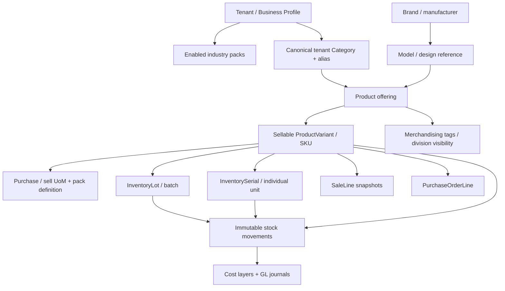
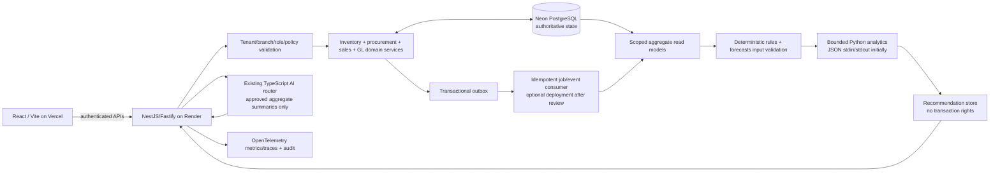

# LEXA MULTI-BUSINESS ADAPTIVE ERP — SOFTWARE REQUIREMENTS SPECIFICATION (SRS)

**Document ID:** LEXA-SRS-MULTIBUSINESS-001  
**Version:** 1.0.0 — architecture proposal for implementation review  
**Date:** 5 November 2026  
**Product:** LEXA Multi-Tenant Business Management Platform  
**Primary market:** Uganda; extensible to other jurisdictions through configured policies  
**Architecture choice:** **Option A — one authoritative LEXA engine, industry-adaptive experiences**  
**Status:** **SRS / proposed implementation; NOT a claim that these capabilities are implemented, approved or live.**  
**Reference specification:** `LEXA_ELECTRONICS_CATALOGUE_V2_SPECIFICATIONS.md` v2.0.0, 5 November 2026  
**Source evidence:** GitHub `MONALISA2003-CMD/The-LEXA-`, `scripts/industry-catalogue.v1.json`, `backend/src/catalog/industry-manifest.json`, `backend/src/business-setup/business-setup.rules.ts`, `backend/src/catalog/product-attribute-validation.ts`, `lexa-frontend/src/domain/catalog/industryCatalog.ts`, `lexa-frontend/src/modules/products/AdaptiveProductFields.tsx`, `docs/architecture/backend-architecture.md`, `docs/architecture/AI_ROUTING.md`, and the latest locally inspected LEXA source snapshot.  
**Ownership:** LEXA product, engineering, finance, security, data, operations, and owner-appointed Uganda industry representatives.  
**Requirement language:** **MUST** = mandatory release gate; **SHOULD** = default unless justified by an approved exception; **MAY** = optional, gated and tested.  
**Citation provenance:** `[BASELINE]` inspected LEXA implementation; `[V2]` the electronics PRD; `[DESIGN]` newly proposed in this SRS; `[RESEARCH]` external material listed in §31. A specification requirement is not proof of implementation.

> **Binding principle:** LEXA must feel built for the selected business activities while maintaining **one canonical product/variant, inventory stock ledger, purchasing document chain, sales ledger and general ledger per tenant**. Industry selection controls permitted *new* business configurations, default forms, recommendations, navigation and reports, **not** the truth or accessibility of existing posted business records. No silent business reclassification, catalogue duplication, artificial stock, manufactured identifiers, fictitious tax compliance, synthetic payment success, or historical-ID reassignment.

---

## Contents

0. Executive decisions and definition of done
1. Product vision, scope, personas and terminology
2. Verified brownfield LEXA baseline and gap classification
3. Business selection and personalization policy
4. 13-industry matrix and product-family pack catalogue
5. Canonical product identity, taxonomy and attribute rules
6. Unified inventory, units, traceability and costing
7. Industry vertical functional specifications
8. Cross-module system integration requirements
9. Core operational workflows and exact state machines
10. Database architecture and migration design
11. Domain API, client, events and external integrations
12. Intelligent architecture and Python analytics strategy
13. AI copilot, safety and explainability
14. Frontend UX, accessibility and mobile/offline behavior
15. Roles, permissions, tenancy and cybersecurity
16. Uganda-specific legal, fiscal and safety configuration
17. Reporting, reconciliation and observability
18. Performance, reliability and operational SLOs
19. Testing and executable acceptance scenarios
20. Migration, rollout, monitoring, restore and rollback
21. Engineering delivery plan and work packages
22. Full requirements register and traceability matrix
23. Proposed API examples and data contracts
24. Sample end-to-end industry journeys
25. Repository change map, CI/CD gates and production evidence
26. Decision register, risks and explicit exclusions
27. Data retention, privacy and governance
28. AI and Python algorithm acceptance/evaluation
29. Reconciliation examples and accounting mapping
30. Release sign-off and definition-of-done checklist
31. Source register and research provenance
32. Glossary and binding implementation directive

---

## 0. Executive decisions and definition of done

### 0.1 Approved architecture intent

| ID | Decision | Rationale / non-negotiable invariant |
|---|---|---|
| AD-001 | Preserve exactly the current 13 supported business industry codes until a separately approved industry-manifest version changes them. | No accidental 14th industry or customer migration. |
| AD-002 | Support multiple industries per tenant, plus business activity/division context per transaction where needed. | A shop may sell perfume, clothing and electronics from the same workspace. |
| AD-003 | Publish **versioned, typed, signed-off industry packs** that own form schemas, variants, category suggestions, stock profiles, module affordances and KPI definitions. | No hardcoded, diverging client-specific rules. |
| AD-004 | Keep existing shared Product, ProductVariant, InventoryLot, InventorySerial, StockMovement, Sale, Purchase and GL identities; extend additively only. | No resetting tenant history. |
| AD-005 | Make backend policies authoritative. | Web, REST, CSV, worker and future clients cannot bypass industry/tracking validation. |
| AD-006 | Use stock-profile composition, not one massive custom table per industry. | Quantity, batch, serial, pack, recipe, service, rental and asset-custody can coexist safely. |
| AD-007 | Separate recorded facts, deterministic suggestions, statistical predictions and generative AI answers. | No AI-created inventory or money; explainability and owner review. |
| AD-008 | Keep Render NestJS as transaction/orchestration authority, Neon PostgreSQL as system of record and Vercel as frontend. | Leverage running LEXA rather than a risky rewrite. |
| AD-009 | Introduce Python analytics as **bounded non-authoritative computations**, initially using existing Python scripts; consider a dedicated worker only after performance, security and operating-cost approval. | Modern intelligence with constrained blast radius. |
| AD-010 | Use authoritative, idempotent DB postings with append-only audits, exact currency handling and RLS/role isolation. | No phantom inventory, double sales, mixed tenant data or duplicate journals. |
| AD-011 | Launch by per-tenant/per-pack feature flags with staged migration, evidenced acceptance and rollback. | Never activate an unverified pack platform-wide. |
| AD-012 | Never manufacture compliance certificates, barcode/IMEI identifiers, customer consent, EFRIS acceptance or payment settlement state. | Preserve legal and commercial integrity. |

### 0.2 Operational definition of done

For each supported family, an authorized user can create a catalogued product and valid variants; select an appropriate supplier and purchase UoM; raise/approve a PO or authorized receipt; receive and inspect a quantity/lot/serial/pack/ingredient; reserve and transfer stock; sell at POS or B2B; deliver or fulfil where needed; handle correct unit/lot returns and disposal; reconcile on-hand, value, tax and posted financial entries; and retrieve trustworthy reports **through all relevant client paths**. For a service-only item, inventory receipt is correctly not applicable. For a restaurant recipe, the stock event is ingredient consumption rather than creation of fictitious finished inventory unless a production step actually produces finished goods.

A pack is not complete until its positive and negative E2E scenarios, RBAC, two-tenant isolation, real PostgreSQL migrations, offline conflict behavior where relevant, finance reconciliation and backup/restore checks are evidenced. A green frontend build alone is not acceptance. An approved design is not a production release.

### 0.3 Goals and measurable outcomes (targets, not observed metrics)

- New-product field burden: median time to create a simple item ≤90 seconds after catalog data exist; advanced variants/receiving have separate flows, measured in pilot.
- Industry relevance: ≥95% of first-page new-product templates correspond to the selected business activities, with no unrelated promoted verticals.
- Data integrity: **zero** unauthorized negative stock, double sold serials, duplicate posted payment/journal events and cross-tenant disclosures in required tests.
- Inventory reconciliation: every posted movement has a source document/event; SKU × branch × location × lot/serial balances tie to authoritative entries.
- Cash and valuation: GL balancing invariant (sum of debits equals sum of credits in each posted journal by currency/ledger policy); exceptions explicit.
- Explainability: every forecast/suggestion displays source window, timestamp, model/rule version, bounds, and reason, and never automatically commits purchasing, pricing, payroll, stock or finance.
- Deployment: all required source, Prisma, integration, security, restore, Render, Vercel and feature-flag evidence green before rollout.

---

## 1. Product vision, scope, personas and terminology

### 1.1 User story

> As the owner of a perfume shop and boutique, I select both relevant activities in Business Setup. The Products screen recommends perfumes, decants, cosmetics, dresses, shoes and handbags; Purchase Orders default to cases, bottles or clothing units as appropriate; Inventory shows batch/expiry/tester controls for the beauty line and size-colour matrices for fashion; POS recognizes exactly those SKUs; Finance reports each line's actual margin within the same company ledger. I can later add a supermarket activity without losing any historical receipt, transfer, return or account.

### 1.2 Personas

| Persona | Typical tasks | Limits |
|---|---|---|
| Tenant owner | Select activities, publish internal policy overrides, view all permitted divisions and consolidated finance. | Two-person approval for high-risk adjustments/restore. |
| Branch manager | Maintain local assortment, approve transfers, review suggestions, manage refunds by threshold. | Bound to authorized branches and limits. |
| Product/cataloguer | Create categories, valid product/variant drafts, collect product evidence. | Cannot self-approve regulated compliance or posted valuation. |
| Purchaser | Manage suppliers, RFQs/POs and suggested reorder lists. | No phantom receipts, no bypass of three-way match. |
| Storekeeper | Scan received stock, put away, transfer, count, quarantine, pick. | Physical custody doesn't imply finance-approval authority. |
| Cashier | Search active sellable catalogue, reserve exact stock, complete authorized POS sale. | No unreviewed stock profile/tax override. |
| Technician / stylist / kitchen manager | Repair parts, service work, recipe or production operations, inspection. | Context-scoped permissions, no arbitrary GL writes. |
| Finance user | AP/AR, bank/mobile money reconciliation, landed costs, journal exceptions. | Posted entries immutable; corrections as reversals. |
| Auditor / compliance | Read provenance, logs, lot recall reports, regulatory evidence. | Mask identifiers and PII as permitted. |
| External client | User-scoped mobile, web, partner API, import worker. | Same server contracts and tenant/branch filters as UI. |

### 1.3 Included and excluded

**In scope:** all 13 industry experiences, mixed businesses, cross-module policy integration, specialized variants/tracking, recipes/production where supported, quotes/receipts/returns, service and custody, procurement/stock/finance, reporting/intelligence, migration, API clients, standards, safety and certification. **Out of scope without separate approval:** automatic medicine/pharmacy compliance; telecom SIM activation/KYC; electrical/gas professional certification; legal/tax filing impersonation; licensing of external manufacturer SKU/GS1 datasets; instant AI-driven finance/stock mutation; bank/card/mobile-money payment claims without provider confirmation; full farm, healthcare, manufacturing and logistics industry reintroduction (retired codes stay historic).

### 1.4 Terminology

`Industry` = business activity chosen in tenant settings. `Pack` = versioned policy/UX/config bundle for an activity. `Division` = optional sub-business within a tenant used for merchandising/management reporting, not a second ledger. `Family` = typed product template (perfume, dress, ingredient). `Product` = merchant offering. `Variant` = sellable SKU. `Lot` = batch group. `Unit` = actual serialized item. `Package` = UoM conversion and pack presentation. `Stock profile` = quantity/lot/serial/pack/recipe/service etc. `Source document` = verified PO, receipt, stock work order, sale or return. `Suggestion` = non-authoritative recommendation. `Evidence` = source, author, timestamp, state, immutable checksum where needed.

---

## 2. Verified brownfield LEXA baseline and gap classification

### 2.1 Observed in source [BASELINE]

| Area | Observed implementation | Do not overclaim |
|---|---|---|
| Industry catalog | `scripts/industry-catalogue.v1.json` (currently schemaVersion 2), generated backend/frontend manifests, 13 codes, 51 presets and suggested category paths. | Most non-electronics families remain coarse. |
| Business Setup | `business-setup.rules.ts` validates one or more active industries, business model, offering types, selling channels, currency/time zone/payment-recording options; `normaliseSavedIndustries` supports legacy records. | Not all screens/policies consume this context. |
| Product wizard | `AdaptiveProductFields.tsx` filters presets from selected industries, offers custom category paths, variant fields and equipment subtypes; `ProductsPage.tsx` reads `industry-config`. | Electronics gets deeper subtype forms than fashion, beauty, food and hardware. |
| Backend product policy | `assertTypeAllowed`, `enforceTrackingPolicy` and `cleanProductAttributes` exist; versioned generation/contract checks are present. | Every purchasing/sales/import edge needs actual endpoint and DB E2E verification. |
| Inventory | Shared product/variant, lot/serial, receiving and stock ledger with core routes and existing equipment module. | No claim that recipes, decants, wastage and rental custody are complete. |
| Finance | General-ledger posting, purchasing/sales/finance flows and reconciliation checks already exist. | No blanket claim of all mixed-currency, refund and recipe costing journeys. |
| Intelligence | Native TypeScript AI router with restricted aggregate-only provider access; bounded Python `operations_intelligence.py` and `finance_intelligence.py` scripts exist. | No evidence of live forecasting/ML service or unrestricted AI actions. |
| Deployment | React/TypeScript/Vite on Vercel, modular NestJS/Fastify API on Render, Prisma/Neon PostgreSQL, object-storage adapter, audit and OpenTelemetry dependencies. | Source configuration and deployed provider settings may diverge; require fresh release inspection. |

### 2.2 Deliberate design changes [DESIGN]

- Replace broad-family-only UX with a **catalog of composable versioned pack policies**; extend, do not replace, the existing electronics V2 policies.
- Move industry selection/context into a single backend-resolved capability projection consumed by **all modules**, not only Products.
- Add explicit per-variant/batch/recipe/rental/measurement semantics and reconciled postings for non-electronics verticals.
- Introduce deterministic rule advice first and Python statistical models second, with model registry/evaluation/safety controls.
- Expand CI/staging evidence from static source checks to real authenticated workflow assertions and finance+restore invariants.

### 2.3 Backward compatibility

- Existing 13 codes stay: `retail_trade`, `wholesale_distribution`, `electronics`, `mobile_phones`, `fashion_beauty`, `perfumes_cosmetics`, `food_hospitality`, `bakery`, `construction`, `household_goods`, `repair_services`, `education`, `other`.
- Legacy/retired choices `agriculture`, `healthcare`, `manufacturing`, `logistics_transport`, `professional_services` remain historic-only; never present as new selectable codes without separately reviewed product/legal expansion.
- Existing Product/Variant/Lot/Serial/Category/Sale/Payment/GL and tenant records retain their stable identifiers, original transaction snapshots, valuation history and legal evidence.
- Non-electronics product field changes MUST be additive or versioned. Previously posted items remain readable; they are not silently coerced to new required fields.

---

## 3. Business selection and personalization policy

### 3.1 Data and scope model

1. **Tenant's enabled activity set** (`BusinessProfile.industries`) is the binding owner selection; `BusinessProfile.industry` remains a compatibility/primary-display field, not an independently contradictory policy.
2. **Active division** (`business_division_id`, optional) organizes assortment, reporting and default navigation per tenant/branch. Multiple packs may serve one division; one product remains canonical and may receive non-duplicating merchandising tags for other divisions.
3. **Branch assortment** determines which already-authorized products can be stocked/sold locally; does not change their owner or original category.
4. **User workspace preferences** (last-used pack, favorites, compact/advanced mode) affect presentation only and never authorize an activity or write.
5. **Family/subtype policy** determines required fields, variant axes, stock profile, scans, package and compliance behavior.
6. **Capability matrix** is the intersection of configured activities, rollout flags, role/permission, branch entitlement, jurisdiction policy and historical action rights. A hidden button is not security.
7. **Tenant override** may relax optional fields or add custom fields with versioning; may **not** downgrade a mandatory identity, compliance, expiry or stock constraint, or alter posted history.

### 3.2 Selection and change workflows — numbered requirements

| ID | Requirement |
|---|---|
| BS-001 | Onboarding SHALL display only current 13 active industries, searchable and multi-select; show understandable examples, not technical codes. |
| BS-002 | The tenant owner SHALL choose one or more activities; at least one is required; associated business models and channels are separately configurable. |
| BS-003 | Settings SHALL show current activities, primary display activity, assigned branches/divisions, pack versions and last change actor/time. |
| BS-004 | Adding an industry SHALL expose templates and optional onboarding suggestions; never auto-create actual sellable products, stock balances or accounting entries. |
| BS-005 | Removing an industry SHALL hide its *new-product suggestions* after a safe-impact review, but preserve historical products and in-flight receipts, returns, warrants, rentals, repairs, supplier settlements and reports. |
| BS-006 | The system SHALL block a change if it would orphan future mandatory workflows; provide a transition plan, not automatic deletion. |
| BS-007 | A multi-industry owner SHALL switch default activity in Products/Purchases/Inventory/POS without creating a new login, tenant or GL. |
| BS-008 | Shared products (e.g. water sold in retail and hospitality, printer parts sold in repair) SHALL have one product ID and stock identity; tags/assortments present them in multiple contexts. |
| BS-009 | Tenant and branch settings changes SHALL be audited, permissioned, revisioned and effective-dated. |
| BS-010 | All API clients SHALL receive server-derived `industry-config` and `effective-capabilities` with ETag/version; server SHALL re-evaluate on write. |
| BS-011 | Unsupported or mismatched industry+family writes SHALL fail with consistent 400/403/409/422 semantics and no partial mutation. |
| BS-012 | Historical edit/return/finance actions SHALL remain possible under existing-role authority even if a family is no longer offered as a new template. |

### 3.3 Effective capability evaluation

```text
principal/session → tenant membership → branch scope
         ↓
BusinessProfile active industries + optional divisions
         ↓
published pack versions + selected product family/subtype
         ↓
feature/tenant rollout flags + plan entitlements + jurisdiction policy
         ↓
operation permissions, required fields, validation, stock profile
         ↓
API response: allowedActions, screens, recommendedTemplates, packVersion,
             policyHash, warnings, historicalReadCompatibility
```

The UI SHALL make the business's relevant families prominent, but provide an explicitly labeled **Search all existing products** view for authorized historical/mixed assortments. **All business types** must never be an indiscriminate default product list if a business has deliberately selected a narrow industry. All catalog-wide global search results remain subject to product ownership, role, and stock location.

### 3.4 Behavior examples

| Tenant choices | Preferred template groups | Not recommended by default | Existing history |
|---|---|---|---|
| `perfumes_cosmetics` | Perfume, body mist, decant, cosmetic, skincare, haircare, tester | IMEI handset, cement, restaurant recipe | All authorized existing records remain accessible |
| `fashion_beauty` | Clothing, footwear, bags, jewellery, accessories, uniform | Laptop upgrade wizard, kitchen ingredient | Same |
| `food_hospitality` + `bakery` | Ingredients, recipe, menu item, pastry, bread, catering | Serialed CCTV receiving | Same |
| `retail_trade` + `wholesale_distribution` | Grocery, drinks, cleaners, multi-packs, bulk supply | Technical servicing by default | Same |
| `construction` | Cement, rebar, paint, pipes, cable, timber, fasteners, tools | Fragrance concentration by default | Same |
| `other` | Approved generic stock, non-stock service and custom field builder | Forced specialization | Same |
| `mobile_phones` + `perfumes_cosmetics` | Both full packs, context selector and consolidated POS | Other verticals | Same |

### 3.5 Sub-activity (merchant niche) selection — essential for the requested personalization

**[DESIGN]** An industry code alone is not granular enough: the current LEXA `fashion_beauty` manifest includes `clothing`, `footwear`, `bag`, **and** `perfume`/`cosmetic` presets. A boutique that sells only dresses should not be shown fragrance templates simply because its industry has "beauty" in its legacy label. Likewise, a grocery-only shop and a mixed supermarket need different first-page shortcuts while sharing `retail_trade`.

Introduce a **tenant-selected sub-activity list** (merchant niches) as a secondary taxonomy, **not new industry codes**. During Business Setup and Settings, after selecting one or more of the 13 industries, ask "What do you actually sell or do?" with searchable choices and multi-selection. Offer a clear `I sell something else` custom-description path. Store versioned `subActivityCodes` and applicable sales channels in a tenant-scoped profile; owners can revise choices with an impact review. Each niche maps to **recommended family codes**, which are a strict subset of the tenant's allowed industry families. SKU/stock, compliance and RBAC still use canonical family policy. A niche changes **discovery/personalization**; it does not authorize a forbidden product type or delete older stock.

| Parent industry | Example approved niche IDs | Suggested first-view families |
|---|---|---|
| `fashion_beauty` | `fashion.boutique`, `fashion.footwear`, `fashion.bags`, `fashion.uniforms` | Clothes/size matrices, shoes/pairs, bags, school uniforms; **no perfume first-view** for boutique-only |
| `perfumes_cosmetics` | `beauty.fragrance_shop`, `beauty.cosmetics_shop`, `beauty.skincare_shop`, `beauty.haircare_shop` | Perfume, body mist, decants, makeup, skincare or haircare as selected |
| `retail_trade` | `retail.grocery`, `retail.supermarket`, `retail.convenience`, `retail.cleaning_goods` | Grocery/produce or comprehensive retail as selected |
| `wholesale_distribution` | `wholesale.grocery`, `wholesale.household`, `wholesale.building_supplies`, `wholesale.mixed` | Bulk pack/pallet options for selected actual goods |
| `food_hospitality` | `hospitality.restaurant`, `hospitality.cafe`, `hospitality.catering` | Menu/recipe, prepared beverages or catering work orders |
| `bakery` | `bakery.bread`, `bakery.cakes`, `bakery.pastry`, `bakery.mixed` | Bakery production and custom order variants |
| `construction` | `hardware.cement`, `hardware.electrical`, `hardware.plumbing`, `hardware.paint`, `hardware.general` | Bag, cable/roll, pipe, paint, general tools |
| `household_goods` | `home.furniture`, `home.bedding`, `home.appliances`, `home.homeware` | Furniture and assembly, textiles, appliances and dispatch |
| `repair_services` | `repair.phones`, `repair.computers`, `repair.appliances`, `repair.general` | Appropriate customer asset intake, compatible parts/labour |
| `education` | `education.bookshop`, `education.stationery`, `education.school_uniforms`, `education.training` | Book ISBN/edition, stationery, uniforms or services |
| `electronics` / `mobile_phones` | **Reuse Electronics V2** subtypes/divisions (phone, accessory, IT, appliance etc.) | Device-appropriate UI; do not duplicate electronics taxonomy |
| `other` | `flex.stock`, `flex.services`, `flex.mixed` | Only owner-approved generic families and custom fields |

**Policy order:** role/tenant permission → active 13-industry permissions → published family/stock policy → niche recommendation filter → user-selected screen context. If niche selection is absent for a legacy business, show an **onboarding suggestion to choose niches** and safe broad industry templates; never infer the niche from unrelated historical purchases without owner review. A user may explicitly access "More categories from my allowed industries" without losing existing records. All niche IDs above are **proposed**, not yet present in LEXA. The industry-pack generator must reject a niche pointing to a family disallowed by its parent industry's published policy.

**Acceptance:** For `fashion_beauty + fashion.boutique` only, relevant clothing/shoes/bags are first-view; perfume, electronics and other verticals are not promoted. For `perfumes_cosmetics + beauty.fragrance_shop`, perfume/decant/testers appear without unrelated makeup/retail clutter; a mixed owner selecting both niches sees both. A direct API request for an unauthorized *industry* still fails; a niche is never a bypass of backend type authorization.

---

## 4. 13-industry matrix and product-family pack catalogue

### 4.1 Active industries and release packs

| Industry code [BASELINE] | Pack ID [DESIGN] | Domain-specific templates and wizard families | Primary stock profile(s) | Release priority |
|---|---|---|---|---|
| `retail_trade` | `pack.retail.v1` | Grocery, drinks, dairy, cleaners, hygiene, baby items, weighed produce | Quantity, pack, lot/expiry | P2 |
| `wholesale_distribution` | `pack.wholesale.v1` | Cartons/cases, trade packs, bulk supplies, supplier SKUs, wholesale quotes | Pack, quantity, lot, bulk UoM | P2 |
| `electronics` | `pack.electronics.v2` | Computers, TVs, office equipment, power, audio, appliances | Serial, IMEI where applicable, qty, pack, component | Existing V2 / compatibility |
| `mobile_phones` | `pack.mobile.v2` | Smartphone, feature phone, cellular tablet, MiFi, accessories | IMEI, serial, quantity, pack | Existing V2 / compatibility |
| `fashion_beauty` | `pack.fashion.v1` | Dresses, shirts, trousers, shoes, bags, jewellery, uniform | Variant quantity, optional lot/serial | P1 |
| `perfumes_cosmetics` | `pack.beauty.v1` | EDP/EDT/extrait, body mist, oils, decants, testers, makeup, skin/hair care | Quantity, lot/expiry, pack, recipe/decant | P1 |
| `food_hospitality` | `pack.hospitality.v1` | Ingredients, recipes, menu items, beverages, catering and service charges | Lot, UoM, recipe, non-stock service | P3 |
| `bakery` | `pack.bakery.v1` | Bread, dough, cakes, pastries, custom cakes, toppings and packaging | Lot/expiry, recipe/BOM, production | P3 |
| `construction` | `pack.hardware.v1` | Cement, steel, timber, paint, fittings, pipes, cables, fasteners | Quantity by UoM, lot/batch, pack | P2 |
| `household_goods` | `pack.home.v1` | Furniture, mattresses, homeware, appliances, furniture assembly | Quantity, serial if necessary, fulfilment | P4 |
| `repair_services` | `pack.repair.v1` | Spare parts, consumables, labour, service diagnostics, customer assets | Quantity/lot/serial, non-stock labour, asset custody | P4 |
| `education` | `pack.education.v1` | Books, uniforms, stationery, course/tuition, school supplies | Quantity/variant, non-stock service | P4 |
| `other` | `pack.flex.v1` | Generic stock/service, approved tenant-defined family templates | Authorized quantity/lot/serial/service | P4 |

The industry pack mapping does **not** imply thirteen distinct financial ledgers, web applications or microservices. Each pack defines **additional domain policy and UI** over shared LEXA entities.

### 4.2 Common pack contract

Each published pack MUST contain: stable `packCode`, `schemaVersion`, `policyHash`, `effectiveFrom`, `effectiveTo?`, `industryCodes`, `familyCodes`, display labels/translations, `categoryPaths`, `fieldDefinitions` with type/requiredness/provenance, `variantAxes`, `stockProfile`, `uomPolicies`, `purchaseForm`, `receiptForm`, `salesForm`, `returnsForm`, `financeMapping`, `reportDefinitions`, `roleRequirements`, `compliancePolicyRefs`, `featureFlag`, `minimumClientContract`, `migrationNotes`, and `acceptanceScenarioIds`. Publications require validation of codes, category/field uniqueness and policy hash; incompatible changes use a new version and migration review. Only signed-off published versions serve new product creation; pending changes are drafts.

### 4.3 Industry bundle interaction and overlap rules

- A product has **one primary family code** and **one primary canonical category**. Cross-industry discoverability uses tags, catalog shortcuts, sales channel or division assignment; no duplicate product row merely to appear in two menus.
- Existing electronics/mobile family codes, IMEI rules, serial IDs, unit costs, after-sales and compatibility remain authoritative under Electronics V2. The new packs do not reimplement those controllers or redefine those events.
- `household_goods` and `electronics` can both surface the *same* appliance family; policy is keyed to the family+subtype, not which menu opened it.
- `bakery` and `food_hospitality` can both reference the same butter/flour ingredient inventory. Recipe consumption is canonical and tenant-scoped.
- `wholesale_distribution` describes pricing, packaging, supplier and customer terms over an actual product family; it cannot create a separate wholesale stock ledger.
- Service-type offerings have `stockProfile=service` and cannot receive imaginary sellable stock; separately charged parts are product line items, not labour units.

---

## 5. Canonical product identity, taxonomy and attribute rules

### 5.1 Ownership graph



No arrows from `Industry` to physical stock identity are allowed except through selected family policy and product. A business selection is not the owner of the product; the **tenant** is.

### 5.2 Product lifecycle and attribute levels

| Entity | Stores | Must not store |
|---|---|---|
| Category | Stable code/path/alias, parent, optional category field policy | Brand as child category, fabricated stock |
| Brand/Model | Vendor/model identifiers and documented specs | Retail stock balance, merchant's dynamic sale price |
| Product | Merchant name/description, active status, family code, primary category, chosen pack/policy version, tax/warranty defaults | An aggregate fake serial, user-specific inventory quantity |
| Variant | Actual sellable choices, SKU, barcode/GTIN if valid, pricing UoM, stock profile reference, procurement rules | Duplicated parent product, physical unit condition |
| Lot | Batch/expiry/manufacture dates as known, supplier, status, receipt and quality evidence | Individual serial as required alternative for T-SERIAL |
| Physical unit | Serial/IMEI(s), unique device condition, receipt cost, current custody, configured state | An invented IMEI or unsourced manufacturer spec |
| Purchase/receipt | Supplier, approved cost, currency, conversion, lot/serial acceptance and discrepancies | Stock created directly from PO ordered quantity |
| Sale/return | Immutable SKU/price/tax/condition/sold-unit snapshot, settlement/return references | Live mutable product description as receipt truth |
| AI recommendation | Approved aggregate feature inputs, version, rationale, confidence, expiry and status | Direct mutation permission or trusted final inventory state |

### 5.3 Field/variant dictionary

Field kinds: `text`, `enum`, `boolean` (true/false/unknown), `decimal` with dimension+unit, `integer`, `date`, `reference`, `multiSelect`, `documentRef`, `moneyMinor`, `identifier`, `typedRelation`, `imageRef`. Validate at client *and* server; server owns final schema. Requiredness can differ by stage: `creation`, `variant`, `receiving`, `sale`, `return`, `service`, `regulatory-condition`. Missing/unknown is **not** zero/false/verified. Decimal stock/length/volume uses exact decimal or rational arithmetic; money uses ISO 4217 currency + integer minor units with documented cash rounding.

### 5.4 Variant and change rules

- Size × colour × fit, fragrance bottle volume × concentration, cosmetics shade × pack size, paint colour × volume, hardware diameter × length: create only real commercially distinguishable combinations.
- Every SKU and barcode must be normalized and uniqueness-checked in the tenant as applicable; unknown manufacturer GTIN is null, never automatically generated as a genuine GTIN.
- Variants can have prices, unit ratios, batch/serial requirements and images. Changing a variant after sale never rewrites the posted snapshot.
- Product fields can use optional tenant-approved custom attributes with max length, type, validation/version; disallow executable formulas and tenant-controlled SQL/JavaScript.
- New policy versions use capability negotiation; old products remain readable and financial history remains correct.

---

## 6. Unified inventory, units, traceability and costing

### 6.1 Tracking/stock profile matrix

| Code | Appropriate families | Mandatory movement semantics |
|---|---|---|
| `QTY` | Clothing, groceries, most homeware | Product variant × branch × warehouse/bin; exact base-UoM quantities |
| `LOT` | Cosmetics, skincare, food, prepared bakery, selected paint/chemical/battery | Supplier batch, status, expiry/quality info where applicable, FEFO selection when applicable |
| `SERIAL` | Electronics, premium devices, selected furniture/equipment | One physical unit per serial; exact-unit state/cost/history |
| `IMEI` | Cellular devices with assigned identifiers | One unit for multiple actual IMEIs; tenant-wide cross-slot uniqueness |
| `PACK` | Wholesale cartons, bottled packs, multipacks | Immutable conversion version; receive base units once; never count pack and pieces twice |
| `MEASURE` | Cable, pipe, timber, fabric, cut-to-length goods, fresh produce | Decimal quantity with base dimension, conversion/rounding/physical tolerance policy |
| `RECIPE` | Bakery, restaurant, perfume decants, manufactured kits | Versioned component/ingredient BOM, actual quantities, yield, waste, work order |
| `SERVICE` | Repair labour, training/tuition, appointments | No merchant inventory; optional capacity/time allocation and billable work |
| `CUSTODY` | Customer-owned repair items, consigned goods where enabled | Non-sale inventory custody ledger; title ownership and consent separate |
| `RENTAL_ASSET` | Explicitly approved equipment/furniture rentals | Fixed asset or held inventory separately identified; check-out/in, damage, availability and deposits |
| `KIT` | Gift sets, school starter packs, solar sets, furniture packages | Sealed vs assembled/BOM distinction; atomic component reservation/consumption |

Optional serial tracking must be decided before first receipt or follow reviewed conversion; an individual cashier cannot disable it to pass a sale. All lot+serial+measure choices must be validated together when combined.

### 6.2 UoM engine (non-lossy)

- Separate `baseUom` from `purchaseUom` and `saleUom`; every conversion has integer numerator/denominator, dimension, version, effective dates, precision/allowed fractional quantity and provenance.
- Reject cross-dimension conversions (kg to litre) unless a recorded product-specific density/physical measurement with unit and approved variance is provided; no automatic grams ↔ pieces without validated count/yield.
- Batch cost allocation uses source currency, rate/date, FX gain/loss mapping, freight/landed costs and explicit rounding remainder assignment to one last component or designated cost line.
- Support packs without creating parallel stock: 20 cartons × 10 cables creates 200 **pieces**, selling 35 leaves 165 pieces; shipping five to a second branch does not change tenant-wide 165.
- Cut goods preserve length balance and measured waste: a 100 m cable roll cut into 12.5 m and 5.2 m sale pieces consumes 17.7 m plus separately recorded approved cut waste; never round it to 18 m silently.
- Recipes track ingredient conversion (e.g. 250 g from inventory held in kg); multi-output/batch yield and scrap must reconcile.

### 6.3 Available-to-promise and state

`ATP = accepted_saleable_on_hand - active_reservations - committed_unfulfilled_allocations` in each exact dimension/lot/location, with no double subtraction where reservations are themselves included in allocation. Quarantine, expiry, in-transit/outbound, returned-uninspected and customer-owned custody are **not saleable**. All state transitions use transactional conditional updates/locks and idempotency keys; the database must reject negative authorized stock and double allocation.

### 6.4 Lot/expiry and returns

- FEFO applies where the product has real expiry/removal dates and policy; not all products are artificially assigned expiry. Quarantined, recalled and expired lots fail sale allocation.
- Return requires original sale-line, variant, actual lot/serial where relevant, quantity, condition inspection, cost/finance reversal policy, reason and disposition.
- Returning a wrong serial, wrong variant, wrong branch without permitted transfer, already-returned unit or prior fully refunded quantity is rejected with no partial stock/journal mutation.
- Beauty testers are not normal saleable stock unless explicitly sold in correct condition and barcode/SKU; conversions consume source inventory and create a controlled tester/decant stock type.

### 6.5 Cost/valuation contract

- Each accepted receipt results in inventory quantity and a reconciled cost layer (or approved suspense exception); the GL inventory and AP/GRNI entries agree in currency and value.
- Cost policies are versioned and accounting-approved (e.g., FIFO or weighted average for quantities, exact unit for serials). Never change policy on posted entries retroactively.
- Recipes allocate ingredient, actual labour and overhead where configured; waste/rework is separately costed and approved. The system does not claim a margin when COGS is unknown.
- Bundle and decant operations must debit new finished value and credit consumed component/parent inventory without duplicating value. With loss, post recognized wastage/variance to proper account.
- Every correction is a reversal/new journal, never a destructive edit to a posted ledger or immutable source snapshot.

---
## 7. Industry vertical functional specifications

The family tables below are new design requirements unless explicitly described as existing baseline. `R` = required for the relevant stage, `C` = conditionally required, `O` = optional, `V` = variant choice; no data inferred without evidence. The proposed packs must be implemented from one versioned manifest plus explicit backend state machines, not independent ad-hoc JSON dictionaries sprinkled through React.

### 7.1 Beauty, perfumes, cosmetics, skincare and fragrances — `pack.beauty.v1`

| Family code | Creation fields (level/stage) | Variant axes | Tracking / receive | POS, service and reporting |
|---|---|---|---|---|
| `beauty.perfume` | Brand R, fragrance line/name R, manufacturer SKU/C, concentration C (`parfum`, `edp`, `edt`, `edc`, `oil`, `other`), nominal bottle mL R, origin O, batch policy, actual label C | Bottle mL, concentration, edition; colour only where commercial | QTY by variant; LOT if configured/required; receive sealed unit and batch if present | Separate sealed/taster/decant SKU; margin by size/concentration; gift wrapping as service or bundle |
| `beauty.body_mist` | Name R, mL R, scent family C, skin-use warnings C | mL, scent variant | QTY/LOT policy | Do not classify as certified perfume or medical product |
| `beauty.fragrance_oil` | Name R, mL R, oil type C, source C | Size, scent | LOT/MEASURE when bulk filled | Dispensing/decant BOM, accurate yield and waste |
| `beauty.decant` | Parent source bottle/lot R, fill mL R, container/atomizer R, contamination/traceability policy C | Filled mL, container type | RECIPE + LOT; controlled source consumption | Link source provenance; no duplicate stock from original bottle |
| `beauty.tester` | Parent SKU R, display-only/sale policy R, condition/source R | Label only if distinct actual SKU | Controlled conversion QTY/LOT; non-saleable default | Tester usage/spoilage expense with authorized write-off |
| `beauty.makeup` | Makeup type R, manufacturer shade/color R, size R, finish C, ingredients/INCI evidence C | Shade, size | LOT where lot/expiry applies | Correct shade return; sealed/opened restrictions by applicable policy |
| `beauty.skincare` | Product use R, skin type C, mL/g R, INCI/label evidence C, expiry/review C | Pack size, formulation | LOT/FEFO where relevant | Recall/quarantine by batch and supplier |
| `beauty.haircare` | Shampoo/conditioner/oil/gel type R, mL/g R, formulation notes C | Pack size, variant | LOT/QTY | Salon service consumption optional but accounted separately |
| `beauty.gift_set` | Component list R, packaging R, gift note O | Set definition | KIT sealed or assembled; not both | Component stock consumed/reserved exactly once |

**Beauty invariants and UX:** `name → brand → scent/concentration → bottle sizes → variant SKUs → purchase → lot/expiry only when applicable → stock → sale/return`. Display a compact fragrance wizard rather than smartphones' RAM, IMEI or screen fields. Manual price-per-mL is a read-only derived helper, not an alternative monetary ledger. Source bottles, decants and testers MUST reconcile volume and cost. Enforce opened-item/contamination handling by actual legal/business policy, not blanket return refusal. Expiration is unknown if label/document does not supply it; DO NOT auto-invent. For cosmetic labelling, capture applicable evidence as required by compliance officer (UNBS US EAS 346:2022 is a research reference; applicability is product- and jurisdiction-specific).

**Beauty acceptance:** `BEA-01` 12 × 50 mL and 8 × 100 mL distinct SKUs; sell 3 × 50 mL ⇒ 9 and 8 remain; revenue/COGS matches. `BEA-02` 1 source bottle 100 mL ⇒ four 10 mL decants, 3 mL documented spill, 57 mL residual, value conserved with loss booked. `BEA-03` quarantined/expired cosmetics lot never sold via POS/REST/import. `BEA-04` tester conversion cannot make source and tester simultaneously available. `BEA-05` beauty-only staff see beauty presets first, not IMEI.

### 7.2 Fashion, boutique, footwear, bags, uniforms — `pack.fashion.v1`

| Family code | Creation fields | Variant axes | Stock/returns behavior |
|---|---|---|---|
| `fashion.clothing` | Garment type/style R, brand C, material C, fit C, season O, target sizing system R | Size × colour; pattern/fit only when SKU-distinct | Variant-level QTY; each size/colour separate allocation/price |
| `fashion.footwear` | Shoe type R, EU/UK/US sizing system R, style R, material C | Size (system-specific) × colour × width C | QTY by pair, not single shoe; exchanges link sold and received SKUs |
| `fashion.bag` | Type R, design R, material C, dimensions C | Colour, size/edition | QTY; optional premium serial by approved policy |
| `fashion.jewellery` | Material/evidence C, size/weight C, style R | Length/ring size/stone/finish | QTY/optional serial; don't assert purity authenticity without evidence |
| `fashion.uniform` | Institution/school C, garment type R, sizing system R | Size × colour × house/group | QTY; allow school procurement/B2B quotes |
| `fashion.fabric` | Fabric type R, width R, pattern C, composition C | Colour/pattern/roll width | MEASURE in m/yd; cuts + wastage reconciled |
| `fashion.alteration_service` | Work description R, fitting appointment O | None | SERVICE, optional linked original sale/customer consent |

**Fashion UX:** variant grid generated after master/style creation; 3 sizes × 2 colours = six valid SKUs. Disallow normalized duplicate combinations; show matrix available/reserved/per-branch counts and sizes, barcode labels and reorder suggestions by specific size. Do not create separate Products for each size unless merchant truly sells distinct items. Exchanges require exact sold original variant and linked new sale; any price differential, tax and journal reversal must be explicit. Use unit `pair` for shoes; dual shoe components are not two stock items. Seasonal and consignment stock need ownership tags, not fake sale proceeds. Allow custom size charts with locale-specific labels and a stable normalized size code.

**Fashion acceptance:** `FAS-01` six-variant matrix and stock isolated by size/colour; `FAS-02` exchange M/Black for L/Blue posts one return plus one sale; `FAS-03` 6.4 m of fabric sold from a 30 m roll deducts 6.4 m + approved cutting loss; `FAS-04` category change preserves original receipt and return.

### 7.3 Retail, supermarkets and general merchandise — `pack.retail.v1`

| Family | Fields | Tracking | Key behavior |
|---|---|---|---|
| Grocery / staples | Brand, package/weight, supplier, SKU/GTIN | QTY/PACK or LOT if batch/expiry | Barcode; promo and min/max reorder |
| Beverages / bottled water | Pack/bottle capacity, pack size, container deposit where legally appropriate | QTY/PACK/LOT as needed | Carton/each selling; no double units |
| Dairy, chilled and perishable | Batch, source and actual expiry, storage condition as verified | LOT + FEFO | Block expired/recalled, short-dated alerts |
| Fresh produce | Unit and precision, weighed barcode rules, origin/grade when known | MEASURE/LOT by policy | Scale integrations only via authenticated, verified payload; unit price and measured quantity immutable at sale |
| Cleaning and hygiene | Pack size, hazards/safety doc when applicable | QTY/LOT policy | Prevent dangerous false suitability claims |
| Baby goods | Brand/size/pack, batch/expiry as applicable | QTY/LOT | Traceable recalls |
| Returnable containers | Deposit policy and liability mapping | CUSTODY or deposit ledger distinct from item stock | Deposit collected/refunded once |

**Retail acceptance:** `RET-01` mixed weighted/pack basket reconciles by base units; `RET-02` 10 cartons × 12 bottles and sale of 25 = 95 bottles; `RET-03` expiry and recall block all clients; `RET-04` offline scanner draft isn't posted until server confirmation; `RET-05` discounts preserve tax, cost and receipt snapshots.

### 7.4 Wholesale and distribution — `pack.wholesale.v1`

Bulk procurement, pallet/case/base-unit conversion, customer- and tier-specific price lists, MOQ, case-breaking, credit terms, partial PO/ASN receipts, backorders, multi-warehouse transfer, picking/packing, B2B quotations, supplier returns and AR reconciliation. `wholesale` is a business model overlay and does not replicate the underlying retailer's products. A wholesale-only business can still use generic/retail families appropriately through selected activities.

**Wholesale acceptance:** `WHO-01` partial receipt 40 of 100 cases and subsequent 60 cases never duplicates stock or AP; `WHO-02` 20 cartons of 10 sold as 35 each leaves 165 each, conversion fixed by version; `WHO-03` credit customer over-limit blocked/approved by role; `WHO-04` FX landed cost and payable reconcile; `WHO-05` branch-to-branch transfer is zero-sum at tenant level.

### 7.5 Restaurants, food service and hospitality — `pack.hospitality.v1`

| Family / transaction | Specific requirements |
|---|---|
| Ingredient | Canonical ingredient product, base UoM (kg/L/each), supplier/lot/expiry, food allergen metadata from evidence |
| Recipe | Versioned portion size, component IDs and exact quantities, approved yield, substitution policy, effective dates, allergen calculation provenance |
| Menu item | Non-stock sale offering referencing active recipe and price; optional actual prepared-food stock only when produced as finished goods |
| Beverage | Finished bottled item or prepared recipe; deposits/service charges separately modelled |
| Modifier | Additional cheese, extra ingredient, size, substitution; computes delta component consumption and price |
| Kitchen order | `ordered → accepted → preparing → served/completed`, plus void/refund states; consume stock at configured, unambiguous event |
| Wastage | Spoilage, kitchen waste, staff meal, recipe variance: reason, quantity, manager approval and cost/GL |
| Catering/event | Quote, deposit, planned vs actual portions, procurement, fulfilment and revenue recognition policy |

**Hospitality boundaries:** A menu sale MUST NOT simply deduct one phantom `menu_item` from warehouse stock when recipe-driven; the server consumes ingredient stock exactly once upon the configured execution milestone (e.g. `prepared`/`fulfilled` after approval). If cancellation precedes consumption, release reservation; if already consumed, apply documented salvage/waste rules, not automatic restoration of cooked ingredients. Recipe variant size adjusts quantity and price according to published ratios. Allergen advice is based on verified ingredients with disclaimers; unknown ingredient ≠ allergen-free.

**Hospitality acceptance:** `HOS-01` recipe uses 200 g flour + 50 g sugar; five portions deduct exactly 1 kg + 250 g; `HOS-02` same order event retried does not re-consume ingredients; `HOS-03` out-of-stock ingredient blocks or explicitly authorizes substitution; `HOS-04` cancelled unprepared order releases reservation; `HOS-05` food waste is separate expense and manager-audited.

### 7.6 Bakeries and prepared food — `pack.bakery.v1`

Family codes `bakery.bread`, `bakery.cake`, `bakery.pastry`, `bakery.ingredient`, `bakery.custom_order`, `bakery.packaging` and `bakery.production_service`. Recipes/BoMs link flour, yeast, sugar, eggs, butter, water, fillings, packaging and other real ingredients; use explicit formula/yield version, planned batch, actual production lot, shift/operator, scrap/wastage, quality disposition, manufacture/expiry if actual, and unit/portion conversions. Support made-to-order cake deposits, delivery date and customer specification; protect customer artwork/contact details. A completed production order consumes ingredients and creates *actual* sellable finished-batch stock if produced for shelf sale. An immediate-order food sale may consume ingredients without finished-stock receipt, but the two modes cannot both post for one production event.

**Bakery acceptance:** `BAK-01` 10 kg flour yields 80 verified loaves and recorded 2 rejected loaves as finished units/waste under approved formula; no 80 ghost loaves before completion. `BAK-02` expired lot fails POS. `BAK-03` cake deposit posts customer liability, not full sales revenue absent the recognition event. `BAK-04` change of recipe version doesn't rewrite historic costs.

### 7.7 Hardware, building materials and construction supply — `pack.hardware.v1`

| Family | Typed details and variant axes | Inventory and sales |
|---|---|---|
| Cement | Grade, manufacturer, unit bag weight, batch if applicable | Bag/tonne purchase conversions; damages/broken bags logged |
| Rebar/steel | Diameter, grade, length, material | MEASURE: length, pieces and mass only with verified item-specific factor |
| Timber/sheets | Width, thickness, length/area, grade | Piece/m²/m³ conversions only with verified dimensional policy and loss |
| Pipes/fittings | Diameter, pressure rating, material, length/connector | Metre/length piece vs fittings by each |
| Cable/wire | Gauge, cores, insulation, voltage rating, roll length | MEASURE in metres; each cut linked to roll/source lot |
| Paint/coatings | Colour/finish, formulation, litres, brand, batch | Variant size and colour, LOT where batch required, tinting/mixture BOM when supported |
| Roofing tiles/sheets | Profile, material, thickness, length, coverage | Pack/piece/area with explicit overlap assumption |
| Screws/fasteners | Size, thread, material, package qty | Base each; bag/box wholesale conversions |
| Power tools | Manufacturer model, rated capability and warranty | QTY/optional SERIAL, tool rental as separate licensed operation |

Quotation includes unit, measured quantity, wastage allowance and delivery cost as separate lines. Price by metre/length must not silently convert to price per roll. Bulk customer credit and site delivery share the normal order/AR engine. Safety compliance only from actual documentation.

**Hardware acceptance:** `HAR-01` sell 17.7 m from 100 m roll; residual 82.3 m before waste; `HAR-02` incorrect kg-to-m conversion rejected; `HAR-03` 100 bags cement received and damaged two quarantined; 98 saleable; `HAR-04` site invoice, delivery and tax journal reference original order/variant.

### 7.8 Household, furniture and home goods — `pack.home.v1`

Furniture has manufacturer/style, material, dimensions in mm, colour/finish, number of pieces, condition, assembly requirement, weight/package/delivery classification; variants distinguish actual stocked finishes/sizes. Mattress dimensions/firmness may define SKUs; textiles are QTY/size variants; large appliances retain existing Electronics V2 identity, warranty and delivery logic. Delivery appointments, split shipment, assembly checklist, customer POD, failed delivery and return damage must refer to original sale line. Customer household asset/service history may persist after sale but sold units never remain available in warehouse.

**Home acceptance:** `HOM-01` three chairs with one delivered leaves two available; `HOM-02` assembly parts and labour post once; `HOM-03` failed delivery keeps the unit allocated and not available until controlled reversal; `HOM-04` household goods + electronics shared appliance remains single SKU.

### 7.9 Repair shops and technical services — `pack.repair.v1`

Repair intake records customer authorization, actual device identity, observed condition, supplied accessories, technician/assigned branch, estimates, job notes, parts consumption, status, consent-scoped privacy, warranty applicability and release signature. The **customer-owned asset is not inventory for sale**. Labour is a non-stock service; consumed merchant spare parts decrement canonical quantity/lot/serial stock and post COGS/expense according to business policy. Work-order status `intake → diagnosis → quote → approved → in_repair → QC → ready → collected` with cancellation/return-unrepaired paths; deposit and service revenue recognition separated. Electronics V2 upgrade and warranty work-order functionality must be reused rather than competing repair ledgers.

**Repair acceptance:** `REP-01` intake device adds zero merchant saleable inventory; `REP-02` installed repair screen consumes exact available part once; `REP-03` without approval, repair cannot consume controlled parts; `REP-04` wrong owner/tenant cannot read device IMEI or case; `REP-05` collected work order has immutable release acknowledgement.

### 7.10 Education, schools and training — `pack.education.v1`

Book ISBN/edition, subject, educational level and language; stationery packs; school uniform size×colour; school supply kits; non-stock course/tuition line with term/session, schedule, student/payer privacy, receivable and deferral/revenue recognition when applicable. **This pack does not grant permission to store sensitive student data by default.** Library lending would be a separately approved rental/loan custody pack, not an untracked sale. School purchase orders and B2B invoices share the same AR/AP system.

**Education acceptance:** `EDU-01` correct ISBN/edition variant sold without merging different editions; `EDU-02` uniform size matrices; `EDU-03` course sale creates no fictitious stock movement; `EDU-04` invoiced term fee and payment reconcile; `EDU-05` unauthorized users cannot browse student/customer details.

### 7.11 Other and mixed/custom businesses — `pack.flex.v1`

`other` provides owner-approved typed custom families with required fields, list choices, UoM dimensions, state, tracking profile, receipt and sale contracts, role limits and schema version. Tenants may make **fields and templates** but cannot inject executable scripts, bypass reserved attribute fields, forge stock or EFRIS status, or create self-approving journal mappings. New packs from custom families require staging contract tests before other tenants use them. For unsupported regulated industries, use explicit scope limitations and policy review instead of misleading generic compliance.

**Other acceptance:** `OTH-01` custom item has valid UoM/SKU/tracking; `OTH-02` false/unknown not auto-converted; `OTH-03` invalid expression/code payload rejected; `OTH-04` custom schema change retains historical records; `OTH-05` mixed-business invoice line-level cost/GL tie out.

### 7.12 Existing electronics and mobile — shared integration only

The 147,949-byte `LEXA_ELECTRONICS_CATALOGUE_V2_SPECIFICATIONS.md` is a **normative companion** covering IMEI, individual device identity, accessory fitment, laptop upgrades, printer consumables, appliance installation/warranty, finance, security and release scenarios. This new SRS extends the multi-industry platform; it MUST NOT override Electronics V2 decisions D-01…D-12 or weaken its E2E-001…025 and NEG-001…020 gates. Shared technical controls (pack versions, client contracts, finance, stock, identity, RLS, backup/restore) are consolidated here. If a policy conflicts, the stricter safety/identity rule prevails and an explicit product-owner decision is required rather than silent reinterpretation.

---

## 8. Cross-module system integration requirements

### 8.1 Common context propagated to every module

Every domain API uses `workspaceId` derived/validated from membership, optional `branchId` and permitted `businessDivisionId`, `principalId`, `role/permissions`, `industryPackVersion` and `policyHash` as **server validated context**. Client IDs may select context but never prove access. Financial postings always use canonical entity IDs; a display label never substitutes for a foreign key.

| Area / touchpoint | Required adaptive behavior | Authoritative shared records | Failure prevention |
|---|---|---|---|
| Onboarding / Settings | Set active industry packs, branch/division assortment, jurisdiction and optional policies. | BusinessProfile, industry pack assignments, audit | Historic data remains visible; no silent migration |
| Products / categories | Relevant family wizard, custom category lineage, variant axes and stock profile. | Category, Product, ProductVariant, family policy | Same server validation for create/edit/CSV |
| Purchasing / suppliers | Supplier/pack/UoM defaults, quote+PO, price/FX/cost authorization, anticipated batch requirements. | Supplier, PurchaseOrder, PO line | Ordered != received; ownership and limit checks |
| Goods receiving / QC | Family-specific receiving queue: barcode, batch, serial, measured quantity, temperature/condition as applicable. | Receipt, Lot, Serial, StockMovement | Accepted units posted exactly once |
| Inventory / warehouse | Dedicated filters/views (sizes, FEFO, rolls, ingredients, testers); branch ATP. | Stock ledger + reservations | No negative on-hand, quarantined allocation or double count |
| Stock counts / transfer | Scan family-specific units, approve differences, transfer exact variant+lot/serial/UoM. | Count work order, Transfer, movement | Locked state; every adjustment reasoned |
| Sales / POS / B2B | Relevant product search, exact variant/price/UoM/lot/serial, verified discount/tax. | Sale, SaleLine snapshots | Checkout idempotency, unit reservation, role checks |
| Returns / refunds / exchanges | Return actual sold SKU/serial/lot and condition; reverse money/tax/cost policy properly. | Return, credit note, movement, journal | No wrong-unit return, twice-refunded item |
| Kitchen / bakery / production | Recipe/BoM versions, ingredient staging, actual yield/waste and production lots. | Recipe, production work order, movements | No phantom recipe or finished stock |
| Service / repairs / warranties | Parts consumption, customer-owned custody, work order, warranty, after-sales. | CustomerAsset, ServiceJob, UnitHistory | Asset custody never becomes sale stock automatically |
| Delivery / logistics | Branch pick, assigned serial or bulk package, dispatch/POD/failed shipment. | Delivery, picked allocations, receipt | Sold/delivered stock not available; reversal controlled |
| CRM / customer | Products purchased, consent-managed warranty/repairs, tailored segmentation based on permitted records. | Customer, Sale, service refs | Privacy; no wholesale identifier exposure |
| Finance / accounting | AP/AR, deposits, cost layers, COGS, landed cost, taxes, payment status, reversal events. | GL Journal, Invoice, Payment, CostLayer | Unique idempotency and balanced postings |
| Payroll / people | Role/branch access, kitchen/technician permissions, optional payroll costing with approved timesheets. | Employee, Role, Job, Payroll | Salary data not passed into inventory AI |
| Projects / contracts | Quote/project materials budgets, actual consumption, job cost vs committed purchase. | Project, task/cost, stock movement | No project-only shadow inventory |
| Marketing / customer growth | Industry-aware catalog filters and eligible promotions with truthful available stock. | Product/Variant, promotion & reservation | No automatic availability or price fabrication |
| Reporting / assistant | Contextual dashboards, consolidated/branch/division GL and authorized AI summaries. | Posted facts, snapshots, data lineage | No fabricated sales/margins, sensitive leakage |
| Import/export/backup | Pack-versioned schema, preview/revalidate/apply, scoped masking, complete relation manifest. | Canonical IDs, import job, archive manifest | No alternate client bypass; restore checksum gates |
| Mobile/PWA/partners | Same policyHash and API resource IDs; scanner mode and draft sync. | REST contract, idempotency, scopes | No offline final stock claims |

### 8.2 Required module interactions (transactional)

**Purchase:** approved PO ⇒ supplier evidence/dispatch ⇒ accepted receipt ⇒ exact lot/serial/measure and pack conversion ⇒ stock movements and cost layers ⇒ AP/GRNI journal ⇒ later supplier invoice match ⇒ bank/mobile money confirmation. A failed second subsystem within one bounded posting uses transaction rollback; external payment/event messaging uses a durable outbox/saga, never a pretend distributed transaction.

**Sale:** quote or cart ⇒ server ATP quote + reservation ⇒ validated price/tax/discount snapshots ⇒ authorized settlement state ⇒ committed sale + movements + COGS/revenue/tax journals exactly once ⇒ receipt/fulfilment event ⇒ optional delivery/CRM. Incompatible variants/unknown costs are explicit errors/exception paths.

**Return:** original sale item ⇒ exact variant/lot/serial/unit identity ⇒ inspection ⇒ disposition ⇒ approved refund/credit note ⇒ stock/GL reversal matched to source ⇒ warranty/CRM updated. Avoid reinstating physical units to stock merely because money was refunded.

**Recipe/assembly:** approved formula/BOM ⇒ protected component reservations ⇒ actual production record ⇒ consumed ingredient ledger ⇒ finished batch receipt (if applicable) or immediate-order sale consumption ⇒ cost allocation/waste ⇒ sale/finance. No raw ingredient and finished stock value duplication.

### 8.3 Shared service boundaries

- **CatalogPolicyService:** resolves verified family/industry policy and validates attributes, variant options and allowed operations; no stock mutation.
- **InventoryTransactionService:** sole authoritative API for receiving, transfer, count, reserve, consume, return, quarantine and correct; transaction boundaries and conflict detection.
- **ValuationPostingService:** computes/records cost layers and GL journals; append-only posted finance with reversal rules.
- **DocumentWorkflowService:** PO, receipts, sales, returns, delivery, service and production state transitions; their source references are immutable once posted.
- **IndustryPresentationService:** exposes navigation, forms, recommended templates and available actions; purely derived by server, cached with policy version.
- **AnalyticsReadModelService:** permission-filtered metrics and event history; the assistant and Python read these, never SQL credentials from browsers.
- **ImportValidationService:** calls same domain validators as web API; row preview is not final authority.

These are proposed NestJS modules/classes and integration seams, not instructions to add redundant deployed services immediately. Existing controllers should be refactored only with comprehensive tests and clear ownership.

### 8.4 Cross-module information architecture

Every module shall accept a current `businessActivityFilter` for **suggestions** and an optional `division` filter for management views, but product and financial searches must still support **All authorized activities**. The existing 13-industry selection is authoritative; selecting a specific product family may refine the UI, not alter tenant entitlements.

---

## 9. Core operational workflows and exact state machines

### 9.1 Product publication

`draft → under_review → active → paused/archived`, with `rejected` for draft submissions. Cannot activate unless all required creation fields, an allowed family, verified ownership, valid SKU/variant constraints and tax/default policies satisfy the pack. Archived products remain retrievable for historic documents and returns. Re-activation checks current policy, not just button visibility.

### 9.2 Procurement/receiving

`PO draft → submitted → approved → partially_received → received/closed` with cancellation where safe; `Receipt draft → counted → inspection_pending → accepted/partially_accepted/rejected → posted`. Posting creates **exactly one** immutable stock event per accepted quantity/lot/serial allocation and a financial source reference. `receiptId + lineId + acceptedVersion` unique idempotency condition; no stock from unaccepted receipts. Supplier invoices can be received/matched later without duplicate inventory.

### 9.3 Reservation and fulfilment

`available → reserved → picked → dispatched → sold/delivered` as appropriate. `reservation_expired/cancelled` releases only still-held allocations. Expired, quarantined, stolen/recalled, sold and customer-custody physical units cannot be sold or transferred as normal available stock. Transfers have `requested → approved → dispatched/in_transit → received` with source and destination movements balancing on completed receipt, and discrepancy/claims path for loss.

### 9.4 Return and quality

`requested → identity_verified → inspected → approved/rejected → quarantined/released_to_stock/supplier_return/write_off → financially_settled`. Physical disposition and refund settlement are independently tracked and linked. A cash refund does not imply an item is saleable; a returned item may be quarantined even if refund is complete.

### 9.5 Kitchen and production

`formula draft → approved → active`; `production planned → ingredients_reserved → started → finished/QC → accepted_stock/waste/repair → closed`; a duplicate “finish” command is idempotent. Restaurant immediate orders may consume directly on `prepared` instead of finished-goods receipt; policy chooses one path per workflow to avoid double consumption.

### 9.6 Repair/rental/customer custody

- Repairs: `intake → diagnose → estimate → approval → repair → QC → release`; optional dispute/rework; customer ownership never changes without acquisition contract.
- Rental: `available_for_rental → reserved → checked_out → due/overdue → returned_inspection → available/repair`; deposit liability/accounting separate from revenue, and serial custody cannot be both rented and sold.
- Beauty testers: `saleable source → conversion_work_order → tester_active → exhausted/waste` or explicitly sold via approved condition workflow.

### 9.7 Idempotency and concurrency

- All non-idempotent writes accept an `Idempotency-Key` scoped to tenant + actor/operation + exact request hash, with replay returning the original immutable result or a 409 if payload differs.
- Use DB uniqueness/locks or serializable conflict retry as appropriate for last unit, variant SKU, barcode, lot, serial, purchase receipt and journal uniqueness.
- No automatic retry of externally executed refunds/mobile-money charges unless provider idempotency and reconciliation establish safe state.
- Outbox events carry transaction IDs, schema version and dedupe key; consumer is at-least-once with idempotent inbox, DLQ/quarantine and monotonic state transitions.

---

## 10. Database architecture and migration design

### 10.1 PostgreSQL / Prisma source-of-truth principle

Neon PostgreSQL is authoritative for product, stock, document, ledger, tenancy and permissions. Add only needed tables/columns and indexes to existing schema; migrate via **forward-only Prisma migration with additive PostgreSQL SQL**. All RLS policies must be tested with the **real restricted runtime role** and transaction-local tenant context. Never drop/recreate core tables or change IDs. New model names below are **proposed**, and must be reconciled with actual Prisma names before migration code is authored.

### 10.2 Proposed additive model map

| Proposed logical model | Key fields | Uniqueness/FK and security |
|---|---|---|
| `IndustryPackDefinition` | `pack_code`, `schema_version`, `content_hash`, `status`, `published_at`, `min_client` | Global signed/versioned registry; only trusted publisher can modify |
| `TenantIndustryPack` | `tenant_id`, `pack_code`, `version`, `enabled_at`, `disabled_at`, `actor_id` | Unique tenant+pack+version, tenant RLS; choices derived from approved 13 codes |
| `TenantBusinessSpecialization` | `tenant_id`, `sub_activity_code`, `parent_industry_code`, `policy_version`, `enabled_at`, `disabled_at`, `actor_id` | Unique active tenant+niche; allowed family subset, versioned preferences and audit |
| `BusinessDivision` | `tenant_id`, `id`, `code`, `name`, `branch_scope`, `status` | Unique tenant+code; no separate stock ledger |
| `ProductDivisionLink` | `tenant_id`, `product_id`, `division_id`, `is_primary` | Unique tenant+product+division; composite tenant FK |
| `IndustryFamilyPolicyVersion` | `code`, `version`, `field_schema`, `tracking_policy`, `provenance`, `published_by` | Trusted publisher; append-only published version |
| `ProductPolicyAssignment` | `tenant_id`, `product_id`, `family_code`, `policy_version`, `effective_from` | Product FK tenant scoped; historical version preserved |
| `ProductAttributeProvenance` | `tenant_id`, `product_id`, `field_code`, `evidence_ref`, `actor`, `review_status` | FKs; guard unsupported verified claims |
| `ProductUomConversion` | `tenant_id`, `variant_id`, `base_uom`, `other_uom`, `numerator`, `denominator`, `version`, `effective_at` | Positive nonzero ratio, dimension match, immutable once used |
| `PackDefinition` | `tenant_id`, `variant_id`, `units_per_pack`, `barcode`, `effective_at` | References base variant; cannot double count pack and pieces |
| `LotQualityEvent` | `tenant_id`, `lot_id`, `status_before`, `status_after`, `reason`, `evidence` | Append-only, scoped review |
| `RecipeDefinition` | `tenant_id`, `id`, `finished_variant_id?`, `mode`, `version`, `yield_num`, `yield_den`, `status` | Immutable approved version; cycle/overlap checks |
| `RecipeComponent` | `tenant_id`, `recipe_id`, `component_variant_id`, `quantity_num/den`, `uom`, `loss_policy` | No circular dependency, tenant FKs |
| `ProductionWorkOrder` | `tenant_id`, `branch_id`, `recipe_version_id`, `plan/actual`, `status`, `idempotency_key` | Unique dedupe; events link stock+GL; no phantom stock |
| `ProductionConsumption` | `tenant_id`, `work_order_id`, `stock_movement_id`, `variant_id`, `lot_id`, `qty` | Unique movement; source immutable after posting |
| `TesterConversion` | `tenant_id`, `source_variant_id`, `source_lot_id`, `target_variant_id`, `volume`, `loss`, `approval` | Unique work order; source/target valuation reconciliation |
| `TenantCustomFamily` | `tenant_id`, `family_code`, `version`, `field_schema`, `review_status` | Tenant RLS; typed schema, no executable code |
| `IndustryRecommendation` | `tenant_id`, `branch_id?`, `family_code`, `kind`, `input_watermark`, `model_version`, `payload`, `confidence`, `expires_at`, `status` | No direct movement/GL FK that auto-posts; permitted views only |
| `IntelligenceModelRegistry` | `model_code`, `version`, `digest`, `training_window`, `algorithm`, `review_state`, `feature_schema` | Approved artifacts, provenance, reproducible evaluation |
| `IntelligenceJobRun` | `tenant_id`, `kind`, `idempotency_key`, `input_checksum`, `status`, `started/finished`, `error_code` | Tenant RLS, bounded retention and retries |
| `PostingReconciliationException` | `tenant_id`, `branch_id`, `source`, `amount_minor`, `currency`, `rule`, `severity`, `status` | No silent repair; owner/accountant audit |
| `PolicyDecisionAudit` | `tenant_id`, `actor_id`, `operation`, `policy_hash`, `decision`, `reason_code`, `correlation_id` | Sensitive data masked, append-only |

**Schema design constraints:** Use composite `(tenant_id, id)` or equivalent enforced same-tenant FKs across all new business-owned tables; branch membership FKs/guards; real DB constraints for unique SKU/serial where applicable; careful `JSONB` use for versioned optional attributes only, not for canonical money, quantities, IDs or posting status. Avoid table-level client access. New rows belong to backup inventory and restore checksum manifests before rollout. All indexes must be sized for scale and checked on realistic tenant volume. Retired/new fields are additive; never rekey existing product units or payments.

### 10.3 Accuracy and audit

- Use `numeric(p,s)` for fractional measures, reduced rational conversion for exact conversion factors, and integer minor-unit money (appropriate per currency) for monetary postings. `float` never decides stock, tax or ledger.
- Preserve immutable receipt, sale, cost, tax, quantity, product/variant and finance snapshots alongside changing current catalogue data.
- Event IDs, source IDs, posting and actor IDs have FK/unique constraints as feasible; outbox does not depend on an external distributed transaction.
- `recorded_at`, `effective_at`, tenant timezone and original supplier-document timestamp are distinct; UTC for storage, display in business timezone.
- Multi-tenant analytics or materialized summaries must retain tenant scope and not leak aggregated sensitive rows. DB views use `security_invoker` or equivalent rigorously audited access.

### 10.4 RLS and backup gates

Each new tenant table MUST have `ENABLE ROW LEVEL SECURITY`, `FORCE ROW LEVEL SECURITY` where supported/appropriate, restrictive/explicit policies, tenant-aware composite FK enforcement and a test under `lexa_app_runtime` or actual production-equivalent role. Verify that Postgres role ownership, `BYPASSRLS`, triggers and function security do not undermine isolation. Seed two tenant fixtures on a clone and run cross-tenant SELECT/INSERT/UPDATE/DELETE and same-tenant cross-branch tests.

Perform a full *read-only* preflight on production, clone for migration and restore rehearsal, run forward migration only on approved staging, compare counts/checksums and migration head, then obtain separate release approval before production promotion. Do not connect Python forecasting jobs directly to the production DB with owner credentials.

---
## 11. Domain API, client, events and external integrations

### 11.1 API conventions

Continue existing API prefix `/api/v1/workspaces/:workspaceId` and `/branches/:branchId` where applicable; extend current controllers, OpenAPI and adapters, rather than inventing a conflicting second API tree. Every endpoint enforces authentication, CSRF on browser-authenticated mutations where applicable, tenant/branch capability checks, input validation, replay protection and stable error semantics. Every write returning a state transition includes `resourceId`, `version`, `status`, `postedAt?`, `correlationId` and warning/exception codes. `GET` never silently reserves stock.

### 11.2 Proposed operations (names/path contracts require OpenAPI review)

| API operation | Permission + functionality | Auth/consistency gate |
|---|---|---|
| `GET /catalog/industry-config` (existing) | Authorized member receives active 13-code choices and current catalog version. | No permission escalation. |
| `GET /catalog/industry-capabilities` | Effective pack versions, allowed families, module visibility, specific branch/role actions and warnings. | Server-derived; ETag/policyHash. |
| `POST /catalog/industry-preferences` | Owner proposes activity/division changes with impact summary. | CSRF, owner, approval where needed. |
| `POST /catalog/industry-preferences/:changeId/approve` | Applies effective-dated change; retains old/historical data. | Approved change, optimistic lock. |
| `GET /catalog/families` | Only entitled new-product families plus optional authorized legacy-edit entries. | Policy and branch context. |
| `GET /catalog/families/:familyCode/schema` | Typed forms, UoMs, variants, tracking, conditional rules, version/hash. | Published pack, minimum client version. |
| `POST /products` / existing variant APIs | Create valid family product/variant with tenant ownership and normalized uniqueness. | Same core validator for all clients. |
| `POST /products/:productId/division-links` | Tag existing canonical product in another permitted division; no stock duplication. | Owner/manager and same-tenant FK. |
| `POST /inventory/availability/quote` | Read exact ATP per variant/lot/location/UoM; no state change. | Scoped purpose. |
| `POST /inventory/reservations` | Atomically reserve actual quantity/serial/lot including pack conversions. | Idempotent, stock lock. |
| `POST /purchases/:poId/receipts/preview` | Check supplier, UoM, accepted lots/serials, costs and discrepancies. | No inventory posting. |
| `POST /purchases/:poId/receipts` | Post validated accepted quantity once. | PO approval, invoice/receiving policy, idempotency. |
| `POST /inventory/measurement-cuts` | Convert source roll/sheet length/area into sold amount + recorded scrap. | Exact decimal/UoM, source lock. |
| `POST /inventory/lot-disposition` | Quarantine, release, recall, scrap with evidence. | Privileged approval and stock/GL. |
| `POST /beauty/decant-work-orders` | Create, then approve/consume source and receive verified decants. | No phantom source/batch, cost conservation. |
| `GET/POST /recipes` | Draft/publish versioned ingredient BOM. | No circular refs, reviewer. |
| `POST /production/orders/:id/complete` | Post actual ingredient consumption, yield and waste once. | Work-order idempotency and cost layers. |
| `GET /inventory/size-matrix` | Fashion variant stock by size/colour, branch and replenishment. | Read scope and price permission. |
| `POST /sales` / existing checkout API | Record exact variant/quantity/lot/unit, immutable snapshot and finance. | ATP, session, role, payment state. |
| `POST /sales/:saleId/returns` | Exact sold identity/condition, refund/ledger references. | Duplicate-return guard, approval. |
| `GET /reports/divisions` | Consolidated vs branch/division KPI from posted facts. | Ledger truth, RLS. |
| `POST /intelligence/suggestions/run` | Queue/propose bounded read-only analysis for given scope. | Explicit permission; rate limits; no writes to stock. |
| `GET /intelligence/suggestions` | Review reason/inputs/version/uncertainty before any user action. | Safe aggregation, no PII leakage. |
| `POST /intelligence/suggestions/:id/dismiss` | Audit opt-out; no business transaction. | Auth+tenant. |
| `POST /imports/:jobId/apply` | Recheck manifest hash, preview etag and source data before posted imports. | Source version, policy/tenant and idempotency. |
| `GET /audits/stock-finance-reconciliation` | Restricted reconciled movements, costs, returns and GL exceptions. | Finance role, export logging. |

### 11.3 Single-source schema generation

- Extend `scripts/industry-catalogue.v1.json` only after a migration plan. Prefer a new `scripts/industry-packs.v1.json` registry for richer policies and a generator that cross-validates the existing manifest, electronics policy and roles.
- Generator SHALL output synchronized backend policy constants/types, frontend read-only presentational schemas, JSON schema and OpenAPI fragments, with hash stored in both API and client. CI rejects drift and unknown/duplicate codes.
- Publish pack schemas as read-only API data; clients render fields but cannot claim authority to validate them. API rejects unsupported fields, privileged status and tampered `policyHash` on writes.
- Immutable published schemas and prior versions remain available for interpreting historical sale/receipt snapshots.
- Adapters and future mobile SDKs are generated from the same OpenAPI, with contract tests for every declared route and status code.

### 11.4 Event and outbox contract

Events MUST originate in the same database transaction as their authoritative stock/financial changes. Minimum business events:

`tenant.industry_packs.changed`, `catalog.family_policy.published`, `catalog.product.created`, `catalog.variant.created`, `purchase.po.approved`, `purchase.receipt.accepted`, `inventory.stock.reserved`, `inventory.stock.transferred`, `inventory.lot.quarantined`, `inventory.lot.released`, `inventory.uom.cut_recorded`, `beauty.decant.completed`, `production.recipe.published`, `production.order.completed`, `production.waste.recorded`, `sale.completed`, `sale.return.completed`, `finance.journal.posted`, `delivery.completed`, `service.job.completed`, `intelligence.suggestion.generated`, `intelligence.suggestion.reviewed`.

Required envelope: `{eventId,tenantId,branchId?,divisionId?,schemaVersion,occurredAt,sourceType,sourceId,actorId/serviceId,correlationId,causationId,idempotencyKey,policyHash,payloadHash,payload}`. Payload carries **references and minimally necessary snapshots**, never unmasked IMEIs, salaries, customer identities or raw uploaded documents for analytics. Consumers store `(consumer,eventId)` dedupe; unknown event types go to a visible dead-letter/exception queue and are never acknowledged as completed.

### 11.5 Integrations and boundaries

| Integration | Design rule |
|---|---|
| Cloudflare / Vercel / Render | DNS/TLS/hosting only. No client-side vendor secret, direct DB exposure or bypass of NestJS auth. |
| Neon | The only source of transactional truth. Runtime pooled connection, direct connection for migrations; RLS transaction-local context. |
| Mobile money/cards/bank | Verify provider acknowledgment, transaction reference, webhook signature/replay, settlement and reconciliation before marking paid; unresolved payments held pending. |
| URA/EFRIS | Configured applicable taxpayers only; signed authorized fiscal adapter; statuses `not_applicable/draft/pending/accepted/rejected`; do not equate internal receipt with fiscal acceptance. |
| Barcode / weighing scale | Explicit scan mode + actual decode format, versioned rules and role audit. GS1 AI is separate from SKU/IMEI. |
| S3-compatible/R2 files | Private object storage, signed short-lived access; attachments have tenant scope, malware-check state and checksum. |
| Messaging/email | Outbox idempotent notifications; redact customer/IMEI/payment details, test opt-ins. |
| AI provider gateway | Aggregate-only, owner/role entitlement, provider allowlist/budget/timeout, read-only and audit metadata. |

---

## 12. Intelligent architecture and Python analytics strategy

### 12.1 Goals and strict boundaries

LEXA should be intelligently *assistive*, not autonomously transactional. The system combines **rules + deterministic analytics + statistical models + permissioned explanations**. The canonical event/stock/GL ledger and the NestJS API remain the only authorities for business facts and business state transitions. Python processes calculate suggestions and scores over approved, anonymized, minimal facts; they never directly write purchases, sell stock, modify prices, authenticate as employees, post journal entries, create bank payments or alter production RLS context.

### 12.2 Proposed architecture (brownfield-first)



**Current state:** Existing `backend/analytics/operations_intelligence.py` and `finance_intelligence.py` are small deterministic scripts; the existing native TypeScript AI router is read-only and restricts sensitive data. **Proposed growth:** typed Python analytics modules and scheduled jobs, with optional scalable worker later. Do NOT deploy an unaudited new Python web service or proxy merely because the SRS describes it. One Render API on 1 vCPU/2 GB is not a suitable place for heavy unbounded model training.

### 12.3 Technology choices and deployment phases

| Capability | Proposed technology | Deployment decision / protection |
|---|---|---|
| Rules/schema | TypeScript domain policies; JSON Schema generated from versioned manifest; Pydantic v2 for Python input contracts | Day one; same field semantics; strict types, no implicit nulls or unknown privileged values |
| Deterministic math | Python 3.12+/3.13 after runtime approval, `decimal.Decimal`, `fractions.Fraction`, `statistics` and validated array inputs | Expand existing scripts; no numeric floats for inventory/money outcomes |
| Data transforms | Polars or pandas; NumPy for feature matrix only | Offline/scoped snapshots; bounded memory and CPU; optional dependency by use case |
| Forecasting | Seasonal naive / moving average / exponential smoothing, Croston/TSB for intermittent demand, optional `statsmodels` and gradient-boosted model after measured lift | Start with baselines and confidence windows; per-SKU/branch holdout backtest |
| Anomaly and reconciliation | SQL deterministic invariants first; robust median/MAD, quantile rules and optional isolation forest on clean aggregate features | Suggest investigation only; no auto-adjustment |
| Retrieval/search | Existing PostgreSQL full-text and trigram matching; optional `pgvector` only with approved index/search data policy | No customer raw data embeddings by default; product data only with lawful provenance |
| Model registry | Immutable model version/digest, training horizon, feature schema, metrics, approval and drift status in Neon | No model execution without review and signed artifact checksum |
| Execution | Signed, packaged Python CLI with bounded stdin/stdout JSON, subprocess timeout, resource limits, no network/DB credentials | Phase 1; JSON contract + permission-filtered aggregates |
| Job orchestration | Existing NestJS platform jobs/BullMQ only if worker/Redis setup verified; Postgres outbox for reliable event delivery | Phase 2, after capacity and budget approval; at-least-once/idempotent |
| LLM explanation | Existing native TS router (provider allowlist, usage/budget caps), grounded facts/suggestion IDs | Human-readable explanations, no tool capable of posting finance or stock |
| Observability | OpenTelemetry trace context, structured logs, per-pack metrics and error budget | Scrub PII, secrets, raw serial and AI prompts |
| Experimentation | Feature flags, shadow predictions, paired baseline vs treatment comparisons, controlled A/B pilot where suitable | No automatic financial actions; permit opt-out |

Python package names and versions are **architectural candidates**, not an approval to install them or change production compute. Lock and security-scan versions at implementation time; prefer dependency-light code before adding a large scientific runtime. No scraping proprietary product feeds, bank APIs or external social-media profiles without a legal/licensing review.

### 12.4 Intelligence feature catalogue

| AI/analytics feature | Input (authorized facts) | Output, user and explanation | Safe action boundary |
|---|---|---|---|
| Reorder planner | Net sell-through history, lead time, on-hand, reservations, pack conversion, MOQ, service level | Draft suggested reorder qty, supplier, reason, projected stockout date and confidence band | Procurement approval required; never creates PO on its own |
| Intermittent demand | Low-frequency sale intervals, return adjustments, calendar features | Croston/TSB or best baseline forecast plus error history | Warn about unreliable new SKUs, no black-box exact demand claims |
| Perishable risk | Actual lot expiry, projected consumption, FEFO, returns/recalls | At-risk stock by lot, safe review suggestions, estimated value | No automatic discounts or unsafe sale of expired stock |
| Boutique size optimization | Sales by size/colour, season, branch, returns, lost-sales caveat | Size-level allocation suggestions with confidence and small-sample warning | No automatic transfer/purchase |
| Beauty product intelligence | Bottle/concentration/size sell-through, tester/decant costs, stock ages | Replenishment, margin and tester/waste dashboard | No medical/skin suitability assertions |
| Restaurant and bakery costing | Approved recipe/BOM versions, yield, actual ingredient cost, actual waste | Portion cost, gross margin where known, recipe variance | Never edits recipe cost silently or supplies invented ingredients |
| Wholesale packs | Approved conversions, demand, customer orders, supplier MOQ/price | Suggested procurement UoM/quantity and pricing scenario | Finance price/approval workflows still authoritative |
| Hardware cut optimizer | Exact dimensions, required lengths, tolerance/kerf, eligible rolls | Reviewable cut plan minimizing waste (constraint/heuristic) | Operator confirms physical measurements and planned cuts |
| Supplier scoring | Timeliness, receipt discrepancy, quality, documented cost, exchange-rate source | Weighted transparent score with evidence window | No hidden protected-person profiling, no automatic supplier suspension |
| Payment mismatch alert | Provider-confirmed vs recorded settlement, invoice balance, unique references | Duplicate/missing payments, unexplained balances, severity | No automatic refunds/journal corrections |
| Fraud/data-quality flags | Sequence/rule anomalies, duplicate invoice/IMEI/barcode, oversized discount, repeated voids | Explainable exceptions with audit links | No automatic accusations or disciplinary actions |
| Cross-module business assistant | Authorized aggregated views and approved rule/forecast facts | Answer with timestamps, scope, uncertainty and cited internal record references where permissioned | Read-only and policy-constrained |
| Sales seasonality | Weekly/daypart calendar, holidays when approved, limited history | Baseline-adjusted forecasts and interval; no unsupported certainty | Human review, no automated pricing |
| Multi-business dashboard | Revenue/COGS/stock by active division plus consolidated totals | Mix change and sales margin insight; unallocated activity shown explicitly | No duplicated totals across cross-linked categories |

### 12.5 Forecast and anomaly input/output discipline

**Forecast horizon:** configurable 7/14/30/90 days per item and sales channel, using closed sale/return facts only, scoped by branch and SKU. Distinguish demand history from stock-constrained observed sales (stockouts bias forecasts). Missing sales data or less than minimum observations ⇒ baseline/no forecast with labeled insufficiency. Backtesting uses rolling origin splits, signed data window/timezone, disjoint train/validation periods and no future leakage. Track WAPE/MAE/MASE or other suitable metric with low-demand caveats, interval calibration and stockout-adjusted bias; compare to naive forecasts. Hierarchical reconciliation prevents parent/branch summary predictions from contradicting SKU totals after configured rounding. Forecast quantities remain estimates with confidence/uncertainty and are never posted ledger values.

**Reorder illustration (not fixed default):** `reorderTarget = leadTimeDemand + reviewedSafetyStock - availableToPromise - confirmedOnOrder`, then convert to approved supplier MOQ/pack multiple using positive exact ratios; cap by working capital, expiry risk, shelf capacity and human approval. The model SHALL display every input and flag assumptions; supplier lead time is derived from completed receiving history or explicitly entered, not invented. A suggestion with poor data confidence must default to a simple rule or 'insufficient evidence'.

**Anomaly illustration:** hard invariants (negative quantity, unmatched GL source, duplicate receipt/payment/IMEI) produce deterministic exceptions; statistical outlier flags (sudden demand spikes or void rates) are *advisory* and require investigation, not an allegation of fraud. Raw customer names and staff salaries are excluded from forecasting feature tables.

### 12.6 Python isolation, governance and reliability

- Inputs built by NestJS **after** permission checks from approved aggregate read models. Python receives a stable schema and no database URL, API keys, network, customer PII or file system write privilege.
- Reject unknown schema version, invalid currency, non-finite data, huge input, unsupported industry, negative quantities where inappropriate and unexpected fields with Pydantic `extra='forbid'`/strict settings.
- Run with timeouts, memory/CPU ceilings, non-root identity and OS/process isolation. stdout contains only machine-readable validated result; stderr is scrubbed. Avoid dynamic `eval`, deserialization of untrusted pickle, shell injection or executing tenant-authored Python.
- Each result stores algorithm/model version, input checksum, observation horizon, generated/expiry timestamps, evaluated quality metrics and fallback reason.
- If Python is unavailable, a deterministic TS/SQL read-only fallback may run or clearly show 'suggestions unavailable'; checkout, receipt, stock and finance remain operational.
- Any later dedicated Python service MUST have explicit approval, private authentication, mTLS/service identity or equivalent, traffic budgets, no direct transactional credentials, model supply-chain scanning, rate limits and a rollback plan.

---

## 13. AI copilot, safety and explainability

### 13.1 Role of the assistant

The LEXA Business Assistant answers questions such as 'Which 50 mL perfumes are selling fastest?', 'Which dress sizes are running out at Mukono branch?', 'How much flour was consumed and wasted this week?', and 'Which supplier invoices do not match accepted stock receipts?'. Its natural-language interpretation maps to an **approved analytical intent**, not arbitrary SQL. The NestJS layer executes a **predefined, authorization-scoped query**, returning an aggregate fact pack (source IDs, period, business timezone, currency). Python can calculate a suggestion; the TypeScript LLM router may explain the permitted facts. The LLM cannot change inventory, transfer funds, issue fiscal invoices, read unapproved raw records or invoke an unrestricted tool.

### 13.2 AI safeguards

| ID | Requirement |
|---|---|
| AI-001 | RAG/LLM answers SHALL separate observed facts, calculated forecasts and unsupported hypotheses with confidence/period. |
| AI-002 | Provider input SHALL exclude raw employee/customer PII, full IMEIs, credentials, uploaded documents and protected financial-personal details. |
| AI-003 | Only provider-allowlisted, cost/latency-limited routes in existing TypeScript router may be used; paid tier remains separately approved. |
| AI-004 | Suggested purchase/price/discount/tax/stock correction SHALL be an uncommitted draft or text recommendation; authorized human must initiate normal business API action. |
| AI-005 | Every insight SHALL have tenant and branch access control, source watermark, algorithm hash, explanation and expiry. |
| AI-006 | Prompt injection from product notes, supplier PDFs, messages or search snippets must be treated as untrusted data with no instructions authority. |
| AI-007 | Model evaluation includes factuality, numerical correctness, hallucination/unsafe-action frequency, permission leakage and fairness of recommendations. |
| AI-008 | Owner controls feature opt-out; disabling intelligence does not disable core POS, purchasing or GL. |
| AI-009 | AI interactions are metadata-audited; avoid storing sensitive prompts/answers unless a separately approved retention/privacy design exists. |
| AI-010 | The assistant SHALL never claim certificate approval, supplier authenticity, tax acceptance, device safety, account balance confirmation or payment success without actual authoritative evidence. |

### 13.3 Knowledge/rule architecture

Create a typed **business knowledge graph view** from canonical references (`family → variant → supplier → receipt → stock lot → sale → return → cost layer → journal`). This is a read-only, tenant-scoped graph **projection** over relational foreign keys, not an ungoverned new source of truth. Use explainable policy/rule IDs; show 'why this matters' and links to authorized original transaction pages. Optional embeddings/semantic search are limited to approved public/merchant-owned product descriptions, with opt-in and removal support. No model-generated compatibility/safety relationship is automatically verified.

---

## 14. Frontend UX, accessibility and mobile/offline behavior

### 14.1 App shell and navigation

- On first login after Business Setup, the sidebar and landing dashboard show activity-appropriate quick actions: 'Receive perfumes', 'Manage sizes', 'Produce bakery batch', 'Build quotation', 'Repair intake', etc. Generic modules still accessible to authorized roles.
- A mixed business shows a persistent **Activity / division** context switcher and a distinct **Consolidated view** option. Context selects suggestions and filters; does not silently change tenant or receipt currency.
- Inventory feature vocabulary adapts: 'Sizes & Colours' for boutiques; 'Lots & Expiry' for cosmetics/food; 'Ingredients & Production' for restaurants; 'Length & Rolls' for hardware; 'IMEI & Unit History' only for relevant devices.
- Purchasing adapts default UoM, supplier filters and receipt proof requirements; Finance adapts chart/report **views** but retains the shared accounts/journals and common control workflows.
- Every screen supports global search of authorized existing products, historical documents, accessible help and explicit context. Hiding an unused wizard is permitted; hiding an outstanding refund/AP task is not.

### 14.2 Product wizard state machine and screens

Step 1 activity/family → 2 category/brand/style/model → 3 typed details → 4 variant matrix and SKU/GTIN → 5 UoM and tracking → 6 supplier/pricing/tax/warranty defaults → 7 validation preview → 8 save product (no stock) → 9 separately receive or import accepted stock. Each step supports save draft and exposes why a field is required. Required fields may differ by phase; receiving information cannot be faked at product creation.

**Example perfume wizard:** Fragrance → Brand/name → concentration → bottle sizes → actual SKUs/barcodes → batch/expiry/decant controls if applicable → cost/sales price → save. **Example boutique wizard:** Dress → Style/material → size system → colour/size matrix → per-variant price/barcode → supplier → save. **Restaurant wizard:** Ingredient vs recipe vs menu item distinction. **Hardware wizard:** Cut-to-length/base UoM plus dimensions and tolerances. **Service wizard:** Non-stock fees and booking/technician context, no 'opening stock' button.

### 14.3 Scanner and connectivity

- Provide camera, USB/Bluetooth/keyboard scan modes, manual entry, visible last-read code and type (SKU/GTIN, lot, serial/IMEI, product variant, weighed barcode). Disallow interpreting every 15-digit string as IMEI.
- Offline capability is **draft collection only**. Show explicit `Pending server validation`; cannot display sale/payment/receipt completed or available units until committed server result returns.
- On reconnect, apply idempotency key, revalidate current pack/policy and inventory state; return per-row partial error or complete transaction failure as documented, never silently merge quantities.
- Offline drafts containing identifiers or PII require encryption or shorter retention and device-lock/access policy. Browser URLs/telemetry never expose full IMEIs or secrets.

### 14.4 Accessibility, localization and device targets

- WCAG 2.2 AA target (keyboard use, focus visibility, accessible form errors and table semantics); touch targets sized for low-cost Android and scanners; never rely solely on colour for status.
- Default Uganda currency UGX and `Africa/Kampala`, but use tenant-configured ISO currency/timezone; no assumptions all customers are Ugandan or all products taxable.
- Implement English baseline and architecture for multilingual labels (e.g., Swahili or Luganda if separately localized/reviewed); machine-generated translations MUST NOT change legal/compliance or taxonomy codes.
- Support responsive 360px mobile through desktop and low-bandwidth connections; avoid fetching all 51 presets or all historical products to render a single family wizard unnecessarily.

---

## 15. Roles, permissions, tenancy and cybersecurity

### 15.1 Permission/role policy (proposed; map to actual LEXA RBAC)

| Operation | Owner | Manager | Purchaser | Warehouse | Cashier | Technician/kitchen | Finance | Auditor |
|---|---|---|---|---|---|---|---|---|
| Change selected business activities | Approve | Propose | — | — | — | — | Review impact | Read |
| Publish global pack version | Platform release authority | — | — | — | — | — | — | Audit |
| Create product/variant | Yes | Delegated | Propose | — | — | Propose | — | Read |
| Approve supplier PO | Yes | Limit-based | Request | — | — | — | Payment terms review | Read |
| Accept physical receipt | Yes | Yes | View | Assigned scope | — | Assigned repair parts | Value match review | Read |
| Quarantine stock | Yes | Yes | — | Assigned scope | Intake only | Assigned inspection | — | Read |
| Release quarantined/expired item | Special approval; expiry block not overridable if unlawful | Qualified delegated review | — | Propose | — | QC proposal | — | Read |
| Checkout and reserve | Yes | Yes | — | — | Scoped | — | — | Read |
| Refund / credit note | Yes | Limit-based | — | Inspect only | Propose | Inspect only | Approve/post by policy | Read |
| Recipe version approve | Yes | Delegated culinary authority | — | — | — | Author/approve by segregation | Cost review | Read |
| Inventory cost / GL posted correction | Two-person controls | — | — | — | — | — | Authorized approved reversal | Audit |
| Run analytics / view own relevant metrics | Yes | Scoped | Purchasing | Stock | POS summaries | Assigned work | Finance | Scoped read |
| Restore backups or export sensitive data | Two-person operational authority | — | — | — | — | — | Dual-review if authorized | Audit evidence |

`—` means deny. Actual permission names/thresholds MUST match implemented role-policy definitions before code. Direct REST and workers enforce the same controls; front-end permissions are convenience only.

### 15.2 Security guarantees

- Enforce authenticated tenant membership, branch assignment, division access and operation role on every mutation/read; cross-tenant references return 404/403 without leaking existence.
- Force RLS/tenant FK coverage for all new tables, verify with restricted runtime role. Check row ownership after aggregation and in materialized views, cache keys and object-storage URLs.
- Protect cookie sessions (secure, httpOnly, SameSite), CSRF on relevant mutation endpoints, CORS/Origin restrictions, per-user rate limits, password/authentication controls and step-up approval for high-risk actions.
- All imports use preview/revalidate/apply; strict schema input bound size; sanitized CSV/formula injection; do not execute spreadsheet formulas.
- All logs and traces redact raw IMEI, credentials, salaries, customer phone numbers, payment-token data and sensitive order notes. Store access review events for detailed device/financial exports.
- Dependency/SBOM, image and Python-package supply-chain scans, pin digests/lockfiles and signed releases. Restrict GitHub workflow permissions; the source ZIP importer must preserve `.github` and reject nested code, secrets, symlinks and generated dependencies.
- Documented break-glass procedures require owner/platform audit, bounded sessions and revocation; no permanent superuser shortcut.
- Customer-owned repairs and education data receive explicit consent, retention and segregation review. Data-minimize scanned receipt text and pictures.

---

## 16. Uganda-specific legal, fiscal and safety configuration

### 16.1 Tax and fiscal receipts

- Verify taxpayer registration, applicable VAT, sales sector and fiscal-document requirements with the business's designated accountant/legal representative. The URA EFRIS Handbook states VAT-registered taxpayers are required to use EFRIS; URA also lists designated additional taxpayer sectors. **No assumption that every small business is VAT registered or that every receipt is an accepted fiscal invoice.**
- Keep `internalReceipt`, `fiscalSubmission`, `fiscalAcknowledgement`, `fiscalReference`, `rejectionReason`, `taxpayerProfile` and exact tax snapshots distinct.
- Where a real authorized fiscal adapter is not operational, mark submission unavailable/pending rather than fabricating a fiscal code or auto-completing. Refund/credit note fiscal behavior must be approved and tested.

### 16.2 Products and safety

- Beauty cosmetics: capture label/manufacturer/lot/ingredient/allergen/expiry evidence and review as applicable. UNBS `US EAS 346:2022` (cosmetics labelling) is a relevant reference; do not auto-certify products.
- Foods: lot/expiry/temperature evidence and actual ingredient/allergen provenance when applicable; avoid claiming food safety without real inspections; use competent Uganda regulatory review before hardcoding sector obligations.
- Hardware: voltage, material, rated pressure/weight and safety information from documented manufacturer/product evidence; measured size/grade must be verified.
- Electronics: preserve original V2 UCC/UNBS, voltage/plug and IMEI rules; never fabricate device authenticity or regulatory clearance.
- Fashion: avoid automatically claiming textile origin, luxury authenticity, fibre percentage or condition without supplier/document evidence.
- Consumer warranties: merchant vs manufacturer terms/condition at sale; return and complaint rights depend on applicable law, not arbitrary app-level restrictions.

### 16.3 Privacy and records

Ugandan privacy and consumer-law applicability requires separate legal verification by counsel; this SRS deliberately avoids declaring exact retention/registration duties from limited source evidence. The architecture still MUST support purpose limitation, consent evidence where required, access/delete/export workflows where lawful, secure storage and data retention configuration.

---

## 17. Reporting, reconciliation and observability

### 17.1 Truthful reporting hierarchy

`Tenant consolidated → branch → division/business activity → family → product → SKU variant → lot/unit/time window`. Because one product may appear in two merchandising divisions, the financial reporting rule is to assign the **posted sale line's single business division attribution** or explicit approved split allocation, not count the line twice in every linked division. If an event lacks division classification, display `Unallocated` rather than silently assigning it to primary industry.

| Dashboard | Required indicators |
|---|---|
| Consolidated owner | Sales, gross/net margin with known-cost qualification, cash/AR/AP, stock value, top exceptions, active divisions |
| Beauty | Sales by scent/concentration/size, aging, tester and decant yield/waste, batch expiry and GM |
| Boutique | Sales by size/colour/style/season, slow sellers, returns/exchanges, markdown impact and size availability |
| Retail / wholesale | Units per UoM, expiring lots, ATP, replenishment, supplier fill rate, cartons vs each, credit aging |
| Hospitality | Ingredient usage, recipe variance/portion COGS, prepared vs wasted, menu contribution margin and daypart sales |
| Bakery | Recipe yield, batch output, shelf-life losses, custom order deposits, production cost/waste |
| Hardware | Length/area/weight stock by base UoM, cut loss, supplier price movements, job cost and bulk margins |
| Repairs / home | Parts used, technician/job status, service profitability, custody exposure, warranty exceptions, delivery outcomes |
| Education | ISBN/edition sales, uniform sizes, stationery reorder, course invoicing/deferral and school B2B AR |
| Data integrity | Stock-ledger mismatch, negative ATP attempt, duplicate event, expired sold lot, missing GL source, unbalanced journal, stale AI advice |

### 17.2 Reconciliation requirements

- Daily and on-demand checks tie accepted receipt quantity to stock ledger and cost layers; sold/consumed units to sales/production documents and COGS; returns to physical status and approved refund/credit note.
- For all currencies, credits and debits balance in the journal's accounting basis and FX treatment; no silent combining of raw different-currency minor amounts.
- Ingredient BOM versions, wastage, decants and hardware cut jobs reconcile source and transformed material quantity/value.
- Recognize `unknown cost`, `pending receipt match`, `missing invoice`, `unverified payment`, `unallocated division`, `quarantined` as exception states, not healthy zero.
- Evidence includes ledger IDs, timestamps, original source refs, business timezone, policyHash and operator/action. Reconciliation jobs are read-only until a separately approved correction API posts a new audited reversal.

### 17.3 Observability

Use OpenTelemetry across browser → NestJS → DB/posting → Python job → optional provider routing. W3C `traceparent`/correlation IDs propagate with tenant identifiers **hashed/pseudonymized where appropriate**. Track API and queue p50/p95/p99 latency, checkout conflicts, error rates, RLS denial counts, expired/quarantined sale attempts, stock ledger drift, receipt/GL exceptions, suggestion age and model fallback rates. Error alert thresholds are product-release decisions, and a single security breach or data-integrity invariant failure is an automatic stop-ship. Sentry/structured logs must not contain raw PII or provider secrets.

---

## 18. Performance, reliability and operational SLOs

SLO numbers below are **release targets to measure on realistic staging**, not current production observations.

| Metric | Target / qualification | Test plan |
|---|---|---|
| Normal catalogue search | p95 ≤500 ms for in-scope business product search after warm-up, at agreed staging load | 10k products/tenant mixed SKUs, branch scopes, search prefixes |
| Product schema / capability fetch | p95 ≤250 ms cached, p95 ≤750 ms uncached | 13 packs, multi-industry + role/flag checks |
| POS ATP quote | p95 ≤350 ms at ordinary pilot concurrency | 100 concurrent attempts, serial/lot/variant and cache invalidation |
| Checkout commit | p95 ≤1.5 s exclusive of external provider network | Concurrent last-unit and multiple branch load |
| Serial/lot lookup | p95 ≤350 ms within allowed tenant/branch scope | Test 100k identifiers and negative cross-tenant requests |
| Bulk receive | 1,000 lines or accepted units preview within an agreed batch budget; posted batches chunked safely | Exact cost/lot/serial and dedupe audit; no timeout partial corruption |
| Frontend interaction | Important form visible ≤3 s on representative 4G/low-end Android in pilot | Real-device/Lighthouse/Web Vitals; offline behavior |
| AI suggestions | Normal deterministic recommendation ≤5 s for bounded request; heavier job asynchronous | Timeout and degraded mode fallbacks |
| Availability | Target ≥99.9% rolling monthly for core API subject to signed production SLO and provider plan | Health check, synthetic probes, deploy/restore testing |
| Recovery | Initial design targets RPO ≤15 min and RTO ≤4 h **only if** backup retention/restore verification proves these values | Real restore rehearsal and documented dependency inventory |
| Risk response | Critical stock/GL consistency alerts paged within 5 min after detection | Instrumentation and on-call owner acceptance |

Never guarantee these metrics without measured staging/prod evidence; adjust load targets in a signed performance plan that includes Render 1 vCPU/2 GB, Neon connection pool, Vercel and Cloudflare configuration, and expected pilot traffic. Do not run heavy Python training inside the API request path.

---

## 19. Testing and executable acceptance scenarios

**Requirement:** tests must be real authenticated browser/API + generated Prisma + PostgreSQL staging tests where marked E2E. Source-string tests alone do not satisfy them. Use synthetic test-only fixtures; never place fabricated stock or IMEIs in production.

### 19.1 Industry business-journey matrix

| ID | Scenario and quantitative assertion | Areas |
|---|---|---|
| E2E-MB-001 | Select only perfumes; new-product UI shows beauty templates first; API rejects new electronics family without enabled industry. | Settings, policy, product, REST |
| E2E-MB-002 | Select perfumes + boutique; add perfume and dress; both in one tenant and POS/GL, division reports partition without double counting. | Multi-industry, finance |
| E2E-MB-003 | Disable boutique after prior sale; historical dresses, returns and refunds still accessible and correct. | Settings, legacy safety |
| E2E-MB-004 | 12 bottles 50 mL and 8 bottles 100 mL; sell 3 × 50 mL; on-hand 9 and 8. | Beauty variants, POS |
| E2E-MB-005 | Decant 100 mL source into 4 × 10 mL bottles plus 3 mL waste; original residual 57 mL and cost conserved. | Beauty, BOM, GL |
| E2E-MB-006 | Tester creation consumes one sealed perfume source, tester stays non-saleable and costs/stock reconcile. | Beauty, controlled conversion |
| E2E-MB-007 | Skincare with two lots, one expired; FEFO uses eligible earlier lot and expired lot never sold. | Lot, QC, POS |
| E2E-MB-008 | Boutique-only niche shows clothing/footwear/bags first (not perfume); dress sizes S/M/L × Black/Blue produce six SKUs; sell S/Black without decrementing others. | Fashion niche, variant matrix |
| E2E-MB-009 | Exchange M/Black shoe for L/Blue, with same or different price; linked original return and new sale + tax/COGS reversal. | Fashion, returns, GL |
| E2E-MB-010 | 30 m fabric roll sells 6.4 m and 0.1 m approved scrap; available 23.5 m. | Fashion, MEASURE |
| E2E-MB-011 | 10 cartons × 12 bottled drinks = 120 base units; sell 25 = 95; balances/GL tie. | Retail, PACK |
| E2E-MB-012 | Weighed produce 2.375 kg at exact unit price; quantities and tax/rounding use documented precision. | Retail, MEASURE |
| E2E-MB-013 | Receive perishable groceries with lot, supplier and actual expiry; attempt post-expiry sale blocked across browser/REST. | Retail, lot, negative |
| E2E-MB-014 | PO for 100 cases, partial receive 40 then 60; supplier invoice and cost layers total exactly 100 received cases. | Wholesale, purchasing |
| E2E-MB-015 | B2B customer with credit terms buys 5 packs; AR, shipment, inventory and approval limits reconcile. | Wholesale, finance |
| E2E-MB-016 | Recipe uses 200 g flour + 50 g sugar; five prepared portions consume 1 kg + 250 g once. | Hospitality, recipe |
| E2E-MB-017 | Cancel unprepared restaurant order; reservations released, no consumed ingredients or duplicate refund. | Hospitality, POS |
| E2E-MB-018 | With ingredient shortage, chef proposes valid replacement; item allergens/price/cost recomputed with authorized recipe variation. | Hospitality, consent, cost |
| E2E-MB-019 | Bakery produces 80 loaves with validated ingredients; 78 accepted, 2 waste; posted output/cost reconcile. | Bakery, production |
| E2E-MB-020 | Custom birthday cake 50% deposit; liability recorded, no phantom stock, revenue timing per approved accounting policy. | Bakery, orders, finance |
| E2E-MB-021 | Hardware cable roll 100 m, sell 12.5 m + 5.2 m; balance 82.3 m before cut waste. | Hardware, MEASURE |
| E2E-MB-022 | Buying steel by kg and selling m requires approved conversion factor; unapproved cross-dimension attempt blocked. | Hardware, UoM |
| E2E-MB-023 | 100 cement bags received, two damaged/quarantined; only 98 saleable until approved disposition. | Hardware, quality |
| E2E-MB-024 | Furniture sale with delivery; exact stocked item reserved, dispatched, delivered; no double sale during shipment. | Home, delivery |
| E2E-MB-025 | Repair intake of customer-owned laptop does not increment merchant stock; part consumption reduces one part and posts cost. | Repair, custody, finance |
| E2E-MB-026 | School uniforms S/M/L and books with different editions; stocks are separate and historical ISBNs preserved. | Education, variants |
| E2E-MB-027 | A tuition service posts proper invoice/receivable, no stock movement, and required privacy controls. | Education, service, AR |
| E2E-MB-028 | Generic custom family with typed schema and tracking created, used and edited without losing historic fields. | Other, schema migration |
| E2E-MB-029 | Mixed electronics+perfumes; one phone serial/IMEI and one perfume lot sold through same POS, correct independent stock profiles. | Electronics V2 compatibility |
| E2E-MB-030 | Product and variant imported through CSV preview/apply; apply-time industry/ownership/batch revalidation identical to REST. | Import/client bypass |
| E2E-MB-031 | Two branches transfer measured/lot/serialized stock; no tenant-wide quantity/value creation. | Warehouse, transfer |
| E2E-MB-032 | Event retry/replayed webhook neither duplicates settled payment nor stock/journal. | Outbox, payments |
| E2E-MB-033 | Consolidated/division reports sum to unique sale lines, including `Unallocated`, and GL totals match. | BI, finance |
| E2E-MB-034 | Backup/restore on isolated Neon staging tenant restores industries, categories, lots, recipes, cuts, finance refs, and attached metadata with checksums. | Disaster recovery |
| E2E-MB-035 | All 13 industries are selectable; no retired code can be selected for a new business by browser, REST or CSV. | Setup/security |
| E2E-MB-036 | Direct API, importer, worker and UI all reject invalid lot/serial/recipe settings and preserve atomicity. | Cross-client |
| E2E-MB-037 | Authorized inventory analyst requests demand forecast; returned explanation includes data window, algorithm, bounds and human approval; no PO created. | Python intelligence |
| E2E-MB-038 | Python process fails/times out; POS, sale, inventory and GL work normally; suggestion marked unavailable. | Fault isolation |
| E2E-MB-039 | Activity changed concurrently with product save; server rejects stale policyHash and makes no partial product. | Concurrency/settings |
| E2E-MB-040 | Finance original posted receipt remains unchanged after category rename, pack upgrade, product edit and currency-display change. | Immutable evidence |

### 19.2 Negative / adversarial scenarios

| ID | Attempt | Required result |
|---|---|---|
| NEG-MB-001 | Cashier selects disabled industry's new family via REST. | 403/422; no product. |
| NEG-MB-002 | Two users create same case-insensitive SKU/variant concurrently. | Exactly one created; 409 for other. |
| NEG-MB-003 | Use normalized duplicate barcode or serialized ID across products in tenant. | Conflict and no partial receipt. |
| NEG-MB-004 | Apply stale CSV preview after changing product/pack/policy ownership. | Apply-time rejection; no unauthorized rows. |
| NEG-MB-005 | Add converted pieces and unchanged cartons to stock simultaneously. | Prevent double count. |
| NEG-MB-006 | Sell expired or quarantined lot from UI or API. | Fail closed. |
| NEG-MB-007 | Artificially change currency or precision to post tiny/negative cost. | Validation failure and no journal. |
| NEG-MB-008 | Return wrong shoe size/phone serial or already-returned line. | Conflict, no second stock/refund. |
| NEG-MB-009 | Publish recipe with circular BOM or cross-tenant component. | Rejected, not active. |
| NEG-MB-010 | Retry same production completion or decant conversion ten times. | One stock and GL posting. |
| NEG-MB-011 | Split roll using negative/zero length or unit mismatch. | Validation failure; source untouched. |
| NEG-MB-012 | Create customer-owned repair asset then sell it from merchant stock. | Rejected until independently acquired. |
| NEG-MB-013 | Supply invented tax/fiscal acceptance flag from frontend. | No accepted fiscal document; reject forged flag. |
| NEG-MB-014 | Upload malicious formula/JavaScript/SQL in custom field/CSV. | Sanitized/rejected; no execution. |
| NEG-MB-015 | Tenant A requests tenant B's lot, report, recipe or recommendation ID. | Generic inaccessible 403/404; no leak. |
| NEG-MB-016 | Branch A worker receives on branch B without assignment. | 403; no stock. |
| NEG-MB-017 | Poison supplier note/prompt instructs AI to execute payment/refund. | Data treated as untrusted; no tool action. |
| NEG-MB-018 | Python model emits NaN, negative recommendation, invalid schema or enormous output. | Rejected/contained; no transactional impact. |
| NEG-MB-019 | R2 attachment unsigned/unclean/wrong tenant. | No access/download. |
| NEG-MB-020 | Restore missing recipe/lot/sale/finance chunk. | Abort before acceptance; no false success. |
| NEG-MB-021 | Turn off an industry with unresolved in-flight work orders. | Require explicit impact/transition resolution; no history deletion. |
| NEG-MB-022 | Same service/stock event delivered twice to outbox consumer. | Exactly one downstream effect. |
| NEG-MB-023 | Unlicensed/unsafe cosmetic or electrical claim presented as verified by AI. | No trusted verification; visible review state. |
| NEG-MB-024 | Worker posts transaction using model recommendation ID without owner authorization. | Authorization failure, audited. |
| NEG-MB-025 | Conflicting sale and expiry/quarantine transition same lot. | Only legal serialized order commits; no sale of blocked stock. |

### 19.3 Test dimensions and evidence

- Run `E2E-MB-001..040` and `NEG-MB-001..025` with real branch scope, generated Prisma, and isolated Neon PostgreSQL with enforced RLS. Add existing Electronics V2 `E2E-001..025` and `NEG-001..020` without weakening them.
- For each applicable path, exercise owner, manager, cashier, purchasing, warehouse, technician/kitchen operator, finance and auditor; web UI, direct REST, staged CSV, worker/event consumer and mobile contract simulator; two unrelated tenants and at least two branches.
- Reconcile accepted receipts, on-hand, reservations, cost layers, AP, sales, returns, AR and GL posting after every scenario. Include negative and concurrent last-unit tests.
- Record test case ID, pack/schema version, Git SHA, migration head, test dataset seed, runner, role, result, evidence artifact URI, reviewer and reviewed timestamp. Unexecuted test ≠ pass; blank evidence blocks promotion.

---

## 20. Migration, rollout, monitoring, restore and rollback

### 20.1 Preflight inventory

1. Record Git HEAD/Render/Vercel deployments, Neon project+branch+schema version, existing table counts/tenant sums, source backup/writable status and externally dependent connectors. Confirm the actual production source is the approved green commit.
2. Audit current 13 industry selections, legacy/retired codes, duplicate SKU/barcodes, sale-line/variant ownership, stock movement anomalies, lot expiry, serial/IMEI conflicts, cost and GL source references and immutable receipt data.
3. Capture a tested Neon branch/PITR restore point plus object-store dependency manifest and checksums; store encrypted evidence in controlled location.
4. Add tables/columns/indexes/RLS via reviewed forward migration, in separate staging branch. Never edit a migration already recorded in `_prisma_migrations`.
5. Backfill only provable industry/pack assignments and field aliases; unknown values remain unmapped in review queue; no invented category or stock movement.
6. Dual-read legacy and new policies until all client versions are supported. Existing products retain their old policy versions and historical snapshots.
7. Run staged migrations+restore, the 65 new multi-business scenarios (40 positive + 25 negative), plus all 45 separate electronics V2 scenarios, both-tenant RLS, performance and manual role acceptance before promotion.
8. Roll out to platform-internal tenant, opt-in boutique/perfume pilot, then other industry packs independently; monitor reconciliation/stock drift continuously.

### 20.2 Flags and rollout controls

Feature flags (proposed names) `adaptiveIndustryPacksV1`, `fashionPackV1`, `beautyPackV1`, `retailPackV1`, `wholesalePackV1`, `hospitalityRecipesV1`, `bakeryProductionV1`, `hardwareMeasuredStockV1`, `householdFulfilmentV1`, `repairCustodyV1`, `educationPackV1`, `pythonIndustryIntelligenceV1`. Flag evaluation is tenant + branch + role + plan + pack version, with **default off for unverified new transactions**; read compatibility remains on where necessary. Existing electronics rollout flags must remain independent, not accidentally toggled by adding a new business pack.

### 20.3 Circuit breakers and recovery

Any cross-tenant leak, double-posted receipt, negative stock, incorrect exact-unit return, unbalanced GL, invented fiscal settlement or unrecoverable migration failure: stop promotion, disable the affected transactional pack, freeze its newly hazardous paths, preserve evidence and notify release owner. **Never delete or rewrite posted historical data to roll back application code.** Restore only after documented point-in-time and signed consistency checks; ensure object attachments/keys and external settlement references are included.

### 20.4 Production certification record

Store `release_id`, approved commit SHA, root ZIP checksum (if imported), GitHub run/job URLs, backend/frontend build hashes, Render deployment ID/status, Vercel deployment ID/custom domain status, Cloudflare DNS/TLS status, Neon project/branch/migration head, staging replay signature, backup/restore checksum, 65+45 scenario evidence, role test results, p95 metrics, reconciliations, rollout flags, engineering and business-owner signatures. A missing record is `BLOCKED`, not inferred from 'LIVE' or 'READY' provider status. A deployed migration with flags off does not imply the new experience is usable.

---
## 21. Engineering delivery plan and work packages

All phases are **planned work**, not actual deployments. Complete one pack at a time, keep one live shared stock/accounting engine, and use release flags. Do not conflate frontend previews with reconciled server support.

| Phase | Deliverables | Dependencies | Owner/release gate |
|---|---|---|---|
| 0 — Baseline and decisions | Full schema/API/CI/Render/Vercel/Neon audit; current code SHA; compatibility and data counts; signed UX/finance decisions | Existing source and backups | Architecture + security + finance approve no-loss plan |
| 1 — Pack contracts | Versioned industry-pack manifest; generator; backend/frontend/OpenAPI sync; effective-capabilities endpoint; policyHash and cache invalidation | 0 | All 13 codes and 51 existing presets regress; no client drift |
| 2 — Settings personalization | Mixed-business selection/edit impact wizard; division attribution, branch assortment; module navigation and historical read behavior | 1 | E2E-MB-001,002,003,035,039 |
| 3 — Stock/UoM foundations | Exact quantity/UoM conversion, lot expiry, variant accounting, stock/finance idempotency; prepare recipe/decant extension | 1,2 | Unit conversion/negative and posting tests; staging DB/RLS |
| 4 — Perfumes and boutique | Beauty and fashion schemas, variants, size matrix, testers, decants, batch/expiry, tailored purchases/POS/returns/reporting | 3 | E2E-MB-004..010 and NEG/finance tests |
| 5 — Retail, wholesale, hardware | Carton/piece UoMs, weighed food, FEFO, B2B price/receipts, cut length, hardware quote and returns | 3 | E2E-MB-011..015,021..023 |
| 6 — Restaurants and bakery | Ingredient/recipe/production, food waste, menu modifier, batch yield, custom orders/deposits, GL costing | 3,5 | E2E-MB-016..020, recipe/recall and cost reconciliation |
| 7 — Household, repair, education and flex | Delivery/assembly, custody, repair parts, books/uniforms, course services and custom schema | 3–6 | E2E-MB-024..028; Electronics V2 compatibility |
| 8 — Python intelligence | Deterministic rules, quality/reorder dashboards, model contract and registry; optional statistical forecasts with measured improvement | Reliable read models from prior | E2E-MB-037..038, AI red-team and model quality gates |
| 9 — Every client and accounting | API/CSV/worker/mobile contracts, all RBAC, payment/fiscal states, consolidated division reporting, current Electronics V2 interfaces | 1–8 | E2E-MB-029..040; all NEG scenarios; 45 electronics scenarios |
| 10 — Production launch | Full recovery rehearsal, concurrency/performance, staged pilot, owner signoff, provider deployment SHA, live smoke, rollout monitoring | All | No outstanding P0/P1, backup/restore, signed promotion |

### 21.1 Technical workstreams

**Frontend:** industry context and module entrypoints, manifest-driven form component library, size/colour matrix, measured UoM input, batch/expiry inspector, recipe editor, tester/decant workflow, finance/read-only insights, low bandwidth/mobile scanner. **Backend:** schema/policy resolver, domain validators, reservation/transactions, UoM/recipe/decant work orders, source/GL posting, API/adapter contracts. **Database:** migrations, tenant composite FKs, RLS, triggers, indexes, append-only audits, retention, backup manifest and staging data quality. **Python/data:** bounded contracts, deterministic/forecast pipelines, evaluation, suggestion audit and human feedback. **QA/security:** authentic E2E, cross-tenant, financial invariant, restore, AI adversarial, performance and infrastructure release certification. **Product/business:** actual Ugandan merchant pilots, category/terminology review, tax/safety applicability and accountant approvals.

### 21.2 Release ownership and acceptance evidence

Assign an accountable owner for every SRS requirement and pack. Development acceptance needs a runnable migration and API+frontend test artifact; product acceptance needs pilot merchant walkthroughs; security acceptance needs role/RLS/tenant tests; finance acceptance needs AP/AR/GL and cost reconciliation; operations acceptance needs live deployment+restore/runbook evidence. Each exception has a dated business/technical decision record with impact and remediation plan.

---

## 22. Full requirements register and traceability matrix

Each requirement is normative unless marked `SHOULD`; implementation status is **proposed/not verified** in this new SRS. Feature IDs are stable across future versions; deprecation requires an explicit decision log.

| Req ID | Normative requirement | Owning modules | Minimum verification |
|---|---|---|---|
| REQ-SET-001 | Multi-select exactly supported active industries, preserve legacy codes for reads. | Setup, Policy | MB-001,035, NEG-001 |
| REQ-SET-002 | Versioned owner settings, branch/division contexts and impact review. | Setup, Audit | MB-002,003,039 |
| REQ-SET-003 | Removing a choice must not delete/hide historical outstanding operations. | Policy, All | MB-003,040 |
| REQ-SET-004 | One pack policy must power all supported client interfaces. | Generator, OpenAPI | MB-030,036 |
| REQ-SET-005 | Owner-selected sub-activity niches filter suggestions (boutique ≠ perfumes), without granting new industry permissions or hiding historical records. | Setup, Policy, Frontend | MB-001,002,008 |
| REQ-CAT-001 | Canonical categories, family codes and aliases remain stable. | Catalog | MB-003,040 |
| REQ-CAT-002 | Product/variant identity and SKU/barcode uniqueness per approved scope. | Catalog, DB | MB-008, NEG-002/003 |
| REQ-CAT-003 | Typed required fields and variant axes at appropriate workflow stage. | Product, Policy | All pack creation cases |
| REQ-CAT-004 | Attribute provenance and no fabricated verification. | Catalog, Compliance | NEG-023 |
| REQ-CAT-005 | Existing electronics family policies retain stronger identity constraints. | Catalog, Electronics | MB-029 + Electronics V2 |
| REQ-INV-001 | Single authoritative tenant-wide inventory engine and movement history. | Inventory, DB | MB-002,031,033 |
| REQ-INV-002 | Multiple UoMs with immutable exact rational conversion versions. | Inventory, Purchasing | MB-010..015,021..022 |
| REQ-INV-003 | Transactional ATP/reservations under concurrent customers. | Inventory, POS | MB-024, NEG-025 |
| REQ-INV-004 | LOT/serial/IMEI and inventory custody policies enforced by server/DB. | Inventory, Service | MB-007,025,029 |
| REQ-INV-005 | Expiry/quarantine/recall must block all sales channels. | Inventory, POS | MB-007,013, NEG-006 |
| REQ-INV-006 | All count, scrap, transfer and return adjustments reference approved source docs. | Inventory, GL | MB-023,031, NEG-008 |
| REQ-INV-007 | No double count for source and transformed/bundled material. | Production, Inventory | MB-005,006,019 |
| REQ-INV-008 | Serial/IMEI and precise return identity retained even after catalog changes. | POS, Returns | MB-029 + Electronics V2 |
| REQ-PRC-001 | PO/receipts enforce product policy, UoM, supplier, cost and idempotency. | Purchasing | MB-014,030 |
| REQ-PRC-002 | Partial receipt never posts ordered-but-unaccepted stock. | Purchasing, Inventory | MB-014, NEG-022 |
| REQ-PRC-003 | Purchase invoice/AP/FX/landed cost tie to accepted receipt and valuation. | Purchasing, Finance | MB-014,015,033 |
| REQ-SAL-001 | POS sells exact variant, lot/serial, quantity and snapshot. | POS, Inventory | MB-004,008,011,029 |
| REQ-SAL-002 | Refund/exchange posts linked physical and financial dispositions. | POS, Returns, GL | MB-009, NEG-008 |
| REQ-SAL-003 | Provider-confirmed payments and tax/fiscal status, never invented success. | Payments, Finance | MB-032, NEG-013 |
| REQ-SAL-004 | Existing sale and receipt snapshots do not change after product policy edits. | Sales, DB | MB-040 |
| REQ-BEA-001 | Fragrance variants by commercial concentration/size, not arbitrary stock duplication. | Beauty, Catalog | MB-004 |
| REQ-BEA-002 | Decants reconcile volume, actual costs, source lot, wastage and destination. | Beauty, Production | MB-005, NEG-010 |
| REQ-BEA-003 | Tester stock conversion requires audit and excludes normal saleable ATP. | Beauty, Inventory | MB-006 |
| REQ-BEA-004 | Actual cosmetic lot/expiry/label evidence is respected; unknown remains unknown. | Beauty, Compliance | MB-007, NEG-023 |
| REQ-FAS-001 | Fashion size/colour/fit variants have independent stock SKU/cost. | Fashion, Catalog | MB-008 |
| REQ-FAS-002 | Exchanges link original and replacement SKU and journals correctly. | Fashion, Returns | MB-009 |
| REQ-FAS-003 | Fabric cut quantities/waste reconcile source roll. | Fashion, Inventory | MB-010 |
| REQ-RET-001 | Carton/each and weighted sale units do not multiply physical stock. | Retail, Inventory | MB-011,012 |
| REQ-RET-002 | Perishable/recall lot rules fail closed across clients. | Retail, Stock | MB-013, NEG-006 |
| REQ-WHO-001 | Wholesale purchasing, customer tiers, partial fulfilment and AR reuse canonical models. | Wholesale, Finance | MB-014,015 |
| REQ-HOS-001 | Recipe component consumption per actual prepared sale happens exactly once. | Restaurant, Production | MB-016,017 |
| REQ-HOS-002 | Allergens and substitutions rely on reviewed component evidence. | Restaurant, Catalog | MB-018 |
| REQ-BAK-001 | Production consumes actual ingredients and receives only actual finished batch/yield. | Bakery, Inventory, GL | MB-019 |
| REQ-BAK-002 | Custom-order deposits and revenue recognition obey approved accounting policy. | Bakery, Finance | MB-020 |
| REQ-HAR-001 | Hardware measured/cut stock exact by base dimensions. | Hardware, Inventory | MB-021 |
| REQ-HAR-002 | Cross-dimensional conversions need product-specific approved factors. | Hardware, Policy | MB-022, NEG-011 |
| REQ-HAR-003 | Damaged supplied units quarantine and reconcile. | Hardware, Inventory | MB-023 |
| REQ-HOM-001 | Large goods delivery links actual sold identity and controlled dispatch/reverse. | Home, Delivery | MB-024 |
| REQ-REP-001 | Customer-owned repair assets never become shop saleable stock. | Repairs, Custody | MB-025, NEG-012 |
| REQ-REP-002 | Repair part and service cost/labour revenue have auditable job linkage. | Repairs, GL | MB-025 |
| REQ-EDU-001 | Book edition/ISBN and uniform variants remain distinct. | Education, Products | MB-026 |
| REQ-EDU-002 | Training/tuition services have no fake stock, support invoicing and privacy. | Education, Finance | MB-027 |
| REQ-OTH-001 | Typed versioned custom family cannot bypass stock/security/finance invariants. | Flex, Policy | MB-028, NEG-014 |
| REQ-FIN-001 | All stock, receipt, sale, return, waste and production postings balance GL. | Finance, Inventory | MB-033 |
| REQ-FIN-002 | Currency conversion is sourced, dated, precision-correct and reversible. | Finance, Purchasing | MB-014,033, NEG-007 |
| REQ-FIN-003 | Unknown costs and unresolved payments are exceptions, not 0 or settled. | Finance, Reports | MB-033,032 |
| REQ-FIN-004 | Division reporting allocates every sale once; consolidated equals unique posted source. | Finance, BI | MB-002,033 |
| REQ-API-001 | All clients (browser, REST, CSV, worker) use same server policy and IDs. | API, Clients | MB-030,036 |
| REQ-API-002 | Every non-idempotent operation has dedupe/optimistic lock semantics. | API, DB | MB-032,039, NEG-010/022 |
| REQ-API-003 | OpenAPI and generated clients reflect real routes and status codes. | CI, API | Route/OpenAPI coverage + MB-036 |
| REQ-SEC-001 | Tenant/branch RLS and RBAC disallow cross-tenant reads/writes. | Auth, DB | NEG-015/016, role matrix |
| REQ-SEC-002 | Untrusted product data and AI content cannot execute privileged operations. | Security, AI | NEG-014,017,024 |
| REQ-SEC-003 | Sensitive identifiers and customer data are redacted from logs/exports by policy. | Security, Ops | Two-tenant/role export tests |
| REQ-INT-001 | Native AI router remains read-only, grounded and aggregate-only. | AI, API | MB-037, NEG-017 |
| REQ-INT-002 | Python analytics bounded, schema-validated, non-authoritative, with fallback. | Python, Jobs | MB-038, NEG-018 |
| REQ-INT-003 | Predictions show model/version/window/evidence, uncertainty and approval boundary. | AI, BI | MB-037 |
| REQ-INT-004 | Forecasting improves measured baseline or automatically falls back. | Python, QA | Offline backtests and §28 |
| REQ-OPS-001 | Backups, migrations and restores preserve all canonical IDs and relationships. | DB, Backup | MB-034, NEG-020 |
| REQ-OPS-002 | Production requires green CI, staging E2E and signed rollout. | Release, Ops | §25/30 checklist |
| REQ-OPS-003 | Pack flags default off until real evidence; enable per tenant. | Flags, Ops | Staged rollout audit |
| REQ-OPS-004 | Render/Vercel/Neon exact SHA and schema migration head match approved release. | Ops, CI | Production evidence record |

*Note:* in this register `MB-xxx` is shorthand for `E2E-MB-xxx`; `NEG-xxx` for `NEG-MB-xxx`, unless referring explicitly to the separate Electronics V2 matrix.

### 22.1 Binding crosswalk to the entire Electronics Catalogue V2 specification

The original Electronics PRD and this new multi-business SRS are **complementary**. Neither file silently supersedes the other's domain-specific safety requirements. This crosswalk makes every original chapter visible in the implementation programme; an actual release still needs per-requirement code references, test evidence and owner signoff.

| Electronics V2 chapter / binding theme | New SRS integration | Mandatory integration rule |
|---|---|---|
| §0 Executive decisions D-01…D-12 | §§0,2,3,4,26 | 13 industries preserved; one authoritative stock/GL; no data reset |
| §1 Uganda market / evidence boundaries | §§1,7,16,31 | Verified actual product, compliance and FX evidence; no inventing facts |
| §2 Taxonomy, 10 electronics divisions | §§3,4,5 | Existing codes and category aliases retained; specialty filters do not duplicate product |
| §3 Typed attributes, tracking profiles | §§5,6,10,11 | Unit/manufacturer/variant facts separate; server enforces true tracking |
| §4 Product families and feature phones | §§4,7.12,14 | Original mobile/electronics subtype wizards and IMEI rules remain normative |
| §5 Domain ownership | §§5,8,10 | Stable canonical IDs; no stock/ledger fork by new business pack |
| §6 Receiving/transfers/checkout/service workflows | §§6,8,9,23,24 | One immutable movement ledger and exact-unit allocations |
| §7 REST, events, client adapters | §§11,23,25 | Contract parity; event idempotency; no alternate client bypass |
| §8 Role, PII, UNBS/UCC/EFRIS and compliance | §§13,15,16,27 | Restricted roles, actual evidence, no fiscal/certificate fabrication |
| §9 Migration and recovery safety | §§10,20,25,30 | Forward migrations, RLS, backup/restore checks, unchanged historic IDs |
| §10 Ten phased implementation gates | §§20,21,25,30 | No inherited 'green' claims without live testing and release evidence |
| §11 E2E-001…025 and NEG-001…020 | §§19,21,22,30 | All 45 original scenarios remain separate from the 65 new multi-business ones |
| §12 Import templates and examples | §§11,23,25 | Preview/recheck/apply, typed schemas and immutable posted evidence |
| §13 Open decisions | §26 | Document decisions with accountable approvers; do not silently assume |
| §14 Research/source provenance | §31 | Source-derived vs proposed vs researched claims clearly separated |
| §15 Glossary/directive | §§0,32 | Shared ledger, real IDs, verified releases, no false certification |

**Acceptance precedence:** If an electronics unit has an IMEI or serial requirement, a non-electronics/mixed-business preset cannot downgrade it. If a mixed POS basket contains beauty lots and electronic serials, both tracking policies apply independently to their sale lines. If stock or finance source posting changes, run **both** acceptance matrices in the affected scope, not just the new industry tests. Old customer records and original fiscal snapshots remain immutable regardless of presentation pack changes.

---

## 23. Proposed API examples and data contracts

**Examples are structural and synthetic**, not existing endpoints, implementation code or valid production fixtures. Generated OpenAPI/Prisma types at implementation time are binding. UUID placeholders are explanatory, not data suitable for insertion.

### 23.1 Effective industry capability response

```json
{
  "schemaVersion": 1,
  "tenantId": "<authorized-tenant-uuid>",
  "branchId": "<authorized-branch-uuid>",
  "industries": ["perfumes_cosmetics", "fashion_beauty"],
  "subActivities": ["beauty.fragrance_shop", "fashion.boutique"],
  "primaryIndustry": "perfumes_cosmetics",
  "activeDivision": "beauty-retail",
  "effectivePacks": [
    {"code": "pack.beauty.v1", "version": "1.0.0", "policyHash": "sha256:...", "state": "enabled"},
    {"code": "pack.fashion.v1", "version": "1.0.0", "policyHash": "sha256:...", "state": "enabled"}
  ],
  "recommendedFamilies": ["beauty.perfume", "beauty.decant", "beauty.skincare", "fashion.clothing", "fashion.footwear"],
  "allowedActions": ["catalog.product.create", "inventory.stock.read", "sales.checkout.create"],
  "legacyReadsEnabled": true,
  "issuedAt": "2026-11-05T12:00:00Z"
}
```

### 23.2 Family field policy and variant axes

```json
{
  "packCode": "pack.beauty.v1",
  "familyCode": "beauty.perfume",
  "schemaVersion": 1,
  "stockProfile": "QTY",
  "fields": [
    {"key":"brandId","kind":"reference","requiredAt":["creation"]},
    {"key":"fragranceName","kind":"text","requiredAt":["creation"],"maxLength":120},
    {"key":"concentration","kind":"enum","options":["parfum","edp","edt","edc","oil","other"]},
    {"key":"bottleMl","kind":"decimal","dimension":"volume","unit":"mL","minExclusive":"0","requiredAt":["variant"]}
  ],
  "variantAxes": ["bottleMl", "concentration"],
  "lotTracking": {"default":"optional","conditionallyRequiredBy":"regulated-label-or-business-policy"},
  "noAutomaticExpiry": true,
  "newProductCreatesStock": false
}
```

### 23.3 Measured pack conversion, preview/accept

```json
{
  "variantId": "<authorized-variant-uuid>",
  "baseUom": "piece",
  "purchaseUom": "carton",
  "numerator": "10",
  "denominator": "1",
  "quantityPurchased": "20",
  "quantityInBaseUom": "200",
  "sourcePurchaseOrderLineId": "<approved-po-line-uuid>",
  "conversionVersion": 1,
  "idempotencyKey": "<client-generated-unique-token>"
}
```

Server MUST recompute `quantityInBaseUom`; client-supplied totals are preview aids only. Validated goods receipt, not this preview, causes stock movement. The conversion must be immutable once referenced by posted stock and financial documents.

### 23.4 Decant work-order posting example

```json
{
  "workOrderType": "beauty.decant",
  "sourceVariantId": "<source-perfume-variant-uuid>",
  "sourceLotId": "<source-lot-uuid-or-null>",
  "sourceAvailableVolumeMl": "100.0",
  "targetDecantVariantId": "<10ml-decant-sku-uuid>",
  "finishedUnits": "4",
  "volumeEachMl": "10.0",
  "wasteMl": "3.0",
  "residualMlExpected": "57.0",
  "lossReason": "approved-spill-record",
  "policyVersion": "pack.beauty.v1:1.0.0",
  "idempotencyKey": "<operation-token>"
}
```

Receipt/cost/quantity reconciliation happens inside the authoritative transaction; the work order is not evidence that a retailer actually has this stock. A decant SKU must reference physical bottles/containers and actual production; do not assume empty atomizers are free consumables.

### 23.5 Recipe and production item example

```json
{
  "recipeCode": "bakery.white-bread.standard",
  "version": 3,
  "yield": {"quantity":"10","unit":"loaf"},
  "components": [
    {"ingredientVariantId":"<flour-uuid>","quantity":"2.5","unit":"kg"},
    {"ingredientVariantId":"<yeast-uuid>","quantity":"0.050","unit":"kg"},
    {"ingredientVariantId":"<water-uuid>","quantity":"1.4","unit":"L"}
  ],
  "approvedBy":"<authorized-user-uuid>",
  "effectiveAt":"2026-11-06T00:00:00Z"
}
```

Ingredient component identities and quantities are actual merchant evidence/recipes; these example numbers are illustrative only. Production records actual yielded loaves, scrap and component usage, rather than blindly crediting the nominal yield.

### 23.6 Read-only Python job request and response

```json
{
  "schemaVersion": 1,
  "requestId": "<job-uuid>",
  "task": "reorder_suggestion",
  "scope": {"tenantPseudonym":"<opaque>","branchPseudonym":"<opaque>","familyCode":"beauty.perfume"},
  "currency": "UGX",
  "unit": "bottle",
  "window": {"start":"2026-08-01","end":"2026-10-31"},
  "observedDailyDemand": [1,0,2,0,1],
  "availableStock": "12",
  "confirmedIncoming": "4",
  "supplierLeadTimeDays": 7,
  "safetyStockPolicyVersion": 1,
  "algorithm": "baseline.seasonal_naive.v1"
}
```

```json
{
  "schemaVersion": 1,
  "requestId": "<job-uuid>",
  "algorithm": "baseline.seasonal_naive.v1",
  "modelDigest": "sha256:...",
  "inputDigest": "sha256:...",
  "recommendationType": "draft_reorder",
  "quantitySuggested": "0",
  "reasonCodes": ["INSUFFICIENT_HISTORY"],
  "confidence": "insufficient_data",
  "sourceWindow": {"start":"2026-08-01","end":"2026-10-31"},
  "isPostedTransaction": false,
  "requiresHumanApproval": true
}
```

The sample input intentionally includes only five observed days inside a longer window. A safe model should return a low-confidence/no-action result, **not** an invented precision order quantity. Production uses bounded daily-series input validated against the stated window and explicit missing-day vs zero-demand semantics.

### 23.7 Error envelope and concurrency contract

```json
{
  "code": "PACK_POLICY_CHANGED",
  "message": "Business product rules changed. Refresh the form before saving.",
  "correlationId": "<opaque-request-id>",
  "retryable": false,
  "details": {"currentPolicyVersion": "1.0.1"}
}
```

Normalized status mapping: `400` malformed, `401` missing/expired session, `403` denied permission, `404` inaccessible resource (especially cross-tenant), `409` duplicate/stock race/stale revision, `422` semantically invalid family/tracking, `429` rate limit, `503` dependencies unavailable; never return raw SQL/PII/secrets. No route or envelope change without OpenAPI contract, adapter and backward-compatibility test updates.

---

## 24. Sample end-to-end industry journeys

### 24.1 Fragrance shop, boutique, then supermarket (same tenant)

1. Owner selects `perfumes_cosmetics` + `fashion_beauty`; API records activity versions and the UI shows beauty and fashion shortcuts.
2. Product operator creates one perfume model/brand and two 50/100 mL variants, then one shirt style with six size/colour SKUs; no stock exists yet.
3. Purchaser orders 20 perfume bottles and 50 shirts using supplier/pack UoMs. Receiving counts actual variants and batch evidence; stock and cost layers post once.
4. Storekeeper moves five shirts to another branch; branch ATP reflects physical transfer; tenant totals unchanged.
5. Cashier sells one perfume and one shirt. Shared Sale references exact ProductVariant IDs; division assignment attributes revenue once. General Ledger posts one balanced transaction chain.
6. Customer exchanges shirt size; return of original SKU and new sale must reconcile price/tax and actual physical status. No mutation of first receipt history.
7. Owner later adds `retail_trade`. Grocery suggestions appear, but past perfume and boutique records are neither hidden nor recategorized. Business-level margin includes three divisions without counting perfume twice.

### 24.2 Bakery, supermarket and wholesale overlap

A mixed bakery/retailer buys one flour lot, records actual supplier receipt, approves a 10-loaf recipe, produces and accepts eight loaves, records two failed loaves as production waste, then sells five finished units via POS and supplies three via wholesale order. The system retains one flour lot source, one finished bread batch, two consumption/cost channels and a balanced GL. It cannot simultaneously recognize flour sold, loaf produced and recipe sale as three unrelated sources of new stock value.

### 24.3 Hardware cut-to-length and construction projects

Purchaser buys one 100 m cable roll. Warehouse receives the base quantity and documented batch. An approved construction quote sells 12.5 m + 5.2 m, with 0.3 m actual waste. The API locks the roll, posts 17.7 m sale + 0.3 m waste and leaves 82.0 m. Delivery and project cost use the original sale line, purchase receipt and inventory movement references; no parallel project-only stock created.

### 24.4 Repair business + electronics retailer

Customer leaves a laptop for repair; staff record consent and exact device identity in customer custody, **not** sellable inventory. Technician consumes one replacement SSD from merchant stock, logs diagnosis and repair result, and records labour as service. Separately, the same business may sell a new serialized laptop under Electronics V2. Both operations feed consolidated finance, but customer-owned device identifiers cannot be allocated to POS stock.

---

## 25. Repository change map, CI/CD gates and production evidence

### 25.1 Expected paths (proposal, confirm against current `main` at implementation)

| Repository location | Change intent | Responsibility |
|---|---|---|
| `scripts/industry-catalogue.v1.json` | Preserve existing codes/presets, add reviewed family aliases only | Catalog owner |
| `scripts/industry-packs.v1.json` **new** | Versioned pack field/rule/UI metadata, referencing existing/electronics contracts | Architecture, product |
| `scripts/sync_industry_catalogue.py` | Extend/coordinate codegen and contract checks, not parallel drift | Build tooling |
| `scripts/sync_industry_packs.py` **new** | Emit TS/JSON schema/OpenAPI refs and hash/version validation | Build tooling |
| `backend/src/business-setup/` | Activity impact review, division and tenant capability resolution | Backend |
| `backend/src/catalog/` | Policy validator, family schemas, custom fields and product/variant constraints | Backend |
| `backend/src/commerce/` | Transactional purchasing/receiving/stock/POS/return integrations; reuse current controllers | Backend/finance |
| `backend/src/general-ledger/` | Valuation, reversible postings, GL/AR/AP source mapping and exceptions | Finance |
| `backend/src/authorization/` | RLS context, branch/role and division scope; permission audits | Security |
| `backend/src/platform/` | Outbox/job scheduling, immutable audit, telemetry, private attachments | Platform |
| `backend/src/intelligence/` **proposed** | Scoped aggregate read models, recommendation APIs and safety gating | Backend/AI |
| `backend/analytics/operations_intelligence.py` and `finance_intelligence.py` | Extend bounded deterministic scripts; do not expose DB credentials | Python/data |
| `backend/analytics/industry_*` **proposed** | Forecast, anomaly, material-optimization typed Python jobs and evaluation tests | Python/data |
| `backend/prisma/schema.prisma` | Add approved models/constraints and versioned relations | DB |
| `backend/prisma/migrations/<future_version>/migration.sql` | Additive, guarded, real-DB tested forward migration; immutable after apply | DB |
| `backend/backup/authoritative-inventory.json` | Every new table's backup/restore authority classification | DR/security |
| `lexa-frontend/src/modules/products/` | Family-driven wizard, size matrices, fragrance fields, custom controlled schema | Frontend |
| `lexa-frontend/src/modules/inventory/` | Contextual lots/expiry, rolls, testers, batches, recipes, variants | Frontend |
| `lexa-frontend/src/data/remote/` | Shared typed API adapters; policy error/etag handling | Frontend |
| `lexa-frontend/src/domain/catalog/` | Generated read-only industry pack schemas/labels | Frontend |
| Purchasing/POS/Finance/CRM/Service/Reports front-end modules | Scoped context filters and actual canonical record links | Frontend/domain |
| `lexa-frontend/openapi/backend-contract.yaml` | Versioned real route and model contract | API governance |
| `docs/architecture/` | System/container/data flow diagrams, threat model and ADRs | Architecture |
| `docs/quality/` | 65 + 45 acceptance evidence, performance, security, release record | QA/ops |
| `.github/workflows/` | Reviewed CI gating; preserve existing ZIP importer and no production secret exposure | CI/platform |
| `render.yaml`, `lexa-frontend/vercel.json` | Review deployment/build/health/route config only if needed | Operations |

### 25.2 Existing ZIP source-import workflow compatibility

The user's repository refresh workflow imports exactly **one root-level `.zip`**, verifies canonical root folders `backend/`, `lexa-frontend/`, `docs/`, `scripts/` and required manifests, explicitly rejects `.github` inside the ZIP, nested ZIPs, `node_modules`, `dist`, secrets and wrapper folders, then preserves existing `.github` and Git metadata, regenerates/restores dependency lockfiles as workflow-defined, runs layout check, backend install/Prisma generate+validate/tests/contracts/Nest build, frontend install/Vite/TS build, and only then commits canonical source. This SRS itself is a documentation deliverable, **not a source-replacement ZIP**; do not upload it as a source-import ZIP without a reviewed complete source tree.

### 25.3 Required CI gates before any phase promotion

1. `scripts/validate_repository.py`, repository layout and clean tree; no generated or secret content in source ZIP.
2. Source of truth generator `sync_industry_catalogue.py --check`, `sync_electronics_catalogue_v2.py --check`, `sync_electronics_equipment_subtypes.py --check`, proposed `sync_industry_packs.py --check`.
3. Locked `npm ci` both backend/frontend; `npx prisma generate` and `npx prisma validate`; full backend tests; Nest production build and TypeScript strict compile.
4. Frontend TypeScript/Vite build; component/form accessibility and playwright smoke; `api` adapter/OpenAPI exact parity and route uniqueness.
5. Database migration on isolated staging Neon branch and real runtime-role RLS tests, two tenants/two branches, stock and finance transaction tests.
6. Python isolated environment with pinned hashes, `pytest`/type check (mypy or pyright if approved), schema/property tests and bounded process failure tests; model backtests required only for enabled statistical predictions.
7. Concurrency/stress, backup/restore integrity, security, version compatibility and all applicable acceptance scenarios.
8. Release manifest contains Git commit, hashes, migration head, resulting render+Vercel deploy IDs, Cloudflare domain/TLS checks, live smoke and signed owner/finance/QA go/no-go.

### 25.4 Hosting requirements for green production

**Render:** production Docker build successfully installs locked dependencies, generates Prisma artifacts, compiles Nest, acquires safe migration guard, applies only approved additive migrations with direct DB URL, starts Fastify, exposes verified `/health/ready` database-aware health endpoint, maintains tenant RLS runtime role, observes no 5xx/critical data-integrity errors. Confirm Render service dashboard's actual healthCheckPath matches the repository Blueprint; a Blueprint value alone is not proof of live setting.

**Vercel:** production project uses correct `lexa-frontend` root, Node version and locked dependencies; `tsc -b`+Vite succeeds, deployed commit SHA matches approved source, API origin/CORS are configured, and `lexaaamaal.com` + `www.lexaaamaal.com` domains/redirect work. Source `.env` secrets must not be bundled into client JavaScript.

**Neon:** target production branch and migration history match approved Prisma head; post-migration schema ownership, RLS and new table backup inventory verified; no failed pending migration; stock/GL invariant queries report no unexplained exceptions. Never use production for test seeded rows or destructive migrations.

**Cloudflare:** authoritative DNS zone active, intended apex/`www` records and Vercel verification valid, SSL Full (strict) or stronger, HTTPS enforcement, adequate cache bypass for authenticated/API and sensitive responses, WAF/rate limits consistent with login/payment webhooks. Cloudflare DNS alone is not proof of latest Git SHA; compare Vercel/Render deployments independently.

---

## 26. Decision register, risks and explicit exclusions

| ID | Open decision / recommended default | Owner and validation |
|---|---|---|
| DEC-01 | Pack registration uses current 13 industry codes; new verticals proposed later in a separately approved manifest. | Product/owner, migration review |
| DEC-02 | Activity selection is global tenant, division is optional and branch assortment filters stock; avoid a new tenant per business line. | Owner + finance |
| DEC-03 | Source catalogue `scripts/industry-catalogue.v1.json` remains normative for approved codes; richer pack source generated alongside without duplicate divergent truth. | Architecture/build |
| DEC-04 | Perfume default quantity tracking, conditional lot policy and approved source conversion for decants/testers; legal/compliance review determines mandatory batches for specific cosmetics. | Beauty pilot/compliance |
| DEC-05 | Fashion size/colour are SKU variants; only verified sizing units and charts; footwear pairs as unit. | Fashion pilot |
| DEC-06 | Restaurant consumes on configured preparation/fulfilment milestone; pilot owner selects one consistent posting stage. | Operations + accountant |
| DEC-07 | Bakery made-to-stock finished batch vs immediate recipe consumption are distinct modes; no double count. | Bakery pilot + finance |
| DEC-08 | Inventory costing policy by category/tenant requires finance-approved method and additive handling of historic layers. | Finance/DB |
| DEC-09 | Refunds/payment provider state-machine integration needs provider credentials and legal review; never use simulated paid status. | Finance/payments |
| DEC-10 | Lightweight Python scripts first; separate worker or heavy ML infrastructure only after realistic Render budget/performance validation. | Platform/data |
| DEC-11 | EFRIS adapter is configured for applicable taxpayers only and requires authorized integration before fiscal claims. | Uganda tax owner |
| DEC-12 | Historical removed industry activity still permits settlements/returns; hide only new-product suggestions. | Owner/security |
| DEC-13 | Shipping/tracking and customer CRM division selection should be optional per sale line; default attribution must be documented. | Finance/BI |
| DEC-14 | Offline writes remain drafts; server-only final inventory and payment commitments. | Platform/product |
| DEC-15 | The user/owner must authorize production pack activation and any production DB migration or irreversible financial action. | Release owner |

### 26.1 Top risks and mitigations

| Risk | Impact | Mitigation |
|---|---|---|
| Accidental shadow stock per pack | High: phantom quantity and double COGS | Single InventoryTransactionService, canonical IDs, source-evidence reconciliation |
| Industry selection hides outstanding operations | High: lost returns/AR/AP workflows | Separate historical scope from new template visibility, E2E-MB-003 |
| Recipe/decant conversion duplicates stock/value | High: margin fraud/data corruption | Atomic source consumption + finished output, cost conservation, idempotency |
| Wrong UoM or floating arithmetic | High: negative measured stock, incorrect tax/cost | Exact decimal/rational, unit dimension checks, property tests |
| Tenant/branch data leakage | Critical: confidentiality | Composite FKs, RLS runtime role, negative two-tenant tests |
| Tax/compliance misrepresentation | Critical: legal exposure | Jurisdiction policy, verified evidence, authorized EFRIS adapter |
| AI hallucination/unsafe automation | High: false advice/unauthorized actions | Aggregate-only, read-only, confidence, human approval, red-team |
| Heavy Python ML on current Render API | Medium/high: degraded checkout | Bounded CLI, timeouts, optional separate approved worker |
| Lost transaction on rollout/retry | Critical: GL/stock drift | Outbox/inbox dedupe, canonical lock, restore rehearsal, flags |
| Source-to-host commit drift | High: production doesn't run tested code | Exact Git SHA and provider deploy evidence |

### 26.2 Exclusions and caveats

No prescription/medical advice, licensed telecom provisioning, tax filing without credentialed adapter, false certification, AI control of banks, automatic staff discipline, unsourced supplier authenticity, real-time location stalking, or forced permanent user-level tracking. Any new regulated domain is separately risk-assessed and legally reviewed. This document proposes modern technology options; it **does not assert** those libraries, jobs, services, migrations or pack screens already exist.

---

## 27. Data retention, privacy and governance

- Define a **data-classification catalogue**: public product text; internal pricing/cost; confidential supplier/customer; restricted IMEI/customer-owned repairs; high sensitivity payments, employee records and secrets. Authorization and retention differ by class.
- Publish data lineage from `source document → canonical IDs → movement/journal → aggregation → suggestion → AI answer`, with source checksum, extraction watermark and processing version.
- Store business/legal retention policies by jurisdiction and source type; do not hardcode a universal period without counsel. Some posted financial records cannot be edited/deleted while legal hold/retention applies; use legitimate access controls and redaction where permitted.
- AI feature datasets should be aggregate, minimal, access-scoped, short-retained and regenerable. Exclude customer/employee names, device passwords, phone data and raw payment tokens from Python and provider messages.
- Support subject access, correction/redaction where lawful, breach incident workflows, secret rotation, object-store deletion and PII export audits. Keep archive restore key recovery/evidence and checksum manifest tested.
- Business analytics event payloads include tenant alias/pseudonym for traces, not raw full cross-tenant IDs where logs are broadly accessible. Local per-tenant model calibration must not train on another tenant's sales without explicit opt-in/contract and anonymization review.

---

## 28. AI and Python algorithm acceptance and evaluation

### 28.1 Evaluation requirements

| ID | Method | Required evidence / rejection rule |
|---|---|---|
| INT-TST-01 | Reorder baseline vs naive on rolling-origin test windows | Publish wAPE/MASE/MAE and improve agreed baseline or keep simpler model; no unseen forecast 'accuracy' claims. |
| INT-TST-02 | Intermittent demand | Test long zero intervals, returns and stockouts; Croston/TSB chosen by held-out quality rather than preference. |
| INT-TST-03 | Perishable suggestions | Never recommend selling expired/recalled batches; lot-based input windows and FEFO trace shown. |
| INT-TST-04 | Boutique variants | Predict per size/colour; aggregate totals reconcile to hierarchy after rounding; show sample-size warning. |
| INT-TST-05 | Restaurant COGS | Recipe quantities/costs use Decimal and source purchase cost, unknown ingredients produce unknown margin. |
| INT-TST-06 | Hardware cut suggestion | Solutions fit actual roll lengths, kerf, integer piece count and documented tolerance; no negative remainder. |
| INT-TST-07 | Supplier score | Explain weighted observations, no hidden protected-person attributes, allow dispute and data correction. |
| INT-TST-08 | GL anomaly rules | Hard invariant breaks always surface; explain differences; statistical anomaly doesn't auto-adjust journal. |
| INT-TST-09 | Model drift | Detect feature/schema version change and forecast quality degradation; disable model and revert to baseline. |
| INT-TST-10 | AI answer grounding | Every number ties to actual permitted aggregate, period, currency and derived calculation; fabricated citation/receipt fails. |
| INT-TST-11 | Privacy/malicious content | Prompt-injection, cross-tenant and excessive aggregate inference tests; no PII/raw IMEI/provider key leakage. |
| INT-TST-12 | Compute budget | Python process timeout/OOM/non-JSON/future-dated/NaN fails safely and doesn't degrade core checkout SLO. |

### 28.2 Model lifecycle

`proposed → offline_tested → shadow → pilot_enabled → active → degraded/paused → retired`. Registry holds per-model artifact digest, feature schema, source window, evaluation metrics, relevant pack/version, authors and reviewers. Shadow predictions are not customer-facing or financially actionable. Rollback switches to deterministic baseline and preserves previous suggestions' audit. **No human-permission bypass** even for a trusted model.

### 28.3 Interpretable decision support

Every suggestion includes an explicit statement of whether it is a hard rule, derived arithmetic, statistical forecast or LLM explanation. User can see data recency, confidence range and known limitations (stockout bias, unrecorded sales, incomplete cost data, late invoices). Provide a feedback action: `use as draft`, `dismiss`, `mark data inaccurate`, `request review`, and store reviewer reason. These actions do not themselves post a PO or journal; normal APIs/approvals are still required.

---

## 29. Reconciliation examples and accounting mapping

All examples below are conceptual; exact account numbers and recognition policy must be approved by the tenant accountant before code. Values are expressed in the documented currency minor units and should be traceable to actual source documents.

### 29.1 Purchased inventory receipt

- When goods are **accepted**, stock base quantity increases by actual accepted units and inventory cost layer is recorded at approved cost.
- Recognize inventory debit and GRNI/AP credit according to the verified supplier-invoice workflow; payments later debit AP and credit actual bank/cash settlement, with provider confirmation.
- If supplier invoice or landed FX is unresolved, use a documented pending/matching state rather than invented zero-cost goods. Later price/FX variance uses a separate audited journal under configured policy.

### 29.2 Standard sale

- Sale: debit cash/AR at actual confirmed/customer receivable state, credit net revenue and tax liability, with applicable discount snapshots.
- Inventory issue: debit COGS at appropriate SKU/lot/unit exact cost, credit inventory; both source-linked to immutable sale line.
- Receipt/financial ledger never re-renders its original item name, tax or cost from today's edited product or industry labels.

### 29.3 Fashion exchange

- Return M/Black: physically inspect and place correct SKU into saleable/quarantine; approve credit note/tax/COGS reversal as applicable.
- Replacement L/Blue: separate linked sale/reservation and correct price/tax/COGS; price difference becomes real due/refund state, never cash created out of stock movement.

### 29.4 Perfume tester or decant conversion

- Source bottle stock/lot and its cost decrease. Finished 10 mL decants/bottles increase at allocated actual source+container costs; 3 mL loss goes to authorized wastage/expense/variance account. The residual source quantity/value remain identifiable.
- Source 100 mL → finished 40 mL + lost 3 mL + residual 57 mL is physically conserved. Unit-of-measure rounding and cost allocation reconciliation are exact and audit-readable.

### 29.5 Recipe/bakery production

- Consume flour, sugar, yeast, etc. from specific eligible lots, crediting ingredient inventory; debit WIP or production expense according to approved accounting method.
- Accept actual finished loaves (not planned nominal yield) and cost layers; capture scrap as explicit value/expense. Finished goods sales later recognize COGS; do not recognize the same ingredient cost twice.
- Restaurant prepared-on-demand meals use an approved single consumption/COGS method rather than double charging both prepared stock and source ingredients.

### 29.6 Supplier returns and damaged stock

- Return-to-supplier is a physical stock movement with supplier credit/offset and cost reversal; damage/write-off posts controlled expense and reduces only eligible stock. A refund event is not physical receiving, and supplier credit is not merchant-customer cash payment.

### 29.7 Revenue and cost uncertainty

If source cost, exchange rate, warehouse receipt ownership or payment confirmation is unknown, post a validated exception/reconciliation state under accounting policy; do not invent positive margin. Reports distinguish `unknown` from zero, and finance closes only after required matching/approval.

---

## 30. Release sign-off and definition-of-done checklist

Release pack must be an auditable JSON/Markdown evidence set, not a narrative assertion:

- [ ] Product owner approves pack requirements, industry terminology, workflows and cross-division behavior.
- [ ] Finance signs valuation, GL, returns, deposits, payment and fiscal-policy behavior.
- [ ] Approved pack versions and generated frontend/backend/OpenAPI contracts have matching hashes.
- [ ] Additive Prisma migration is proven on Neon clone; previous production IDs, quantities and journals unchanged.
- [ ] All new tables have tenant-safe RLS, composite FKs, backup classification and restore checksum coverage.
- [ ] Positive `E2E-MB-001…040` and negative `NEG-MB-001…025` cases all have passing staged evidence; none are waived silently.
- [ ] All Electronics V2 `E2E-001…025` and `NEG-001…020` remain passing where impacted.
- [ ] Real user-role, REST/CSV/worker/client and two-tenant/two-branch tests pass.
- [ ] Product, purchase, receiving, stock, POS, returns, service, production, finance and reporting totals reconcile.
- [ ] Forecasting/AI modes remain read-only, gated, grounded, evaluated and explicitly approved.
- [ ] Source import ZIP/layout, backend Nest/Prisma/TS and frontend Vite/type-check build green on the **actual release SHA**.
- [ ] Render build, migration guard, startup and `/health/ready` pass on release SHA, and deployed health path is verified.
- [ ] Vercel production deployment and `lexaaamaal.com` custom domains serve matching release SHA, and browser/API smoke passes.
- [ ] Cloudflare DNS/TLS/HTTPS and authenticated cache-bypass verified, without secret leakage.
- [ ] Backup restores application database and required object metadata, with relation and checksum comparisons.
- [ ] RPO/RTO targets and p95 latency measured against realistic staging tests.
- [ ] Feature flags default off for non-pilot tenants; fallback/rollback documented and tested.
- [ ] Uganda-specific compliance applicability reviewed by authorized experts; no false EFRIS/UNBS/UCC acceptance claims.
- [ ] Security/privacy and QA approvals; owner signs final go/no-go and phase activation record.

**Release status vocabulary:** `DESIGNED` (this document), `IMPLEMENTED_SOURCE` (code reviewed), `CI_GREEN` (full builds/contracts), `STAGING_CERTIFIED` (real DB/browser/security/restore evidence), `DEPLOYED_FLAGS_OFF` (code+migration live, unavailable to tenants), `PILOT_ACTIVE`, `PRODUCTION_ACTIVE`. Only evidence can advance status. `Render LIVE` or `Vercel READY` does not itself imply any pack is production active.

---

## 31. Source register and research provenance

### 31.1 LEXA-first source material [BASELINE]/[V2]

1. [`LEXA_ELECTRONICS_CATALOGUE_V2_SPECIFICATIONS.md`](LEXA_ELECTRONICS_CATALOGUE_V2_SPECIFICATIONS.md), v2.0.0, 5 November 2026. Normative companion for mobile, accessory, computer, electronics, appliance, exact-unit, finance and phased release design; it explicitly distinguishes specification from implementation.
2. GitHub [`MONALISA2003-CMD/The-LEXA-`](https://github.com/MONALISA2003-CMD/The-LEXA-), inspected default-branch catalogue and wizard source on 5 November 2026; 13 active codes, 51 presets in `backend/src/catalog/industry-manifest.json` / `scripts/industry-catalogue.v1.json`.
3. `backend/src/business-setup/business-setup.rules.ts`: active/retired industry normalization, multi-select, business-model/offering/channel/currency settings.
4. `backend/src/catalog/product-attribute-validation.ts`: server-side allowed-product-type and attributes/stock-profile enforcement.
5. `lexa-frontend/src/domain/catalog/industryCatalog.ts`, `ProductsPage.tsx`, `AdaptiveProductFields.tsx`: available product family presets and current frontend filtering, electronics subtype forms.
6. `docs/architecture/backend-architecture.md` and `docs/architecture/AI_ROUTING.md`: established single Render NestJS service, Vercel frontend, Neon PostgreSQL, TypeScript AI router, Python non-authoritative operations/finance scripts and approved provider use. **Deployment/configuration must be reverified at release time.**
7. `docs/architecture/industry-catalogue-enforcement-plan.md` and `docs/quality/lexa-13-industry-operational-integrity-2026-11-04.md`: initial whole-platform industry contracts, history/zero-loss boundaries and known test gaps. Earlier documents are historical, not automatic proof of current production.

### 31.2 Independent external research [RESEARCH], accessed 5 November 2026

| Source | Relevance and limits |
|---|---|
| Shopify ProductVariant documentation: https://shopify.dev/docs/api/admin-graphql/2026-04/objects/ProductVariant | Variant-by-size/colour with separate inventory, SKU, price and barcode. Reference architecture only; not a drop-in LEXA API or endorsement. |
| Odoo 19 Unit of Measure guide: https://www.odoo.com/documentation/19.0/applications/inventory_and_mrp/inventory/product_management/configure/uom.html | Separate purchase/inventory/sale UoM, base-unit conversions. Used to guide design; no license transfer implied. |
| Odoo 19 FEFO guide: https://www.odoo.com/documentation/19.0/applications/inventory_and_mrp/inventory/shipping_receiving/removal_strategies/fefo.html | Lot/expiry/removal strategy and perishable stock selection. Product-specific requirements still need pilot/legal approval. |
| Odoo 19 manufacturing setup: https://www.odoo.com/documentation/19.0/applications/inventory_and_mrp/manufacturing/basic_setup/configure_manufacturing_product.html | BOM and actual component consumption/finished-good manufacturing workflows. Reference conceptual behavior. |
| PostgreSQL row-security docs: https://www.postgresql.org/docs/current/ddl-rowsecurity.html | Enabling RLS, default-deny and owner-bypass caveats; verify production role/policy behavior. |
| Pydantic v2 schema documentation: https://pydantic.dev/docs/validation/2.0/usage/json_schema/ | Typed Python input/output and JSON Schema strategy. Library/version choice still requires dependency review. |
| OpenTelemetry Python propagation: https://opentelemetry.io/docs/languages/python/propagation/ | W3C Trace Context service/worker tracing. No raw PII in telemetry. |
| FastAPI background work caveat: https://github.com/fastapi/fastapi/blob/master/docs/en/docs/tutorial/background-tasks.md | Heavy or distributed jobs may need Celery/worker; reference only. LEXA is **not** required to deploy a FastAPI app. |
| NIST AI RMF Generative AI Profile: https://www.nist.gov/publications/artificial-intelligence-risk-management-framework-generative-artificial-intelligence | Voluntary AI governance/evaluation/information-integrity guidance, not a certification. |
| UNBS US EAS 346:2022: https://webstore.unbs.go.ug/store.php?preview=&src=5551 | Cosmetics labelling requirements are a relevant Uganda standard. Determine applicability and actual full-text obligations with qualified personnel. |
| URA EFRIS Handbook: https://ura.go.ug/en/efris-handbook/ | Fiscal invoicing obligations for VAT-registered taxpayers; an ordinary in-app receipt is not a fiscal acknowledgement. |
| URA notice on additional EFRIS sectors: https://ura.go.ug/en/additional-taxpayers-required-to-use-efris/ | Verify applicable taxpayer categories/effective dates; do not overgeneralize to all business types. |

**Research limitations:** Third-party vendor processes may differ, standards can change, and a retrieved webpage is not legal advice or proof of LEXA implementation. This SRS explicitly marks proposed designs. Implementation must revalidate laws, API versions, library security, provider pricing and business processes at decision time.

---

## 32. Glossary and binding implementation directive

- **ATP:** Available-to-promise quantity after reserved/allocated exclusions.
- **BoM:** Bill of materials, approved quantities/components for production or assembly.
- **FEFO:** First-expiring-first-out eligible stock selection, based on actual known dates.
- **GRNI:** Goods received, not invoiced; provisional finance control as per accounting policy.
- **COGS:** Cost of goods sold tied to real source cost layers.
- **IMEI:** International Mobile Equipment Identity; one physical handset may contain multiple actual IMEIs.
- **Lot:** Actual supplier/production batch with evidence and disposition.
- **Pack version:** Published family and UX/policy contract; old versions remain interpretable.
- **Policy hash:** Content checksum/etag of the server-published rules, not authentication.
- **RLS:** PostgreSQL Row-Level Security with tenant/branch access context.
- **SKU:** Merchant-stocked sellable variant identity; distinct from GTIN and IMEI.
- **Source of truth:** Transactionally authoritative canonical Neon PostgreSQL records and immutable source snapshots.
- **Source proof:** Receipt, cost, scan, certificate, inspection or authorization evidence for a claimed fact.
- **UoM:** Unit of measure with exact conversion dimensions and ratio.
- **Outbox:** Durable events persisted in same transaction as business state; later consumers idempotent.

**Final directive:** Implement Option A as a **cohesive LEXA architecture**: preserve the existing 13-industry code set, enrich them through versioned industry packs, route every family-specific operation through shared tenant-secure stock, sales, purchasing and accounting services, and make Python intelligence explanatory, bounded and subordinate to verified business facts. Every industry selection must personalize **Products, Inventory, Purchasing, POS, Returns, Finance, Service, Delivery, Reports and Assistant** as relevant, without orphaning historic records. Test real multi-business journeys and their negative variants on an isolated Neon clone, prove production release SHA across GitHub/Render/Vercel/Cloudflare, and require explicit evidence and approval before activating new transaction paths for live customers. Nothing in this document alone authorizes production modification.
